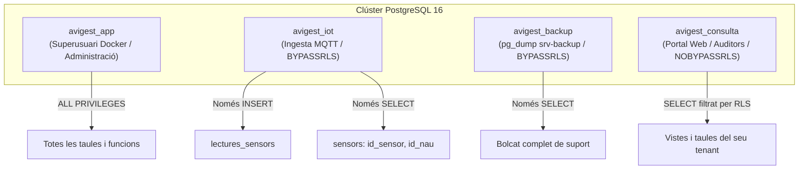

# Arquitectura i Justificació del Disseny de la Base de Dades — AviGest S.L.

**Fitxer:** `bd/explicacio_disseny_base_dades.md`  
**Mòdul:** M12 - Projecte d'Administració de Sistemes Informàtics en Xarxa (ASIX)  
**SGBD:** PostgreSQL 16.4 amb Replicació Hot Standby i Row-Level Security (RLS)  
**Autors:** Mariam Solano (Base de Dades, IoT i Automatització) i Joan Garcia (Xarxes, Sistemes i Seguretat)  
**Data:** Novembre de 2026  

---

## 1. Introducció i Objectius de Disseny

El sistema **AviGest S.L.** és una plataforma centralitzada de serveis al núvol (SaaS) dissenyada per a la integració, gestió telemètrica, control ambiental autònom i seguiment productiu d'explotacions avícoles multiclient.

El disseny de la base de dades relacional a PostgreSQL 16 respon a quatre grans requeriments arquitectònics:
1. **Modelatge de Domini Avícola Real (3FN):** Separació nítida entre la infraestructura física (granges, naus), els equips de control (sensors, actuadors), el cicle biològic animal (lots de criança d'engreix) i la telemetria.
2. **Dualitat Transaccional vs. Sèrie Temporal (Time-Series):** Convivència d'entitats mestres d'alta consistència ACID amb taules d'ingesta d'alt volum (lectures MQTT) optimitzades per a escriptura ràpida.
3. **Smart Database i Seguretat Autònoma:** Execució de lògica de termòstat i alertes crítiques en temps real mitjançant triggers PL/pgSQL (`SECURITY DEFINER`), garantint temps de resposta de microsegons davant cops de calor sense dependre de la latència de serveis web externs.
4. **Aïllament Multitenant Nadiu (Row-Level Security - RLS):** Privadesa estricta entre diferents empreses integradores mitjançant polítiques RLS a nivell de motor de BD, impedint fugues d'informació fins i tot davant consultes SQL directes.

---

## 2. Per què exactament 10 Taules? Justificació Entitat per Entitat

El model s'estructura en exactament **10 taules**, dividides lògicament en quatre capes funcionals. Aquest nombre és el resultat d'un procés de normalització en Tercera Forma Normal (3FN), evitant tant la desnormalització amb redundància com la sobreenginyeria innecessària.

```mermaid
graph TD
    subgraph Capa 1: Infraestructura Física i Clients
        C["1. clients"] --> G["2. granges"]
        G --> N["3. naus"]
    end

    subgraph Capa 2: Gestió Zootècnica
        N --> L["4. lots_crianca"]
    end

    subgraph Capa 3: IoT, Telemetria i Automatització
        N --> S["5. sensors"]
        N --> A["6. actuadors"]
        S --> LS["7. lectures_sensors"]
        A --> RA["8. registre_actuacions"]
        S -.->|dispara| RA
    end

    subgraph Capa 4: Seguretat, Alertes i Auditoria
        N --> AL["9. alarmes_incidencies"]
        S -.->|genera| AL
        AU["10. auditoria_canvis"]
    end

    style C fill:#e1f5fe,stroke:#0288d1
    style G fill:#e1f5fe,stroke:#0288d1
    style N fill:#e1f5fe,stroke:#0288d1
    style L fill:#e8f5e9,stroke:#388e3c
    style S fill:#fff3e0,stroke:#f57c00
    style A fill:#fff3e0,stroke:#f57c00
    style LS fill:#fffde7,stroke:#fbc02d
    style RA fill:#fffde7,stroke:#fbc02d
    style AL fill:#ffebee,stroke:#d32f2f
    style AU fill:#f3e5f5,stroke:#7b1fa2
```

---

### Capa 1: Estructura Organitzativa i Física

#### Taula 1: `clients` (Requeriment R1)
* **Què representa:** L'empresa ramadera o integradora jurídica que contracta la plataforma AviGest (ex: *AgroPonent S.L.* o *Avícola del Segrià S.A.*).
* **Per què és una taula independent:** Una integradora posseeix o té sota contracte desenes d'explotacions ramaderes. Si fusionéssim `clients` amb `granges`, el NIF, la raó social, el telèfon i el correu de contacte es repetirien a cada granja, violant la Segona Forma Normal (2FN) i generant anomalies de modificació si l'empresa canvia de seu social o de telèfon.

#### Taula 2: `granges` (Requeriments R1 i R3)
* **Què representa:** L'explotació ramadera física concreta, identificada pel seu codi oficial REGA/explotació ramadera (`ES...`) i la seva ubicació geogràfica (adreça i municipi).
* **Per què és una taula independent:** Separa la personalitat jurídica (`clients`) de la ubicació territorial. Una granja pertany a un únic client (`id_client` és clau forana `ON DELETE RESTRICT`). Aquesta taula constitueix el **pivot fonamental de l'aïllament multitenant (R3)**: tant l'arbre LDAP (`businessCategory`, `departmentNumber`) com les polítiques RLS s'articulen al voltant d'aquesta divisió.

#### Taula 3: `naus` (Requeriment R2)
* **Què representa:** Cadascun dels pavellons industrials d'engreix físics que formen la granja. Emmagatzema les dimensions estructurals (`longitud_metres`, `amplada_metres`) i la capacitat màxima de càrrega animal (`capacitat_aus`, ex: 12.000 o 20.000 aus).
* **Per què és una taula independent:** En avicultura intensiva, les granges no són espais unitaris diàfans; estan formades per diverses naus (entre 1 i 10+) que operen de forma totalment independent. La temperatura, el cicle de criança i els equips de ventilació es gestionen **a nivell de nau**, mai a nivell global de granja. Disposa d'una clau única composta `uq_granja_codinau (id_granja, codi_nau)` per garantir que el codi `NAU-01` sigui únic dins de cada granja però reutilitzable entre explotacions.

---

### Capa 2: Gestió Zootècnica i Cicle de Vida Productiu

#### Taula 4: `lots_crianca` (Requeriment R6)
* **Què representa:** El cicle biològic d'engreix d'una tongada de pollastres (~45 dies), des de la recepció de pollets d'un dia de vida fins al buidat sanitari i transport a l'escorxador.
* **Per què és una taula independent de `naus`:** Una nau és un actiu immoble permanent amb una vida útil de dècades. En canvi, un lot és un esdeveniment biològic temporal amb data d'inici i de final. Al llarg d'un any, una nau allotja entre 5 i 6 lots consecutius (amb períodes de buit sanitari de 10 a 14 dies entre ells). Unir nau i lot faria impossible guardar l'històric d'explotació o comparar l'evolució entre tongades d'estiu i d'hivern.
* **Per què conté mètriques de rendiment (`num_baixes`, `pes_mitja_kg`, `pinso_consumit_kg`):** Permet calcular els dos indicadors clau de rendibilitat avícola:
  1. **Percentatge de mortalitat:** $\frac{\text{baixes}}{\text{aus inicials}} \times 100$.
  2. **Índex de Conversió Alimentària (ICA / FCR):** $\text{ICA} = \frac{\text{kg pinso consumits}}{\text{kg carn produïts}}$. Aquest índex determina si una granja és viable o genera pèrdues econòmiques.

---

### Capa 3: Sensòrica, Telemetria i Control Automatitzat (IoT Engine)

#### Taula 5: `sensors` (Requeriment R4 i 4.8)
* **Què representa:** El catàleg d'instruments de mesura instal·lats a cada nau: tipus (`temperatura`, `humitat`, `co2`, `pes_silo`, `llum`, `consum_aigua`, `amoniac`), tecnologia de comunicació (`RS485` Modbus RTU per a l'interior cablejat, `LoRaWAN` per a silos exteriors sense fil), unitat i llindars de treball (`llindar_minim`, `llindar_maxim`).
* **Per què és independent de `lectures_sensors`:** Aplica la 3FN estricta. El tipus de sensor, la tecnologia, la unitat de mesura i els llindars d'alarma són metadades estàtiques del dispositiu. Si aquestes dades es guardessin a cada lectura periòdica de camp (que s'emet cada 30-60 segons), la base de dades patiria un malbaratament massiu d'emmagatzematge i degradació del rendiment.

#### Taula 6: `actuadors` (Requeriment R5)
* **Què representa:** La maquinària electromecànica instal·lada a la nau per alterar el clima o alimentar els animals (`ventilador`, `calefactor`, `il_luminacio`, `menjadora`, `bomba_aigua`, `alarma_sonora`, `nebulitzador`), el seu mode d'operació (`automatic`, `manual`, `aturat`) i el seu estat en temps real (`ON`, `OFF`).
* **Per què és independent de `sensors`:** Separa clarament els **dispositius d'entrada** (sensors que llegeixen magnituds físiques) dels **dispositius de sortida** (actuadors que consumeixen energia i modifiquen l'ambient). La relació entre sensor i actuador no és un cablejat físic 1:1, sinó una regla lògica programada a la base de dades o a l'Edge Gateway.

#### Taula 7: `lectures_sensors` (Requeriments R4 i R5)
* **Què representa:** Sèrie temporal (*Time-Series*) d'altíssim volum on s'enregistren totes les dades telemètriques enviades des del camp a través de la passarel·la MQTT.
* **Per què té un disseny hiperminimalista (`id_sensor`, `valor`, `data_hora`):** En un entorn de producció amb centenars de naus transmetent contínuament, aquesta taula acumula milions de registres. Mantenir una estructura estricta de 3 columnes optimitza la velocitat d'escriptura a disc (`INSERT`), redueix l'espai d'índexs i permet aprofitar al màxim la memòria cau de PostgreSQL.

#### Taula 8: `registre_actuacions` (Requeriment R5)
* **Què representa:** El registre cronològic de caixa negra de cada commutació d'actuador (`ON` o `OFF`), indicant el motiu textual de l'acció i el sensor concret que l'ha disparada.
* **Per què és independent si `actuadors` ja té `estat_actual`:** El camp `estat_actual` només sap com està la màquina en l'instant present. `registre_actuacions` resol preguntes d'auditoria essencials: *A quina hora exacta es va disparar la ventilació d'emergència? Quantes hores ha estat engegat el calefactor avui? Va ser encès automàticament pel sensor TEMP-01 o per un operari manualment?*

---

### Capa 4: Gestió d'Incidències, Seguretat i Auditoria

#### Taula 9: `alarmes_incidencies` (Requeriment R7)
* **Què representa:** Les incidències crítiques i avisos disparats de forma autònoma quan es detecten anomalies perilloses (cop de calor $\ge 33^\circ\text{C}$, risc d'hipotèrmia $\le 16^\circ\text{C}$, concentració perillosa de $\text{CO}_2 \ge 3000\text{ ppm}$, silo buit $\le 500\text{ kg}$).
* **Per què és una taula independent i no un camp a `lectures_sensors`:** Una lectura és una dada passiva contínua (ex: "fa 23ºC"). Una alarma és un **esdeveniment operatiu actiu amb cicle de vida**:
  1. Es genera automàticament amb un nivell de gravetat (`info`, `avis`, `critic`).
  2. Notifica el personal de guàrdia.
  3. Té un flux de resolució (`resolta = FALSE` $\rightarrow$ `resolta = TRUE`, `data_resolucio`, `observacions_resolucio`).  
  Barrejar alarmes amb les lectures regulars impediria gestionar el flux de resolució d'incidències i alentiria les consultes del tauler d'alertes pendents.

#### Taula 10: `auditoria_canvis` (Requeriment 4.3 / E2 Secció 7.2)
* **Què representa:** Pista d'auditoria immutable (*Change Data Capture / Audit Log*) que registra qualsevol operació DML (`INSERT`, `UPDATE`, `DELETE`) efectuada sobre les taules mestres de configuració (`clients`, `granges`, `naus`, `lots_crianca`, `sensors`, `actuadors`).
* **Per què s'utilitza JSONB (`dades_antigues`, `dades_noves`):** Permet capturar l'estat complet de qualsevol fila abans i després de la modificació sense necessitat de crear 6 taules d'auditoria duplicades. Registra a més l'usuari SQL connectat (`usuari_bd`) i la marca de temps.
* **Per què NO audita `lectures_sensors`:** Per disseny de rendiment: auditar una sèrie temporal de milions de lectures col·lapsaria el disc duplicant cada inserció. S'auditen únicament les metadades de gestió, prevenint fraus en el recompte d'aus o canvis no autoritzats en els llindars dels sensors.

---

## 3. Integritat Referencial i Estratègies d'Esborrat (Foreign Keys)

L'esquema aplica polítiques diferencials a les claus foranes per protegir la integritat de les dades segons el seu valor històric i legal:

| Relació Clau Forana | Estratègia | Justificació Tècnica i de Negoci |
| :--- | :---: | :--- |
| `granges` $\rightarrow$ `clients` | **`ON DELETE RESTRICT`** | Impedeix esborrar accidentalment una empresa client si té granges actives assignades. |
| `naus` $\rightarrow$ `granges` | **`ON DELETE CASCADE`** | Si es desmantella una granja de prova, s'eliminen automàticament les seves naus associades. |
| `lots_crianca` $\rightarrow$ `naus` | **`ON DELETE RESTRICT`** | Protecció legal sanitària: **mai** es pot esborrar una nau si conté l'històric de cicles d'engreix (traçabilitat alimentària obligatòria per la UE). |
| `sensors` $\rightarrow$ `naus` | **`ON DELETE CASCADE`** | Els sensors pertanyen a l'estructura física de la nau. |
| `actuadors` $\rightarrow$ `naus` | **`ON DELETE CASCADE`** | Els actuadors pertanyen a l'estructura física de la nau. |
| `lectures_sensors` $\rightarrow$ `sensors` | **`ON DELETE CASCADE`** | Si s'elimina un sensor de test, s'esborren les seves lectures vinculades. |
| `registre_actuacions` $\rightarrow$ `sensors` | **`ON DELETE SET NULL`** | Si es canvia o substitueix un sensor físic avariat, **no es perd l'històric** d'activacions passades de ventiladors; el camp queda a `NULL`. |
| `alarmes_incidencies` $\rightarrow$ `sensors` | **`ON DELETE SET NULL`** | Preserva la traçabilitat de la incidència històrica encara que la sonda física hagi estat donada de baixa. |

---

## 4. Lògica Procedural PL/pgSQL: Smart Database vs. Lògica d'Aplicació

A AviGest, la base de dades no és un magatzem passiu, sinó un **motor actiu d'automatització** mitjançant PL/pgSQL:

### 4.1. Termòstat Automàtic en Temps Real (`fn_control_llindars_sensor`)
En avicultura intensiva a l'estiu a les comarques de Lleida, un cop de calor a la nau pot elevar la temperatura per sobre dels $34^\circ\text{C}$. En aquestes condicions, un retard de 10 minuts en engegar els ventiladors asfíxia i mata milers de pollastres.
* **Avantatge del Trigger:** En el moment exacte que el servei MQTT fa l'`INSERT` d'una lectura a `lectures_sensors`, el trigger s'executa a la CPU del servidor de base de dades en **microsegons**:
  - Si $T > 31^\circ\text{C}$: commuta `actuadors.estat_actual = 'ON'`, apaga calefacció i insereix registre d'actuació. Si $T \ge 33^\circ\text{C}$, genera alarma crítica.
  - Si $T < 20^\circ\text{C}$: commuta calefacció a `ON` i apaga ventilació. Si $T \le 16^\circ\text{C}$, genera alarma crítica per hipotèrmia.
  - Si $20^\circ\text{C} \le T \le 31^\circ\text{C}$: apaga automàticament ventiladors i calefactors (estalvi energètic).
  - Cobreix també renovació d'aire per $\text{CO}_2$ ($> 2500\text{ ppm}$) i silos buits ($\le 500\text{ kg}$).
* **Per què `SECURITY DEFINER`:** L'usuari `avigest_iot` només té permís d'`INSERT` a lectures (principi de mínim privilegi). En declarar el trigger amb `SECURITY DEFINER`, aquest s'executa amb els privilegis del propietari de la funció, podent actualitzar actuadors i obrir alarmes sense donar permisos DML globals a l'usuari d'ingesta.

### 4.2. Provisió Atòmica d'Infraestructura (`sp_alta_granja_completa`)
Invocat directament des de l'script d'automatització bash [`alta_granja.sh`](file:///c:/avigest-projecte-git/scripts/automatitzacio-granges/alta_granja.sh):
* Dins d'una **única transacció ACID**, crea la granja, el nombre de naus sol·licitat, els 4 sensors estàndard per nau (temperatura, humitat, $\text{CO}_2$, pes de silo) i els 3 actuadors bàsics (ventilador, calefactor, il·luminació).
* Si qualsevol pas falla, es fa un `ROLLBACK` total, evitant que quedin granges a mig crear a la base de dades.

---

## 5. Aïllament Multitenant amb Row-Level Security (RLS - Requeriment R3)

### 5.1. Per què RLS davant d'altres alternatives?
Hi ha tres maneres clàssiques d'implementar un sistema multitenant:
1. **Base de dades separada per client:** Multiplica el cost operatiu i de manteniment (cal migrar 50 bases de dades per a 50 clients).
2. **Esquema separat per client (`CREATE SCHEMA`):** Dificulta el manteniment de vistes globals i la replicació.
3. **Esquema Compartit amb RLS (Solució Oficial d'AviGest):** Totes les dades conviuen en un únic esquema públic, però el motor de PostgreSQL avalua una política de seguretat abans de retornar cap fila.

```mermaid
sequenceDiagram
    autonumber
    actor U as Usuari / Veterinari
    participant PG as PostgreSQL 16
    participant RLS as Motor RLS (Polítiques)
    participant T as Taules (granges, naus, lots)

    U->>PG: Connexió amb rol 'avigest_consulta'
    U->>PG: SELECT * FROM granges;
    PG->>RLS: Comprova context tenant
    RLS-->>U: Retorna 0 files (Aïllament per defecte)

    U->>PG: SELECT sp_set_tenant(1); (AgroPonent)
    Note over PG: Configura app.current_tenant_id = 1
    U->>PG: SELECT nom_granja FROM granges;
    PG->>RLS: Filtra id_client = 1
    RLS->>T: Executa SELECT filtrat
    T-->>U: Retorna només: Bellpuig i Mollerussa
```

### 5.2. Vistes amb `WITH (security_invoker = true)`
Per defecte a PostgreSQL, una vista s'executa amb els permisos del seu creador (*security definer* implícit). Això hauria provocat que un usuari de consulta veiés totes les dades. En declarar les vistes analítiques amb `WITH (security_invoker = true)`, PostgreSQL força que la vista s'executi sota les regles RLS de l'usuari que la consulta, heretant automàticament l'aïllament del client.

---

## 6. Rols SQL de Mínim Privilegi (Least Privilege - Requeriment 4.3)

S'han separat estrictament les funcions del sistema en 4 rols SQL independents:



1. **`avigest_app`:** Rol d'administració i del portal central AviGest (té control total de l'esquema).
2. **`avigest_iot`:** Utilitzat exclusivament pel dimoni Python d'ingesta MQTT (`mqtt_a_postgres.py`). Només pot fer `INSERT` a `lectures_sensors` i `SELECT` a identificadors de sensors. No pot modificar ni llegir cap dada de clients, lots ni granges.
3. **`avigest_backup`:** Utilitzat per la tasca cron de còpies de seguretat des del servidor dedicat `srv-backup` (`10.0.20.20`). Només té permisos de lectura (`SELECT`) sobre l'esquema públic i té `BYPASSRLS` per poder generar un fitxer `pg_dump` integral.
4. **`avigest_consulta`:** Rol limitat per a veterinaris, auditors i clients. Està sotmès a RLS (`NOBYPASSRLS`). Sense cridar `sp_set_tenant()`, veu 0 registres.

---

## 7. Consultes i Vistes Comparatives de Negoci (Requeriment 4.3)

El fitxer [`05_vistes_consultes_comparatives.sql`](file:///c:/avigest-projecte-git/bd/sql/05_vistes_consultes_comparatives.sql) proporciona les 4 eines analítiques clau del negoci:

1. **`v_comparativa_lots_rendiment` (R6):** Compara mortalitat, durada del cicle en dies, quilos totals de carn produïts i l'Índex de Conversió Alimentària (ICA) entre naus de la mateixa o diferent granja.
2. **`v_resum_diari_climatic` (R4):** Agrupa diàriament el valor mitjà, mínim i màxim de cada variable ambiental (temperatura, humitat, $\text{CO}_2$) juntament amb el recompte d'alarmes per nau per avaluar l'estrès tèrmic dels animals.
3. **`v_estat_silos_gra` (R4 i R7):** Monitoratge d'estoc de pinso als silos mitjançant un `LATERAL JOIN` d'alta eficiència que extreu l'última lectura de pes i emet diagnòstics preventius (`ÒPTIM`, `ATENCIÓ: Nivell baix`, `AVÍS: Demanar pinso urgentment`, `CRÍTIC: Silo buit`).
4. **`v_panell_executiu_global` (R1 i R3):** Panell executiu multitenant que mostra a la direcció el recompte de granges actives, naus en producció, capacitat total d'allotjament d'aus i incidències pendents per client.

---

## 8. Matriu de Traçabilitat de Requeriments Oficials

La següent matriu vincula cadascun dels requeriments oficials de l'enunciat amb els elements de base de dades que els satisfan plenament:

| Requeriment Oficial | Descripció de l'Enunciat | Taules, Triggers o Procediments Implicats | Fitxer SQL de Referència |
| :--- | :--- | :--- | :--- |
| **R1** | Gestió de dades de granges i clients | `clients`, `granges` | [`01_esquema.sql`](file:///c:/avigest-projecte-git/bd/sql/01_esquema.sql) |
| **R2** | Dades individuals per nau (dimensions, capacitat) | `naus` (clau única composta `id_granja, codi_nau`) | [`01_esquema.sql`](file:///c:/avigest-projecte-git/bd/sql/01_esquema.sql) |
| **R3** | Aïllament de dades multitenant i privadesa | Polítiques **RLS**, `sp_set_tenant()`, `sp_reset_tenant()`, `security_invoker` | [`04_usuaris_rols_bd.sql`](file:///c:/avigest-projecte-git/bd/sql/04_usuaris_rols_bd.sql) |
| **R4** | Telemetria ambiental i control de silos | `sensors` (RS485/LoRaWAN), `lectures_sensors`, `v_estat_silos_gra` | [`01_esquema.sql`](file:///c:/avigest-projecte-git/bd/sql/01_esquema.sql) i [`05_vistes_consultes_comparatives.sql`](file:///c:/avigest-projecte-git/bd/sql/05_vistes_consultes_comparatives.sql) |
| **R5** | Automatització d'actuadors (termòstat) | `actuadors`, `registre_actuacions`, trigger `fn_control_llindars_sensor()` | [`02_triggers_procedures.sql`](file:///c:/avigest-projecte-git/bd/sql/02_triggers_procedures.sql) |
| **R6** | Cicle de vida de lots i indicadors de rendiment | `lots_crianca`, procediments `sp_iniciar_lot_crianca`, `sp_finalitzar_lot_crianca`, vista `v_comparativa_lots_rendiment` (ICA) | [`02_triggers_procedures.sql`](file:///c:/avigest-projecte-git/bd/sql/02_triggers_procedures.sql) i [`05_vistes_consultes_comparatives.sql`](file:///c:/avigest-projecte-git/bd/sql/05_vistes_consultes_comparatives.sql) |
| **R7** | Gestió d'alertes i incidències | `alarmes_incidencies`, trigger `fn_control_llindars_sensor()`, `sp_resoldre_alarma()`, `v_alarmes_actives` | [`02_triggers_procedures.sql`](file:///c:/avigest-projecte-git/bd/sql/02_triggers_procedures.sql) |
| **4.3** | Base de dades centralitzada, rols i vistes | 4 Rols de mínim privilegi, Streaming Replication (`00_replicacio.sh`), trigger `fn_auditoria_canvis()`, 4 vistes de negoci | [`00_replicacio.sh`](file:///c:/avigest-projecte-git/docker/initdb/00_replicacio.sh), [`04_usuaris_rols_bd.sql`](file:///c:/avigest-projecte-git/bd/sql/04_usuaris_rols_bd.sql), [`05_vistes_consultes_comparatives.sql`](file:///c:/avigest-projecte-git/bd/sql/05_vistes_consultes_comparatives.sql) |
| **4.7** | Automatització de creació de noves granges | Procediment atòmic `sp_alta_granja_completa()` vinculat amb `alta_granja.sh` | [`02_triggers_procedures.sql`](file:///c:/avigest-projecte-git/bd/sql/02_triggers_procedures.sql) i [`alta_granja.sh`](file:///c:/avigest-projecte-git/scripts/automatitzacio-granges/alta_granja.sh) |

