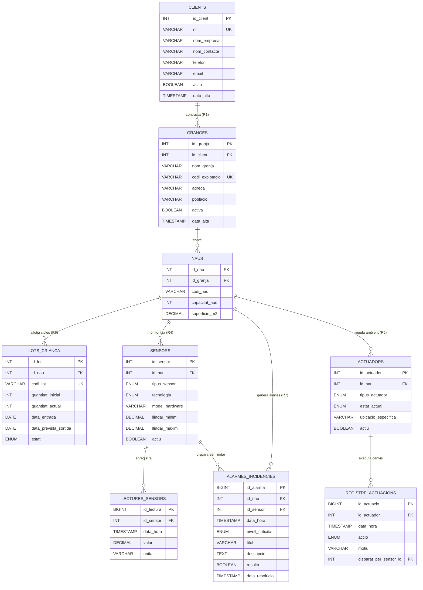

# Model Entitat-Relació (ER) — AviGest S.L.

Aquest document defineix el model de dades relacional per al sistema de gestió de granges avícoles d'AviGest S.L., cobrint tots els requeriments funcionals de l'enunciat (R1 a R7).

---

## 1. Diagrama Entitat-Relació (Mermaid)

---

## 2. Descripció de les Entitats i Requeriments Coberts

### 2.1. `CLIENTS` i `GRANGES` (Requeriments R1, R2, R3)
- **`CLIENTS`**: Empreses propietàries que contracten el servei d'AviGest.
- **`GRANGES`**: Cada explotació física. Una empresa pot tenir 1 o N granges (`id_client` és clau forana).
- **Aïllament multitenant (R3)**: Totes les consultes de clients s'executen filtrant per `id_client` o a través de vistes dedicades. Els usuaris gestors de granja s'assignen a un `id_granja` concret.

### 2.2. `NAUS` i `LOTS_CRIANCA` (Requeriment R6)
- **`NAUS`**: Estructures de la granja on s'engreixen els pollastres.
- **`LOTS_CRIANCA`**: Representa el cicle de vida d'una tongada d'animals (entrada de pollets de 1 dia, seguiment, pèrdues/baixes i sortida a escorxador). Permet calcular l'històric de cicles de cada nau.

### 2.3. `SENSORS` i `LECTURES_SENSORS` (Requeriments R4, 4.8)
- **`SENSORS`**: Catàleg de dispositius instal·lats a cada nau.
  - Tipus: `temperatura`, `humitat`, `co2`, `amoniac`, `silo_gra`, `consum_aigua`, `consum_pinso`.
  - Tecnologia: `LoRaWAN` (per a llargues distàncies o elements aïllats com silos) o `RS485` (per a bus de comunicacions cablejat dins de la nau).
  - Llindars de tolerància (`llindar_minim` i `llindar_maxim`) utilitzats pels triggers automàtics.
- **`LECTURES_SENSORS`**: Taula transaccional on arriben les dades telemètriques periòdiques (amb marca de temps `data_hora`, valor i unitat ºC, %, kg, ppm).

### 2.4. `ACTUADORS` i `REGISTRE_ACTUACIONS` (Requeriment R5)
- **`ACTUADORS`**: Equips electromecànics de control ambiental (`ventilador`, `calefactor`, `dosificador_aliment`, `alarma_acustica`).
- **`REGISTRE_ACTUACIONS`**: Historial auditable de cada canvi d'estat d'un actuador (qui o què l'ha activat: automatitzat per un sensor o manual per un operari).

### 2.5. `ALARMES_INCIDENCIES` (Requeriment R7)
- Taula de notificació d'anomalies (temperatura crítica, fallada de ventilació, silo buit). Registra el moment de detecció, nivell de severitat (`INFO`, `WARNING`, `CRITICAL`) i si ha estat atesa pel responsable.
