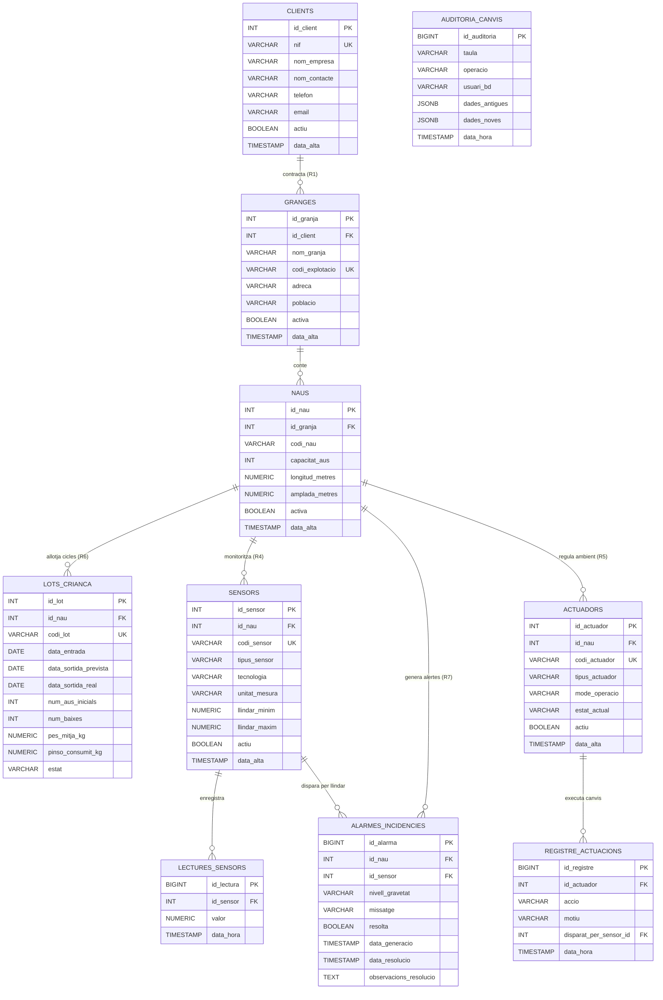

# Model Entitat-Relació (ER) — AviGest S.L.

Aquest document defineix el model de dades relacional per al sistema de gestió de granges avícoles d'AviGest S.L., cobrint tots els requeriments funcionals de l'enunciat (R1 a R7) i la traçabilitat auditada a PostgreSQL 16 (Requeriment 4.3).

---

## 1. Diagrama Entitat-Relació (Mermaid)

---

## 2. Descripció de les Entitats i Requeriments Coberts

### 2.1. `CLIENTS` i `GRANGES` (Requeriments R1, R2, R3)
- **`CLIENTS`**: Empreses ramaderes o integradores propietàries que contracten la plataforma AviGest S.L.
- **`GRANGES`**: Cada explotació física. Una empresa pot tenir 1 o N granges (`id_client` és clau forana).
- **Aïllament multitenant (R3)**: Implementat mitjançant **Row-Level Security (RLS)** nadiu a PostgreSQL 16. Els usuaris amb rol `avigest_consulta` només tenen visibilitat de les granges del seu client (activat mitjançant `sp_set_tenant(id_client)` o `sp_set_tenant(id_client, id_granja)`).

### 2.2. `NAUS` i `LOTS_CRIANCA` (Requeriment R6)
- **`NAUS`**: Pavellons físics d'engreix dins de cada granja, amb dimensions i capacitat màxima d'aus.
- **`LOTS_CRIANCA`**: Representa el cicle de vida d'una tongada d'animals (~45 dies) des de l'entrada de pollets de 1 dia fins a l'escorxador.
  - Camps de rendiment: `num_aus_inicials`, `num_baixes`, `pes_mitja_kg` i `pinso_consumit_kg`.
  - Permet calcular l'Índex de Conversió Alimentària (ICA = pinso total / quilos de carn produïts) i el percentatge de mortalitat mitjançant la vista `v_comparativa_lots_rendiment`.

### 2.3. `SENSORS` i `LECTURES_SENSORS` (Requeriments R4, 4.8)
- **`SENSORS`**: Catàleg de dispositius de telemetria instal·lats a cada nau.
  - Tipus suportats: `temperatura`, `humitat`, `co2`, `amoniac`, `pes_silo`, `llum`, `consum_aigua`.
  - Tecnologies: `RS485` (Modbus RTU cablejat industrial a naus) i `LoRaWAN` (comunicació de ràdio 868 MHz per a pesatge de silos exteriors).
  - Llindars de tolerància (`llindar_minim` i `llindar_maxim`) utilitzats pels triggers automàtics.
- **`LECTURES_SENSORS`**: Sèrie temporal d'alt volum que emmagatzema les lectures rebudes del broker MQTT Mosquitto a través del servei d'ingesta.

### 2.4. `ACTUADORS` i `REGISTRE_ACTUACIONS` (Requeriment R5)
- **`ACTUADORS`**: Equips electromecànics de control ambiental (`ventilador`, `calefactor`, `il_luminacio`, `menjadora`, `bomba_aigua`, `alarma_sonora`, `nebulitzador`).
- **`REGISTRE_ACTUACIONS`**: Historial auditable de cada canvi d'estat d'un actuador (qui o què l'ha activat: automàtic per trigger de sobretemperatura/CO2 o manual per un operari).

### 2.5. `ALARMES_INCIDENCIES` (Requeriment R7)
- Taula d'incidències disparades automàticament pel trigger `fn_control_llindars_sensor()` quan es detecten valors fora de rang (cop de calor $\ge 33^\circ\text{C}$, risc d'hipotèrmia $\le 16^\circ\text{C}$, CO2 $\ge 3000\text{ ppm}$, silo buit $\le 500\text{ kg}$).
- Suporta traçabilitat de resolució amb camps `resolta`, `data_resolucio` i `observacions_resolucio`, gestionat pel procediment `sp_resoldre_alarma()`.

### 2.6. `AUDITORIA_CANVIS` (Requeriment 4.3 / E2 Sec. 7.2)
- Taula immutable de traçabilitat que emmagatzema els canvis DML (INSERT, UPDATE, DELETE) sobre les entitats mestres (`clients`, `granges`, `naus`, `lots_crianca`, `sensors`, `actuadors`).
- Disparada de manera transparent pel trigger `fn_auditoria_canvis()`, desant l'estat anterior i posterior en format JSONB juntament amb l'usuari SQL i marca de temps.
