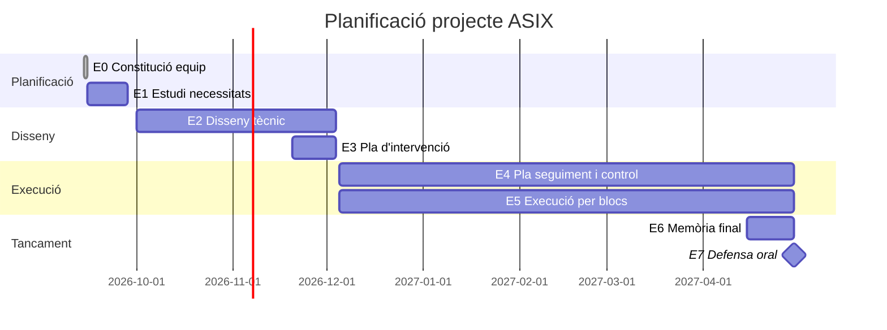

# E0 — Constitució de l'equip i divisió de tasques i rols
**Projecte:** Implantació d'un sistema informàtic de gestió de granges de pollastres (AviGest S.L.)
**Data:** 14 de setembre de 2026

## Divisió de rols

| | Joan | Mariam |
|---|---|---|
| **Àrea principal** | Infraestructura, xarxa i seguretat | Base de dades, IoT i automatització |
| **Responsabilitats** | Maquinari seu central i granges, LDAP (usuaris/grups centralitzats), DMZ i tallafocs, còpies de seguretat i PRD, redundància | Model Entitat-Relació i SQL, triggers i procediments emmagatzemats, decisió i integració IoT (LoRaWAN/RS485), scripts d'automatització d'alta de granges |
| **Mòduls de l'enunciat** | 4.1, 4.2, 4.4, 4.5, 4.6 | 4.3, 4.7, 4.8 |

Les tasques transversals (memòria, diari de treball, fitxes de decisió, Gantt, defensa oral) es fan sempre **a mitges o amb revisió creuada**.

## Diagrama de Gantt inicial

*Es renderitza directament a GitHub. Fites clau: 28 set (E1), 4 des (E2/E3), 1 març (avenç E4/E5), 30 abr (entrega final i defensa).*

## Regla de funcionament
- Cadascú porta la seva àrea **end-to-end** a totes les fases (disseny → execució), no repartiment per fases.
- Sprints de 2 setmanes, alineats amb el lliurament quinzenal del diari de treball.
- Tauler de tasques a **GitHub Projects**, sincronitzat amb el repositori.
- Repositori Git amb branques per àrea (`infra/`, `bd/`, `iot/`) i merges freqüents a `main`.
- Fitxa de decisió tècnica **abans** d'implementar qualsevol component clau.
- Reunió curta de sincronització un cop per setmana.
- Marge de 3-4 dies abans de cada entrega gran per integrar les dues parts.

## Sprint 1 (14–28 setembre) — Objectiu: E1, Estudi de necessitats

| Tasca | Responsable |
|---|---|
| Anàlisi del sector avícola i de la digitalització de granges | Tots dos |
| Identificació de necessitats del client (AviGest i les granges) | Tots dos |
| Recerca de projectes/solucions similars existents al mercat | Tots dos |
| Definició de l'abast del projecte | Tots dos |
| Disseny del logo de l'empresa (AviGest S.L.) | A definir |
| Preparació de les 2 diapositives (què han comparat / què faran) | Tots dos |
| Configuració del repositori Git (estructura de carpetes, branques) | Joan |
| Creació del document/full compartit del diari de treball | Mariam ([diari_treball.md](diari_treball/diari_treball.md)) |
