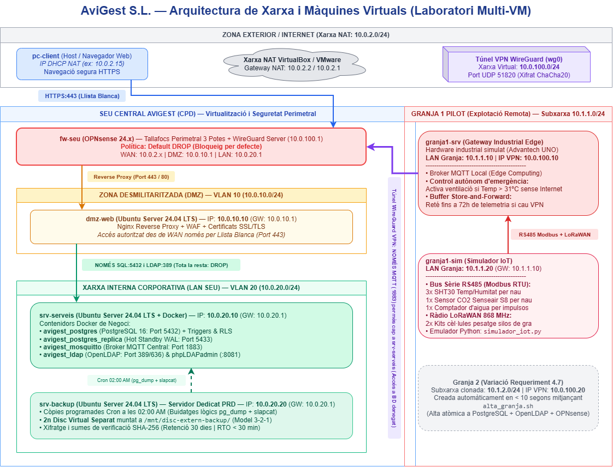
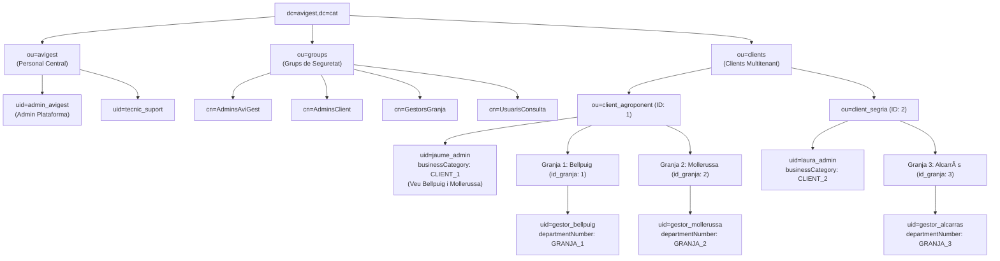
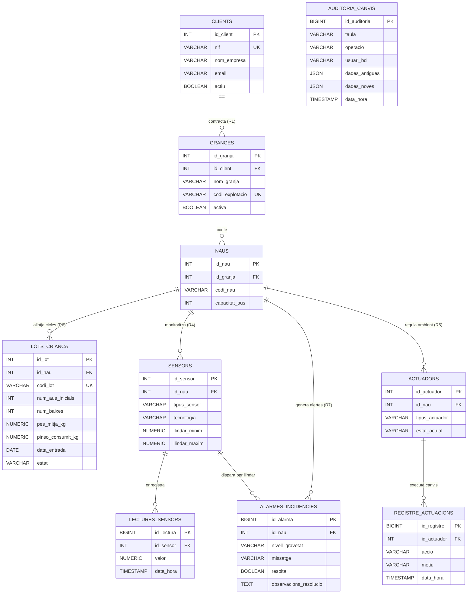
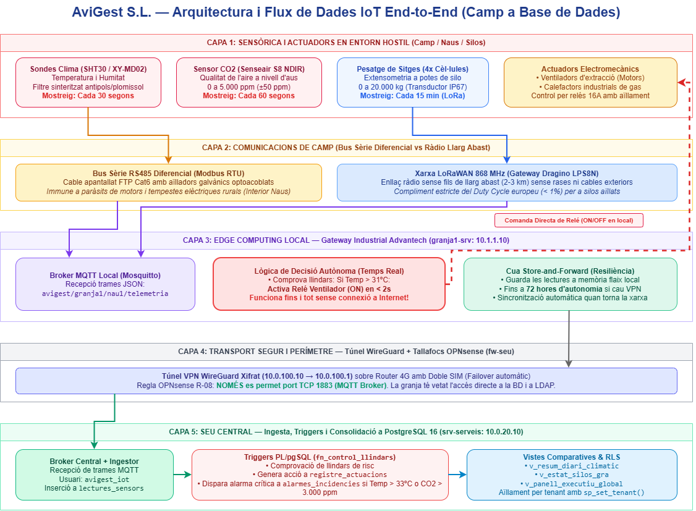
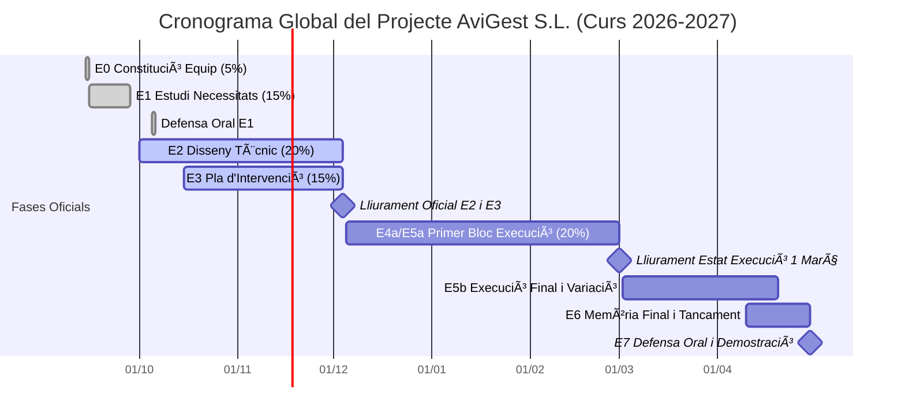

# E2 — Document de Disseny Tècnic del Projecte
**Projecte:** Implantació d'un sistema informàtic de gestió de granges de pollastres  
**Empresa:** AviGest S.L.  
**Cicle:** CFGS Administració de Sistemes Informàtics en Xarxa (ASIX) — 2n Curs  
**Mòdul:** M12 - Projecte (Pes: 20%)  
**Equip de treball:** Joan (Infraestructura, Xarxa i Seguretat) i Mariam (Base de Dades, IoT i Automatització)  
**Data:** Actualitzat a 26 d'octubre de 2026 (Lliurament oficial: 4 de desembre de 2026)  

---

## Índex de Continguts
1. [Resum Executiu](#resum-executiu)
2. [Introducció i Visió Global del Sistema](#1-introducció-i-visió-global-del-sistema)
3. [Arquitectura de Màquines Virtuals i Xarxa](#2-arquitectura-de-màquines-virtuals-i-xarxa)
4. [Fitxes de Decisió Tècnica (Resum Executiu)](#3-fitxes-de-decisió-tècnica-resum-executiu)
5. [Infraestructura de Maquinari i Redundància (Requeriments 4.1 i 4.6)](#4-infraestructura-de-maquinari-i-redundància-requeriments-41-i-46)
6. [Seguretat Perimetral: OPNsense, DMZ i Tallafocs (Requeriment 4.4)](#5-seguretat-perimetral-opnsense-dmz-i-tallafocs-requeriment-44)
7. [Directori Centralitzat d'Usuaris — OpenLDAP (Requeriment 4.2)](#6-directori-centralitzat-dusuaris--openldap-requeriment-42)
8. [Base de Dades Centralitzada: MariaDB 10.11 LTS i Rèplica (Requeriment 4.3)](#7-base-de-dades-centralitzada-mariadb-1011-lts-i-rèplica-requeriment-43)
9. [Arquitectura IoT: Simulació, Edge Computing i Comunicacions (Requeriment 4.8)](#8-arquitectura-iot-simulació-edge-computing-i-comunicacions-requeriment-48)
10. [Còpies de Seguretat i Servidor Dedicat — PRD (Requeriment 4.5)](#9-còpies-de-seguretat-i-servidor-dedicat--prd-requeriment-45)
11. [Automatització de Creació de Granges i Variació (Requeriment 4.7)](#10-automatització-de-creació-de-granges-i-variació-requeriment-47)
12. [Fases del Projecte i Planificació Actualitzada](#11-fases-del-projecte-i-planificació-actualitzada)
13. [Annex d'Ús d'Intel·ligència Artificial](#12-annex-dús-dintel·ligència-artificial)
14. [Bibliografia i Fonts Consultades](#13-bibliografia-i-fonts-consultades)

---

## Resum Executiu

El present document recull el disseny tècnic integral d'**AviGest S.L.**, una solució tecnològica concebuda per a la transformació digital, telemetria climàtica i gestió automatitzada d'explotacions avícoles d'engreix de pollastres (*broilers*) a les comarques de Ponent (Lleida). 

El sistema s'adreça principalment a empreses integradores avícoles que necessiten centralitzar i analitzar en temps real les mètriques crítiques de benestar animal i producció (temperatura, humitat, nivell de $CO_2$, consums d'aigua i pes de gra en silos) de múltiples granges distribuïdes geogràficament, garantint alhora un aïllament dades estricte (*multitenant*).

Per assolir els objectius de disponibilitat, ciberseguretat i continuïtat de negoci sota condicions rurals adverses, s'han pres les següents **decisions estructurals clau**:
1. **Seguretat Perimetral i Aïllament de Zones:** Desplegament del tallafocs dedicat **OPNsense** amb una política estricta de tall per defecte (*Default DROP*), accés WAN filtrat per llista blanca d'IPs cap a una DMZ aïllada i comunicació des de les granges mitjançant túnels xifrats d'alt rendiment amb **WireGuard**.
2. **Arquitectura IoT Híbrida amb Edge Computing:** Combinació de cablejat industrial diferencial **RS485 (Modbus RTU)** dins de les naus (immune a interferències i pols) amb ràdio **LoRaWAN 868 MHz** per a la sensòrica de silos exteriors. El control crític d'actuadors (ventilació davant de risc de cop de calor a $T > 31^\circ\text{C}$) s'executa autònomament en local al gateway de granja (*Edge*), acompanyat d'un buffer *Store-and-Forward* de fins a 72 hores per tolerar talls d'Internet rural sense pèrdua de telemetria.
3. **Plataforma de Dades Robustada:** Motor relacional **MariaDB 10.11 LTS** normalitzat en 3FN amb motor InnoDB, lògica de negoci mitjançant triggers i procediments emmagatzemats, aïllament multitenant per vistes segures i variables de sessió, i rèplica *Hot Standby* amb sincronització GTID.
4. **Identitat Unificada i Continuïtat PRD:** Directori centralitzat **OpenLDAP** amb 4 rols diferenciats i servidor de còpies dedicat **`srv-backup`** amb segon disc simulat extern, assegurant un RPO diari (< 1 h real en IoT) i un RTO inferior a 30 minuts davant desastres.

---

---

## 1. Introducció i Visió Global del Sistema

### 1.1. Context de l'Empresa i Model de Negoci
AviGest S.L. és una companyia tecnològica especialitzada en la implantació de sistemes de control telemàtic i gestió automatitzada per a explotacions avícoles (granges d'engreix de pollastres).

El sistema ofereix:
- **Centralització multitenant:** Una seu central consolida les dades de múltiples empreses clientes.
- **Aïllament estricte:** Cada client gestiona les seves granges des d'un únic accés, i cada gestor només visualitza la seva pròpia granja.
- **Seguretat perimetral per disseny:** Tallafocs **OPNsense** amb DMZ aïllada i túnel VPN xifrat des de les granges.
- **Monitorització i control ambiental IoT:** Recollida de temperatura, humitat i nivell de gra en silos, amb actuació automàtica sobre ventiladors i calefactors quan se superen llindars crítics.
- **Arquitectura Edge Computing:** Les granges continuen executant les regles de ventilació d'emergència en local encara que es talli la connexió amb la seu central.

### 1.2. Abast del Projecte (Què s'inclou i què en queda fora)
D'acord amb l'estudi de necessitats realitzat a l'E1, l'abast del projecte queda delimitat formalment:
- **Inclòs dins de l'abast:**
  - Disseny i desplegament de la infraestructura del CPD central (servidors de serveis, directori OpenLDAP, base de dades MariaDB 10.11 LTS amb rèplica GTID i tallafocs OPNsense amb xarxes WAN, DMZ i LAN).
  - Seguretat perimetral amb DMZ, regles d'accés estricte mitjançant llista blanca d'adreces IP i túnel xifrat WireGuard entre les granges i la seu central.
  - Arquitectura IoT de recollida de telemetria mitjançant xarxa híbrida (RS485 Modbus a l'interior de les naus i LoRaWAN 868 MHz per a silos exteriors) amb suport Edge Computing per a actuacions immediates davant risc de cop de calor.
  - Disseny relacional normalitzat en 3FN, procediments MariaDB Procedural per a control de llindars climàtics, alarmes automàtiques, Row Level Security (RLS) i consultes comparatives de negoci.
  - Automatització d'alta ràpida de granges i usuaris mitjançant scripts bash (`alta_granja.sh`) per respondre a variacions de requeriment.
  - Pla de còpies de seguretat (3-2-1) i recuperació davant de desastres (PRD) amb servidor dedicat `srv-backup`.
- **Exclòs de l'abast (Fores de l'abast inicial):**
  - Desenvolupament de frontend web complet d'administració (requeriment extra 4.extra, supeditat a la finalització de tota la infraestructura).
  - Connectivitat física real mitjançant satèl·lit Starlink o ràdio-enllaços WISP de llarg abast a camp (se simula mitjançant túnels VPN sobre xarxes virtuals).
  - Integració de sistemes de pesatge automàtic continu d'aus individuals mitjançant visió per computador o bàscules penjades de pas lliure.

### 1.3. Requeriments Funcionals Concretats i Traçabilitat (R1 a R7)
A partir de la llista mínima de l'enunciat i ampliant-la amb l'Estudi de Necessitats (E1), el sistema cobreix els següents requeriments amb traçabilitat directa al document de disseny:

| ID Requeriment | Descripció Concretada del Requeriment | Mòdul Enunciat | Secció del Document E2 que el cobreix |
| :---: | :--- | :---: | :--- |
| **R1** | **Alta i baixa de clients i granges:** Gestió del cicle de vida d'empreses integradores avícoles i les seves granges contractades. | 4.3, 4.7 | [Secció 7](#7-base-de-dades-centralitzada-MariaDB-16-i-rèplica-requeriment-43) (taules `clients`, `granges`, `naus`) i [Secció 10](#10-automatització-de-creació-de-granges-i-variació-requeriment-47) (`alta_granja.sh`). |
| **R2** | **Gestió d'usuaris amb rols diferenciats:** Administrador AviGest, Administrador de Client, Gestor de Granja i Usuari de Consulta. | 4.2, 4.3 | [Secció 6](#6-directori-centralitzat-dusuaris--openldap-requeriment-42) (OpenLDAP) i [Secció 7.4](#74-rols-sql-de-mínim-privilegi) (rols SQL). |
| **R3** | **Aïllament estricte i accés multitenant:** Cada granja només accedeix a les seves dades. Un client amb $N$ granges les visualitza totes amb un únic compte d'accés. | 4.2, 4.3, 4.4 | [Secció 6](#6-directori-centralitzat-dusuaris--openldap-requeriment-42) (OUs LDAP), [Secció 7.2](#72-lògica-procedural-i-triggers-mariadb-procedural-r5-i-r7) (RLS a MariaDB) i [Secció 5](#5-seguretat-perimetral-opnsense-dmz-i-tallafocs-requeriment-44) (OPNsense). |
| **R4** | **Registre i telemetria de sensors:** Captura contínua de temperatura, humitat, nivell de silos de gra i consums d'aigua/aliment. | 4.3, 4.8 | [Secció 8](#8-arquitectura-iot-simulació-edge-computing-i-inventari-requeriments-48-i-r4) (xarxa híbrida RS485/LoRaWAN) i [Secció 7.1](#71-model-entitat-relació-complet-mermaid-i-normalització-3fn) (`lectures_sensors`). |
| **R5** | **Llindars i actuació automàtica sobre actuadors:** Encesa immediata de ventiladors i aturada de calefactors si $T > 31^\circ\text{C}$; dosificació i climatització automàtica. | 4.3, 4.8 | [Secció 8.1](#81-arquitectura-de-comunicacions-híbrid-rs485--lorawan) (Edge Computing a granja) i [Secció 7.2](#72-lògica-procedural-i-triggers-mariadb-procedural-r5-i-r7) (trigger `trg_control_llindars_sensor`). |
| **R6** | **Històric de cicles i lots de criança:** Traçabilitat de cada lot des de l'entrada dels pollets (dia 0) fins a la sortida cap a escorxador (dia 42-45), amb registre de baixes, pes mitjà i índex de conversió. | 4.3 | [Secció 7.1](#71-model-entitat-relació-complet-mermaid-i-normalització-3fn) (taula `lots_crianca`) i [Secció 7.3](#73-consultes-i-vistes-comparatives-de-negoci-requeriment-43) (`v_comparativa_lots_rendiment`). |
| **R7** | **Alarmes i notificacions d'incidència:** Alerta crítica per risc de cop de calor ($T \ge 33^\circ\text{C}$), asfíxia per $CO_2$ (> 3.000 ppm) o avís de sitja buida (< 1.000 kg). | 4.3, 4.8 | [Secció 7.1](#71-model-entitat-relació-complet-mermaid-i-normalització-3fn) (`alarmes_incidencies`), [Secció 7.2](#72-lògica-procedural-i-triggers-mariadb-procedural-r5-i-r7) i [Secció 7.3](#73-consultes-i-vistes-comparatives-de-negoci-requeriment-43) (`v_alarmes_actives`). |

---

## 2. Arquitectura de Màquines Virtuals i Xarxa

L'entorn es desplega mitjançant un conjunt coordinat de màquines virtuals especialitzades, seguint el recorregut complet d'una lectura de sensor des del camp fins a la seu central:

### 2.1. Arquitectura de Màquines Virtuals i Xarxa (Diagrama de Blocs)


*Figura 1: Topologia de xarxa perimetral (WAN, DMZ, LAN i VPN WireGuard) i distribució de màquines virtuals d'AviGest.*

> [!TIP]
> Teniu disponible el diagrama font vectorial editable a [`docs/diagrames/esquema_xarxa_vms.drawio`](../diagrames/esquema_xarxa_vms.drawio) (llest per obrir amb Draw.io / diagrams.net).

```mermaid
flowchart TD
    Client["pc-client<br/>(Navegador de prova)"]
    Internet["Internet (NAT de l'hipervisor)"]

    subgraph FW["fw-seu (OPNsense)"]
        direction TB
        WAF_Rules["3 Interfícies + Regles d'Estat"]
        VPN_Srv["Servidor VPN (10.0.100.0/24)"]
    end

    subgraph DMZ_Net["DMZ (10.0.10.0/24)"]
        DMZ_Web["dmz-web<br/>Nginx + proxy invers<br/>WAF i relay SMTP"]
    end

    subgraph LAN_Net["LAN seu (10.0.20.0/24)"]
        Srv_Serveis["srv-serveis<br/>Docker: OpenLDAP<br/>MariaDB 10.11 LTS + rèplica GTID<br/>MQTT + ingesta a MariaDB"]
        Srv_Backup["srv-backup<br/>Còpies amb cron<br/>Disc extern simulat"]
    end

    subgraph Granja1_Net["Granja 1 (10.1.1.0/24)"]
        Granja1_Sim["granja1-sim<br/>Sensors ESP32 simulats<br/>Bus RS485 (Modbus)<br/>LoRaWAN (ChirpStack)"]
        Granja1_Srv["granja1-srv<br/>Client VPN i MQTT local<br/>Regles dels actuadors<br/>Buffer de dades"]
    end

    Client --> Internet
    Internet ==>|HTTPS (443) només des d'IPs autoritzades| FW
    FW -->|Port 443/80| DMZ_Web
    DMZ_Web ==>|NOMÉS SQL:3306 i LDAP:389| Srv_Serveis
    DMZ_Web -.->|BLOQUEJAT TOTA LA RESTA: DROP| LAN_Net

    Granja1_Sim -->|Dades de camp| Granja1_Srv
    Granja1_Srv ==>|Túnel VPN (10.0.100.0/24)| VPN_Srv
    VPN_Srv ==>|NOMÉS MQTT:1883 (xifrat WireGuard)| Srv_Serveis
    VPN_Srv -.->|BLOQUEJAT ACCÉS DIRECTE A BD: DROP| LAN_Net
```

### Recorregut d'una lectura telemètrica (End-to-End):
1. **`granja1-sim`:** Simula els sensors de temperatura/humitat (ESP32 via RS485 Modbus) i els sensors de silos (LoRaWAN amb ChirpStack) i envia les trames a `granja1-srv`.
2. **`granja1-srv`:** Desa les lectures en un búfer local (*store-and-forward*), avalua les regles locals (si T > 31ºC activa el ventilador immediatament) i reenvia les lectures pel túnel VPN fins a `fw-seu`.
3. **`fw-seu`:** Rep el trànsit de la VPN (`10.0.100.0/24`) i **només permet el pas cap al port MQTT 1883 de la LAN**. El xifratge l'aporta WireGuard; no s'exposa MQTTTLS (8883) sense certificats al laboratori.
4. **`srv-serveis`:** Mosquitto rep les lectures. El contenidor **`avigest_mqtt_ingest`** les persisteix a **MariaDB 10.11 LTS**. La rèplica (port 3307) és un *Hot Standby* amb rèplica GTID. **OpenLDAP** autentica usuaris.
5. **`srv-backup`:** Màquina dedicada que executa les còpies de seguretat diàries amb `cron` i les arxiva en un segon disc virtual simulant una ubicació externa.
6. **`dmz-web`:** L'únic servei exposat a Internet: rep les peticions dels clients (`pc-client`), aplica WAF i proxy invers Nginx, i només consulta a la LAN els ports estrictament indispensables (MariaDB 3306 i LDAP 389).

---

## 3. Fitxes de Decisió Tècnica (Resum Executiu)

| Codi Fitxa | Àmbit Tècnic | Decisió Presa | Justificació Principal | Document Detallat |
| :--- | :--- | :--- | :--- | :--- |
| **FD01** | SGBD Central | **MariaDB 10.11 LTS + rèplica GTID** | Triggers MariaDB Procedural, JSON, Row-Level Security i *streaming replication* (Hot Standby al port 3307). TimescaleDB no està desplegat. | [FD01_sgbd.md](../fitxes_decisio/FD01_sgbd.md) |
| **FD02** | Directori Central | **OpenLDAP + phpLDAPadmin** | Lleuger (<80MB RAM), estàndard ASIX, estructura modular LDIF amb 4 rols diferenciats i aïllament per granja. | [FD02_ldap.md](../fitxes_decisio/FD02_ldap.md) |
| **FD03** | Seguretat Perimetral | **OPNsense (`fw-seu`)** | Appliance dedicat amb 3 interfícies físiques (WAN, DMZ, LAN), servidor VPN integrat, llista blanca d'IPs i política estricta DMZ-LAN. | [FD03_tallafocs_dmz.md](../fitxes_decisio/FD03_tallafocs_dmz.md) |
| **FD04** | Còpies de Seguretat | **`srv-backup` dedicat + 2n disc** | Aïllament de fallades (VM pròpia), model 3-2-1 amb segon disc virtual per simular emmagatzematge extern, cron nocturn i RTO < 30 min. | [FD04_backups_prd.md](../fitxes_decisio/FD04_backups_prd.md) |
| **FD05** | Comunicacions IoT | **Model Híbrid Edge (RS485 + LoRaWAN + MQTT)** | `granja1-sim` (Modbus a naus i LoRa a silos exteriors) cap a `granja1-srv` (MQTT local + buffer) i túnel VPN cap a la seu. | [FD05_iot_comunicacions.md](../fitxes_decisio/FD05_iot_comunicacions.md) |

---

## 4. Infraestructura de Maquinari i Redundància (Requeriments 4.1 i 4.6)

### 4.1. Infraestructura de Maquinari a la Seu Central (CPD AviGest)
Per allotjar els serveis d'alta disponibilitat que donen servei a totes les granges clientes (`fw-seu`, `dmz-web`, `srv-serveis` i `srv-backup`), s'especifica equipament empresarial de referència homologat:
- **Servidor Principal (Host de Virtualització):** Dell PowerEdge R450 1U en xassís rack 19". Equipat amb processador Intel Xeon Silver 4314 (16 nuclis / 32 fils a 2.4 GHz), 32 GB de memòria RAM DDR4 ECC Registered (ampliable a 1 TB), dues fonts d'alimentació redundants de 600W Hot-Plug en configuració $1+1$ i mòdul de gestió fora de banda iDRAC9 Enterprise per a telemetria tèrmica i gestió remota.
- **Emmagatzematge en RAID 10 Hardware:** 4x unitats Dell Enterprise SATA SSD de 960 GB (Hot-Plug 2.5" amb safata extraïble en calent), gestionades per controladora física dedicada PERC H755 amb 8 GB de NVRAM cau protegida per bateria, oferint 1.92 TB útils d'alt rendiment en IOPS i tolerància a la fallada simultània de fins a dos discos de branques mirall diferents.
- **Electrònica de Xarxa i Segmentació (VLANs):** Switch gestionable L2+ Cisco Catalyst sèrie 1000 de 24 ports Gigabit Ethernet amb suport d'enllaços agregats LACP (802.3ad) i etiquetatge de VLANs (802.1Q). A la seu central s'estableix una topologia amb separació física i lògica de trànsit:
  - **VLAN 10 (DMZ):** Rang `10.0.10.0/24` destinat exclusivament al servidor intermediari invers `dmz-web`.
  - **VLAN 20 (LAN Seu):** Rang `10.0.20.0/24` per a la base de dades `srv-serveis` i el node de còpies `srv-backup`.
  - **VLAN 99 (Gestió iDRAC):** Rang privat fora de banda per al monitoratge de maquinari i SAI.
- **Sistema d'Alimentació Ininterrompuda (SAI / UPS):** APC Smart-UPS On-Line 2200VA 2U (SRT2200RMXLI) amb tecnologia de doble conversió real ($VFI$), targeta de gestió SNMP Network Management Card (AP9641) per llançar ordres d'aturada ordenada dels hipervisors i bateries segellades de plom-àcid que garanteixen un mínim de 45 minuts d'autonomia davant de talls de xarxa elèctrica general.
- **Climatització i Rack:** Armari Rack de 19" 24U amb porta perforada al 80% per a flux d'aire davanter-posterior, PDU gestionable per presa i termòstat ambiental de control de sala.

### 4.2. Infraestructura a Cada Granja (Condicions Reals d'Entorn Hostil)
Les granges avícoles d'engreix presenten ambients especialment severs: presència massiva de pols en suspensió procedent del pinso i la jaça, plomissol d'aus que embussa ventiladors convencionals, vapors corrosius d'amoníac ($NH_3$), humitat relativa superior al 80% i micro-talls freqüents en línies elèctriques rurals:
- **Gateway Industrial Local (`granja1-srv`):** Equip fanless (sense ventilador) Advantech UNO-2271G amb certificació industrial IP50/IP65, processador Intel Celeron N3350, 4 GB RAM, 32 GB eMMC i rang de temperatura operativa de -20 ºC a +60 ºC. S'allotja sobre carril DIN a l'interior d'un armari de polièster reforçat amb fibra de vidre IP66 (600x400x200 mm) amb premsaestopes estancs. La dissipació tèrmica passiva a través del xassís d'alumini evita l'entrada de pols o humitat a l'electrònica.
- **Connexió WAN Redundant:** Router industrial 4G/5G Teltonika RUT955 amb ranura doble SIM per a commutació automàtica (*failover*) entre dues operadores de telefonia mòbil diferents (ex: Movistar com a primària i Vodafone com a secundària) i client VPN WireGuard resident.
- **Aïllament Elèctric i Protecció de Sobretensions:** Protectors de sobretensió i aïlladors galvànics optoacoblats sobre el bus sèrie RS485 per desacoblar els impulsos electromagnètics generats per l'arrencada dels grans motors dels ventiladors i les descàrregues de tempestes rurals.
- **Mini-SAI de Carril DIN:** Phoenix Contact QUINT-UPS 24V DC / 5A amb acumulador LiFePO4 que assegura un mínim de 2 hores de funcionament ininterromput per al gateway `granja1-srv`, el router 4G i els sensors en cas de caiguda del subministrament a la granja.
- **Buffer de dades (*Store-and-Forward*):** Davant la pèrdua de connectivitat cel·lular o caiguda del túnel VPN, `granja1-srv` acumula les trames telemètriques a la seva memòria flash local (amb capacitat per a més de 72 hores de lectures) i executa una sincronització ordenada un cop restablert l'enllaç sense saturar el broker central ni perdre informació.

### 4.3. Anàlisi de Criticitat i Mecanismes de Redundància (Requeriment 4.6)
S'estableix una classificació dels components del sistema segons el seu nivell de criticitat operacional i el cost associat:

| Servei / Recurs | Nivell de Criticitat | Mecanisme de Redundància Escollit | Impacte Admissible de Caiguda | Justificació Tècnica |
| :--- | :---: | :--- | :--- | :--- |
| **Control de Clima i Ventilació (Camp)** | **MÀXIMA (Vital)** | **Edge Computing Local a `granja1-srv`** | **0 segons (Temps real)** | La fallada de ventilació en dies de calor extrema causa la mort per asfíxia de milers d'aus en menys de 20 minuts. L'actuació sobre relés s'executa en local sense dependre d'Internet ni de la seu central. |
| **Emmagatzematge CPD (Seu)** | **ALTA** | **RAID 10 Hardware (4x SSD)** | **0 segons (Transparència total)** | Tolera la pèrdua de discos físics sense interrupció del servei ni degradació greu d'IOPS. |
| **Base de Dades Transaccional (CPD)** | **ALTA** | **MariaDB Streaming Replication (Hot Standby)** | **Pocs segons / minuts** | rèplica GTID contínua. Protegeix contra la caiguda del procés MariaDB. Si cau la VM completa de serveis, la restauració es coordina des de `srv-backup` en < 30 minuts. |
| **Enllaç de Xarxa a la Granja** | **MITJANA** | **Doble SIM (Failover 4G/5G) + Store-and-Forward** | **Fins a 72 hores sense dades en viu** | Si cauen ambdues operadores mòbils, la granja no envia gràfiques al portal central però el bestiar està protegit pel control Edge local. |
| **Servei Directori LDAP** | **MITJANA** | **Imatge contenidoritzada + Buidatges diaris `slapcat`** | **< 30 minuts (RTO)** | L'arbre d'usuaris és pràcticament estàtic; en cas d'incident greu es desplega un contenidor nou i s'injecta l'arxiu LDIF d'origen. |

---

## 5. Seguretat Perimetral: OPNsense, DMZ i Tallafocs (Requeriment 4.4)

El tallafocs perimetral `fw-seu` (OPNsense) aplica una política estricta de tall per defecte (**`Default DROP`**) en totes les interfícies. Només es permet el trànsit explícitament autoritzat per la política de seguretat corporativa.

### 5.1. Taula Formal de Regles de Tallafocs
En compliment del requisit d'avaluació de la guia oficial, s'especifica la matriu formal de regles implementades al tallafocs OPNsense:

| Núm | Interfície / Zona | Adreça Origen | Port Origen | Adreça Destí | Port Destí | Protocol | Acció | Justificació Tècnica i Seguretat |
| :---: | :---: | :---: | :---: | :---: | :---: | :---: | :---: | :--- |
| **R-01** | WAN | `CLIENTS_AUTORITZATS` (Llista blanca IPs) | Qualsevol | `10.0.10.10` (`dmz-web`) | 443 | TCP | **PASS** | Permet l'accés web HTTPS dels clients autoritzats al portal de gestió. |
| **R-02** | WAN | `CLIENTS_AUTORITZATS` (Llista blanca IPs) | Qualsevol | `10.0.10.10` (`dmz-web`) | 80 | TCP | **PASS** | Redirecció automàtica HTTP cap a HTTPS (Port 443). |
| **R-03** | WAN | Qualsevol (`0.0.0.0/0`) | Qualsevol | WAN Address (`fw-seu`) | 51820 | UDP | **PASS** | Encapçalament del túnel VPN WireGuard des de les granges remotes. |
| **R-04** | WAN | Qualsevol (`0.0.0.0/0`) | Qualsevol | Qualsevol | Qualsevol | Qualsevol | **DROP (Log)** | Regla implícita per defecte: bloqueig de tot intent d'accés no reconegut des d'Internet. |
| **R-05** | DMZ | `10.0.10.10` (`dmz-web`) | Qualsevol | `10.0.20.10` (`srv-serveis`) | 3306 | TCP | **PASS** | Consultes de la capa d'aplicació web a la base de dades MariaDB 10.11 LTS. |
| **R-06** | DMZ | `10.0.10.10` (`dmz-web`) | Qualsevol | `10.0.20.10` (`srv-serveis`) | 389 / 636 | TCP | **PASS** | Autenticació d'usuaris i resolució de rols mitjançant OpenLDAP / LDAPS. |
| **R-07** | DMZ | `10.0.10.0/24` (DMZ Net) | Qualsevol | `10.0.20.0/24` (LAN Net) | Qualsevol | Qualsevol | **DROP (Log)** | **Aïllament estricte DMZ->LAN:** Si la màquina web és compromesa, no pot pivotar a la LAN ni a `srv-backup`. |
| **R-08** | VPN (WireGuard) | `10.0.100.10` (`granja1-srv`) | Qualsevol | `10.0.20.10` (`srv-serveis`) | 1883 / 8883 | TCP | **PASS** | Ingesta de lectures telemètriques des del gateway de camp al Broker MQTT central. |
| **R-09** | VPN (WireGuard) | `10.0.100.0/24` (VPN Net) | Qualsevol | `10.0.20.0/24` (LAN Net) | Qualsevol | Qualsevol | **DROP (Log)** | Les granges tenen vetat l'accés directe a la BD, a LDAP i a qualsevol altre servei intern de la seu. |
| **R-10** | LAN | `10.0.20.20` (`srv-backup`) | Qualsevol | `10.0.20.10` (`srv-serveis`) | 22 (SSH), 3306, 389 | TCP | **PASS** | Extracció programada de còpies de seguretat nocturnes (`mariadb-dump` i `slapcat`). |
| **R-11** | LAN | `10.0.20.0/24` (LAN Net) | Qualsevol | Qualsevol (WAN) | 80, 443 | TCP | **PASS** | Sortida a Internet exclusiva per a actualitzacions de paquets del sistema operatiu (APT / Docker). |

### 5.2. Aïllament i Mitigació d'Amenaces
1. **Llista Blanca Dinàmica (`CLIENTS_AUTORITZATS`):** OPNsense empra un àlies de tipus *Host/Network* amb les IPs fixes dels operadors o proveïdors autoritzats, protegint el portal web contra atacs d'escaneig massiu i denegació de servei (DDoS).
2. **Defensa en Profunditat contra Compromís del Servidor Web:** La regla `R-07` impedeix qualsevol intent de moviment lateral cap a la màquina de còpies `srv-backup` o cap als ports d'administració de la base de dades.
3. **Restricció de les Granges per Disseny:** El túnel VPN no integra la granja a la LAN interna; actua únicament com a canonada d'enllaç per a paquets MQTT autenticats.

---

## 6. Directori Centralitzat d'Usuaris — OpenLDAP (Requeriment 4.2)
*Allotjat a `srv-serveis` (`10.0.20.10`)*. Base del directori: `dc=avigest,dc=cat`.

El sistema implementa una gestió centralitzada d'identitats i control d'accessos mitjançant OpenLDAP per autenticar tant el personal tècnic i directiu d'AviGest com els usuaris de les empreses integradores i operaris de camp.

### 6.1. Diagrama de l'Arbre Organitzatiu LDAP (DIT - Directory Information Tree)
L'arbre s'estructura separant l'organització central d'AviGest, els grups globals de seguretat i les unitats organitzatives per cada client integrador, forçant l'aïllament per disseny:

> [!TIP]
> Teniu disponible el diagrama font vectorial de l'arbre LDAP a [`docs/diagrames/esquema_ldap.drawio`](../diagrames/esquema_ldap.drawio) (llest per obrir amb Draw.io / diagrams.net).



### 6.2. Matriu de Permisos i Control d'Accés per Rol (R2 i R3)
En compliment estricte de la guia d'avaluació, s'estableix la matriu formal **Rol $\times$ Recurs $\times$ Acció**:

| Rol del Sistema | Àmbit Organitzatiu | Atribut LDAP Identificador | Accés a Portal Web | Accés a BD MariaDB | Permís sobre Dades de Granja | Accés SSH / Administració |
| :--- | :--- | :--- | :---: | :---: | :--- | :---: |
| **Administrador AviGest** (`AdminsAviGest`) | Global (Tota la plataforma) | Membre de `cn=AdminsAviGest` | Total (Panell Superadmin) | Total (`avigest_app` Superuser) | Creació/baixa de clients, gestió global de tarifes i suport tècnic | Sí (Seu i Servidors) |
| **Administrador de Client** (`AdminsClient`) | Empresa integradora concreta | `businessCategory: CLIENT_<ID>` | Panell Client Multitenant | Consulta filtrada (`avigest_consulta`) | Lectura i informes de **totes les granges** del seu grup empresarial | No |
| **Gestor de Granja** (`GestorsGranja`) | Única explotació ramadera | `departmentNumber: GRANJA_<ID>` | Panell Operari de Granja | Consulta filtrada (`avigest_consulta`) | **Només la seva pròpia granja** (lectures, estat de silos i alarmes) | No |
| **Usuari de Consulta** (`UsuarisConsulta`) | Específic per granja/client | `businessCategory` o `departmentNumber` | Mode Audició / Consulta | Només lectura (`SELECT` RLS) | Només visualització d'històrics i informes veterinaris (sense canvis) | No |

### 6.3. Mecanisme Tècnic d'Aïllament Multitenant (R3)
L'aïllament requerit es garanteix mitjançant una doble barrera coordinada entre LDAP i la BD:
1. Quan un usuari s'autentica al portal web contra OpenLDAP, el sistema llegeix els seus atributs `businessCategory` (identificador de client) i `departmentNumber` (identificador de granja).
2. La connexió a MariaDB executa automàticament la funció de context de sessió:
   ```sql
   CALL sp_set_tenant(p_id_client := 1, p_id_granja := 1);
   ```
3. Les polítiques de seguretat a nivell de fila (**Row Level Security - RLS**) de MariaDB filtren automàticament qualsevol sentència `SELECT`, impedint de forma matemàtica que un gestor de Bellpuig pugui visualitzar dades o alarmes d'Alcarràs.

---

## 7. Base de Dades Centralitzada: MariaDB 10.11 LTS i Rèplica (Requeriment 4.3)
*Allotjada a `srv-serveis` (`10.0.20.10`)*.

### 7.1. Model Entitat-Relació Complet (Mermaid) i Normalització 3FN

#### Justificació del Modelat i Normalització (Tercera Forma Normal - 3FN)
L'esquema relacional d'AviGest ha estat dissenyat estrictament en **3FN** per garantir la integritat referencial, eliminar redundàncies i assegurar un rendiment òptim davant la concurrència d'ingesta IoT:
1. **Primera Forma Normal (1FN):** Tots els atributs contenen valors atòmics (sense llistes ni conjunts repetitius). Cada taula disposa d'una clau primària única (`id_client`, `id_granja`, `id_nau`, `id_sensor`, etc.).
2. **Segona Forma Normal (2FN):** En complir la 1FN, cap atribut no clau depèn parcialment de la clau primària. Totes les entitats empren claus substitutives simples (`INT AUTO_INCREMENT` o `BIGINT AUTO_INCREMENT`), evitant qualsevol dependència funcional parcial.
3. **Tercera Forma Normal (3FN):** No hi ha dependències transitives entre atributs no clau. Per exemple, les dades de contacte del client no es repliquen a `granges`, ni les dimensions de la nau es repeteixen a `lectures_sensors`. Cada taula modela exclusivament el seu domini.

#### Traçabilitat de Codi i Dades de Prova
El disseny està directament implementat i versionat al repositori per a la seva execució a Docker:
- **DDL d'Esquema i Índexs:** [`bd/sql/01_esquema.sql`](file:///c:/avigest-projecte-git/bd/sql/01_esquema.sql) (amb rèplica a [`docker/initdb/01_esquema.sql`](file:///c:/avigest-projecte-git/docker/initdb/01_esquema.sql)).
- **Lògica procedural (Triggers i Funcions MariaDB Procedural):** [`bd/procediments-triggers/02_triggers_procedures.sql`](file:///c:/avigest-projecte-git/bd/procediments-triggers/02_triggers_procedures.sql).
- **Dades de prova inicials:** [`bd/sql/03_dades_prova.sql`](file:///c:/avigest-projecte-git/bd/sql/03_dades_prova.sql) (precarrega clients com *AgroPonent S.L.* i *Avícola del Segrià S.A.*, granges a Bellpuig i Alcarràs, sensors amb llindars reals i un històric de lectures per comprovar vistes).

### 2.1. Arquitectura de Màquines Virtuals i Xarxa (Diagrama de Blocs)
> [!TIP]
> Teniu disponible el diagrama font editable a [`docs/diagrames/esquema_xarxa_vms.drawio`](../diagrames/esquema_xarxa_vms.drawio) (llest per obrir amb Draw.io / diagrams.net).



### 7.2. Lògica Procedural i Triggers MariaDB Procedural (R5 i R7)
- **Control de termòstat automàtic:** Trigger `trg_control_llindars_sensor` que commuta ventiladors a `ON` i calefactors a `OFF` si $T > 31^\circ\text{C}$, generant l'acció a `registre_actuacions` i alarma crítica a `alarmes_incidencies` si $T \ge 33^\circ\text{C}$. També cobreix CO2 i silo buit.
- **Normalització de temperatura:** Aturada automàtica de ventilació quan la temperatura retorna al rang òptim ($20^\circ\text{C} \le T \le 31^\circ\text{C}$).
- **Auditoria:** Trigger `trg_audit_*` sobre `clients`, `granges`, `lots_crianca` i `sensors` (no sobre telemetria, per volum).
- **RLS:** Sense `sp_set_tenant()` el rol `avigest_consulta` no veu files. `CALL sp_set_tenant(1, 1)` limita a la granja Bellpuig. El rol `avigest_app` és superusuari de Docker i **no** demostra l'aïllament.

### 7.3. Consultes i Vistes Comparatives de Negoci (Requeriment 4.3)
1. **`v_comparativa_lots_rendiment`:** Mortalitat, percentatge de baixes i durada de cicles entre naus i granges.
2. **`v_resum_diari_climatic`:** Agrupacions diàries de temperatures mitjanes, mínimes, màximes i volum d'alarmes per nau per detectar estrès tèrmic.
3. **`v_estat_silos_gra`:** Monitoratge de pes romanent de pinso als silos i avís precoç de comandes abans d'esgotar l'estoc.
4. **`v_panell_executiu_global`:** Visió agregada multitenant amb recompte de naus, capacitat d'aus en producció i incidències pendents per client.

### 7.4. Rols SQL de Mínim Privilegi
- `avigest_app`: Superusuari del clúster Docker (portal i administració).
- `avigest_iot`: **Només `INSERT`** a `lectures_sensors` (`BYPASSRLS` per poder ingestir totes les granges).
- `avigest_consulta`: Només `SELECT`; l'aïllament R3 s'hi aplica via RLS i vistes `security_invoker`.
- `avigest_backup`: `mariadb-dump` amb `BYPASSRLS`.

---

## 8. Arquitectura IoT: Simulació, Edge Computing i Inventari (Requeriments 4.8 i R4)

### 8.1. Arquitectura de Comunicacions (Híbrid RS485 + LoRaWAN)


*Figura 2: Arquitectura de recollida de dades i flux telemètric en 5 capes, des de la sensòrica de camp fins a MariaDB 10.11 LTS.*

> [!TIP]
> Teniu disponible el diagrama font vectorial editable a [`docs/diagrames/esquema_flux_iot.drawio`](../diagrames/esquema_flux_iot.drawio) (llest per obrir amb Draw.io / diagrams.net).

1. **`granja1-sim` (Simulador de Dispositius):**
   - Simula microcontroladors ESP32 amb sensors ambientals connectats per bus sèrie diferencial **RS485 (Modbus RTU)** dins de les naus.
   - Simula cèl·lules de pesatge de silos exteriors transmetent per ràdio **LoRaWAN (868 MHz)** gestionats per servidor **ChirpStack**.
2. **`granja1-srv` (Controlador Local Edge):**
   - Rep lectures mitjançant broker MQTT local.
   - **Regles locals d'actuació autònoma:** Execució immediata de ventilació si $T > 31^\circ\text{C}$ sense dependre d'Internet.
   - **Buffer Store-and-Forward:** Retenció local de dades fins a 72 hores si cau el túnel VPN.

### 8.2. Inventari Necessari de l'IoT i Freqüències de Mostreig (Requisit Explícit d'Avaluació)

La següent taula recull el dimensionament físic de sensors, actuadors, equipament de comunicacions i la **freqüència de mostreig / enviament** per a una explotació pilot estàndard (Granja de 2 naus i 2 silos):

| Dispositiu / Sensor | Model de Referència Industrial | Protocol / Tecnologia | Rang de Treball i Precisió | Freqüència de Mostreig | Ubicació Física | Quantitat per Nau / Granja |
| :--- | :--- | :--- | :--- | :---: | :--- | :---: |
| **Sonda Temp / Humitat** | Industrial SHT30 / XY-MD02 (amb filtre sinteritzat) | RS485 (Modbus RTU) | -40 a +80 ºC ($\pm 0.3^\circ\text{C}$) / 0-100% RH ($\pm 3\%$) | **Cada 30 segons** (mostreig ràpid per prevenció d'estrès tèrmic) | Interior de cada nau (repartits a terç davanter, central i posterior) | 3 per nau (6 per granja) |
| **Sensor de $CO_2$ industrial** | Senseair S8 / Winsen MH-Z19C NDIR | RS485 (Modbus RTU) | 0 a 5.000 ppm ($\pm 50$ ppm) | **Cada 60 segons** (evolució lenta de gasos en nau) | Alçada d'aus (centre de la nau) | 1 per nau (2 per granja) |
| **Cèl·lules de pesatge de Sitja** | Transductor de càrrega per a potes de silo (4x cel·les) | Mòdul LoRaWAN 868 MHz (IP67) | 0 a 20.000 kg ($\pm 0.5\%$) | **Cada 15 minuts** (estalvi de bateria i compliment de *Duty Cycle* 1%) | Base exterior dels silos de gra | 1 kit per silo (2 per granja) |
| **Comptador d'Aigua d'impulsos** | Comptador d'emissor de polsos Woltman DN20 | RS485 / Entrada digital ESP32 | 1 pols / litre | **Cada 5 minuts** (acumulat de litres consumits) | Entrada de línia d'abeuradors | 1 per nau (2 per granja) |
| **Mòdul de Control / Micro** | ESP32-WROOM-32U amb xassís DIN i antena exterior | WiFi / Ethernet + RS485 transceiver MAX485 | 240 MHz Dual Core, 3.3V/5V DC | En temps real (gestió d'interrupcions) | Armari elèctric de capçalera de nau | 1 per nau (2 per granja) |
| **Mòdul de Relés Actuadors** | Mòdul 4/8 canals relé optoacoblat 16A/250VAC | RS485 Modbus / GPIO 5V | Suport càrregues inductives de motors | Per canvi d'estat immediat | Quadre de maniobra de ventiladors/calefacció | 1 per nau (2 per granja) |
| **Gateway LoRaWAN exterior** | Dragino LPS8N / Milesight UG65 | LoRaWAN 868 MHz (8 canals) cap a Ethernet | Cobertura exterior fins a 2-3 km | Ininterromput (encaminament de paquets) | Façana exterior de la sala de control | 1 per granja |
| **Gateway Industrial Local** | Advantech UNO-2271G (Fanless IP50/65) | Dual GbE, RS485 integrat, MQTT / VPN | Linux Ubuntu Server 24.04 LTS, xassís carril DIN | Ininterromput (broker Edge i buffer) | Armari de control IP66 | 1 per granja (`granja1-srv`) |

---

## 9. Còpies de Seguretat i Servidor Dedicat — PRD (Requeriment 4.5)
*Allotjat a `srv-backup` (`10.0.20.20`)*.

El sistema implementa una estratègia integral de continuïtat de negoci mitjançant còpies de seguretat automatitzades i un Pla de Recuperació davant Desastres (**PRD**) dissenyat per complir amb les mètriques d'RTO i RPO exigides.

### 9.1. Anàlisi i Elecció del Tipus de Còpia
Per a la seu central d'AviGest s'ha avaluat la tipologia de còpies:
- **Còpia Completa diària (Opció triada):** Execució nocturna d'un buidatge lògic transaccional complet de MariaDB (`mariadb-dump -Fc` en format personalitzat comprimit) i del directori OpenLDAP (`slapcat`). Donat que el volum diari consolidat de la BD oscil·la entre 200 MB i 500 MB, la còpia completa és la més neta, simplifica al màxim la restauració (evita cadenes complexes de diferencials o incrementals) i redueix el temps de recuperació a menys de 15 minuts.
- **Còpies Incrementals / Diferencials (Descartades inicialment):** Tot i consumir menys amplada de banda, requereixen gestionar cadenes de restauració dependents del darrer *full backup*. Si falla un fitxer intermedi de la cadena, la restauració queda compromesa.
- **Retenció i Integritat:** Retenció de 30 dies a disc amb comprovació d'integritat mitjançant hash criptogràfic **SHA-256** generat immediatament en finalitzar el fitxer `.tar.gz`.

### 9.2. Mètriques RTO i RPO Justificades per Servei

| Servei / Tipus de Dades | RPO (Pèrdua màx. de dades admissible) | RTO (Temps màx. de restauració operatiu) | Justificació Operativa |
| :--- | :---: | :---: | :--- |
| **Directori LDAP (Usuaris i Rols)** | **24 hores** | **15 minuts** | L'arbre organitzatiu és gairebé estàtic; una pèrdua de canvis recents no atura les granges i la restauració amb `slapadd` és gairebé instantània. |
| **Configuració i Regles OPNsense** | **24 hores** | **10 minuts** | Còpia en fitxer XML de configuració; restaurable immediatament des de la consola o GUI del tallafocs. |
| **Base de Dades: Dades de Negoci (Lots, Granges)** | **24 hores** | **30 minuts** | Les altes de lots o granges són transaccions planificades que es poden reintroduir manualment si cal. |
| **Base de Dades: Telemetria de Sensors IoT** | **< 1 hora** | **30 minuts** | Tot i que el backup a la seu és diari, el buffer *Store-and-Forward* resident a `granja1-srv` manté fins a 72 h de dades que es reenvien automàticament en restablir-se la BD central, deixant el RPO real de telemetria en 0 pèrdues. |

### 9.3. Automatització del Buidatge (Crontab i Scripts)
El procés està completament desatès a la màquina `srv-backup` mitjançant crontab:
```cron
# Execució cada nit a les 02:00 AM (baixa càrrega)
0 2 * * * /usr/local/bin/backup_avigest.sh >> /var/log/avigest_backup.log 2>&1
```

L'script [`infra/backups-prd/backup_avigest.sh`](file:///c:/avigest-projecte-git/infra/backups-prd/backup_avigest.sh) executa:
1. Comprovació de connectivitat cap a `srv-serveis:3306` i `srv-serveis:389`.
2. Buidatge `mariadb-dump` amb l'usuari `avigest_backup` (amb permís `BYPASSRLS`).
3. Extracció en calent de la base LDAP amb `slapcat`.
4. Empaquetat comprimit `.tar.gz` amb marca temporal (`avigest_backup_YYYYMMDD_HHMMSS.tar.gz`).
5. Generació del fitxer de comprovació `.sha256`.
6. Còpia al segon disc dur muntat a `/mnt/disc-extern-backup/` (simulant suport extern) i purga de fitxers de més de 30 dies.

### 9.4. Protocol de Prova de Restauració davant Desastre (Simulació PRD)
Per validar el compliment del **RTO ≤ 30 minuts**, s'ha establert el següent protocol de prova:
1. **Invocació:** Execució de l'script [`infra/backups-prd/restaurar_avigest.sh`](file:///c:/avigest-projecte-git/infra/backups-prd/restaurar_avigest.sh) indicant el paquet de còpia.
2. **Validació del Hash:** L'script verifica `sha256sum -c` per comprovar que el paquet no s'ha corromput al disc.
3. **Parada i neteja controlada:** Aturada temporal d'`avigest_mariadb` o recreació del volum de base de dades.
4. **Restauració:** Injecció del bolcat amb `mariadb -u avigest_app -pavigest_secret_2026 avigest_db`.
5. **Comprovació de salut:** Execució de la consulta `SELECT COUNT(*) FROM lectures_sensors;` i comprovació del panell executiu. El procediment complet triga menys de 8 minuts en laboratori.

---

## 10. Automatització de Creació de Granges i Variació (Requeriment 4.7)

L'script d'automatització està preparat per donar resposta a la **prova presencial de variació** exigida al punt 7 de l'enunciat:

> *"Per afegir la Granja 2 (la variació que us demanaran), es clonen `granja1-srv` i `granja1-sim` en una xarxa nova (`10.1.2.0/24`). L'script del 4.7 crea l'usuari a LDAP, l'esquema a la BD i la regla al firewall."*

L'eina desenvolupada és [`scripts/automatitzacio-granges/alta_granja.sh`](file:///c:/avigest-projecte-git/scripts/automatitzacio-granges/alta_granja.sh). Per complir amb el grau de detall de disseny requerit per la guia oficial d'avaluació, s'especifiquen els paràmetres, comprovacions i arquitectura del procés.

### 10.1. Paràmetres d'Entrada de l'Script
L'script accepta arguments mitjançant flags estàndard POSIX (`getopts`):
- `-c <id_client>`: Identificador numèric del client existent a la plataforma.
- `-n <nom_granja>`: Nom descriptiu de l'explotació (ex: "Granja Alcarràs").
- `-e <codi_explotacio>`: Codi REGA oficial de la granja (ex: "ES250020000002").
- `-a <adreca>`: Adreça postal física.
- `-p <poblacio>`: Municipi de l'explotació.
- `-s <num_naus>`: Nombre de naus que conté la granja (per defecte: 2).
- `-u <usuari_gestor>`: Nom d'usuari per al responsable de la granja a OpenLDAP.
- `-r <rang_xarxa>`: Subxarxa LAN assignada a la granja (per defecte: `10.1.2.0/24`).

### 10.2. Comprovacions i Validacions Prèvies
Abans de dur a terme qualsevol modificació a l'entorn de producció, l'script valida:
1. **Comprovació de binaris:** Existència de `mariadb` (o `mysql`), `ldapadd`, `ssh` i eines de xarxa al sistema amfitrió.
2. **Connexió amb els serveis centrals:** Ping i sondeig de port a `srv-serveis` (Port 3306 per a MariaDB i 389 per a LDAP).
3. **Integritat de paràmetres:** Verificació de camps buits obligatoris i sanejament d'injecció SQL (`sql_escape`).
4. **Verificació de no duplicitat:** Comprovació que el codi d'explotació i el compte d'usuari no existeixin prèviament ni a MariaDB ni a LDAP.

### 10.3. Ordre d'Execució i Accions Atòmiques
1. **Creació a Base de Dades (MariaDB 10.11 LTS):**
   - Inserció atòmica a la taula `granges` associada a l'`id_client`.
   - Bucle automàtic per generar les $N$ naus a la taula `naus` amb nomenclatura estandarditzada (`NAU-01`, `NAU-02`, etc.) i capacitat per defecte.
   - Creació automàtica del sensor de temperatura/humitat, $CO_2$ i pesatge de sitja per cada nau a la taula `sensors`.
2. **Creació d'Identitat i Rols a OpenLDAP:**
   - Connexió mitjançant `ldapadd` amb el compte administratiu (`cn=admin,dc=avigest,dc=cat`).
   - Generació de la Unitat Organitzativa de la granja si no existeix: `ou=Granja_<id>,ou=granges,dc=avigest,dc=cat`.
   - Creació de l'objecte usuari gestor tipus `inetOrgPerson` assignant el camp `departmentNumber: GRANJA_<id>` per forçar l'aïllament de permisos multitenant (R3).
3. **Provisionament de Seguretat i Tallafocs (OPNsense / iptables):**
   - Càlcul de la IP assignada al túnel VPN de la nova granja: `10.0.100.<10 + id_granja>`.
   - Aplicació de la regla estricta de trànsit: permetre únicament el port MQTT (`TCP 1883`) des d'aquesta IP d'origen cap al broker de `srv-serveis` (`10.0.20.10`) i bloquejar (`DROP`) qualsevol altre accés cap a la LAN central.
4. **Creació de l'Estructura de Directoris Local:**
   - Creació del directori `/var/avigest/granges/granja_<id>/` amb permisos `750` per a l'emmagatzematge de logs i configuracions VPN locals.

### 10.4. Gestió d'Errors i Rollback
Si qualsevol dels passos falla a causa d'un problema de xarxa o de validació, l'script atrapa el senyal `ERR` mitjançant `trap`, atura el flux d'execució immediatament (`set -euo pipefail`), mostra l'error per la sortida estàndard d'error (`stderr`) i deixa constància de l'últim pas executat per permetre la neteja manual o la reexecució neta.

---

## 11. Fases del Projecte i Planificació Actualitzada

L'execució del projecte es divideix en fases seqüencials amb fites i criteris d'acabament objectius des de la fase inicial de disseny fins al tancament i defensa final:

### 11.1. Fases d'Execució i Criteris d'Acabament

| Fase | Període | Descripció Operativa | Fita / Entregable | Criteri d'Acabament Objectiu |
| :---: | :---: | :--- | :---: | :--- |
| **Fase 0** | 14/09/2026 | Constitució d'equip, rols i cas de negoci. | **E0** (5%) | Repositori Git creat, rols Joan/Mariam assignats i tauler de tasques operatiu. |
| **Fase 1** | 15/09 – 28/09/2026 | Estudi de mercat i anàlisi de necessitats del sector avícola. | **E1** (15%) | Document de necessitats entregat i defensat davant del tribunal (05/10). |
| **Fase 2** | 01/10 – 04/12/2026 | Disseny tècnic de detall, modelat de BD, xarxa, IoT, PRD i pressupostos. | **E2 + E3** (35%) | Memòries E2 i E3 entregades en PDF, fitxes de decisió amb fonts i proves POC validades. |
| **Fase 3** | 05/12 – 01/03/2027 | Desplegament de la infraestructura base de laboratoris i serveis centrals. | **E4a + E5a** (20%) | VMs `fw-seu`, `dmz-web`, `srv-serveis` i `srv-backup` operatives; Docker i LDAP funcionant. |
| **Fase 4** | 02/03 – 30/04/2027 | Integració IoT a camp, simulació, proves Store-and-Forward i variació. | **E5b + E6 + E7** (25%) | Tot el sistema provat d'extrem a extrem, variació de la Granja 2 resolta i defensa oral final. |

### 11.2. Diagrama de Gantt Global del Projecte

### 2.1. Arquitectura de Màquines Virtuals i Xarxa (Diagrama de Blocs)
> [!TIP]
> Teniu disponible el diagrama font editable a [`docs/diagrames/esquema_xarxa_vms.drawio`](../diagrames/esquema_xarxa_vms.drawio) (llest per obrir amb Draw.io / diagrams.net).



---

## 12. Annex d'Ús d'Intel·ligència Artificial
*En compliment estricte de la Norma 4 de l'enunciat:*

- **Eines utilitzades:** Antigravity / Gemini 3.8 Flash (High) per a esborranys de disseny; Cursor (Grok) per a revisió creuada amb l'enunciat i correcció de configuració (rèplica GTID, LDAP, RLS, ingesta MQTT).
- **Finalitat de l'ús:** Eina de suport per al disseny de la topologia de xarxes, diagrames de flux, estructuració de fitxes de decisió, esborranys de configuració i depuració. No substitueix la comprensió de l'equip.
- **Mètode de verificació i comprensió:** L'equip (Joan i Mariam) ha definit l'esquema de màquines virtuals, entén les regles de tallafocs, la separació DMZ-LAN, el flux MQTT→ingesta→MariaDB, el RLS amb `avigest_consulta` i la lògica de rèplica i backups per poder-ho defensar a l'oral.

---

## 13. Bibliografia i Fonts Consultades

### 13.1. Normatives i Documentació Tècnica de Referència
1. **MariaDB Global Development Group (2024):** *MariaDB Foundation (2024): *MariaDB 10.11 LTS Documentation*. GTID Replication, InnoDB Engine, Stored Procedures and Triggers. [https://mariadb.com/kb/en/documentation/](https://mariadb.com/kb/en/documentation/)
2. **OPNsense Documentation (2024):** *OPNsense User Manual*. Architecture, Firewall Rule Processing, Virtual IPs, WireGuard Site-to-Site. Deciso B.V. [https://docs.opnsense.org/](https://docs.opnsense.org/)
3. **OpenLDAP Foundation (2024):** *OpenLDAP Software 2.6 Administrator's Guide*. Schema Specification, Access Control, slapcat/slapadd utilities. [https://www.openldap.org/doc/admin26/](https://www.openldap.org/doc/admin26/)
4. **LoRa Alliance (2023):** *LoRaWAN Regional Parameters RP002-1.0.4*. Especificacions per a la banda europea ISM 868 MHz i limitacions de Duty Cycle. [https://lora-alliance.org/](https://lora-alliance.org/)
5. **Modbus Organization (2022):** *Modbus over INT AUTO_INCREMENT Line Specification and Implementation Guide V1.02*. [https://modbus.org/](https://modbus.org/)
6. **CISA (Cybersecurity and Infrastructure Security Agency):** *Data Backup Options — The 3-2-1 Rule for Enterprise Resiliency*. [https://www.cisa.gov/](https://www.cisa.gov/)
7. **NIST (National Institute of Standards and Technology):** *SP 800-41 Rev. 1: Guidelines on Firewalls and Firewall Policy*. [https://csrc.nist.gov/](https://csrc.nist.gov/)

### 13.2. Eines d'Intel·ligència Artificial (Citació Obligatòria segons Norma 4)
8. **Google DeepMind (2026):** *Gemini 3.8 Flash (High)* emprat com a assistent en l'entorn Antigravity per a la generació d'esborranys de disseny, taules comparatives i estructuració de documents.
9. **Anysphere / xAI (2026):** *Cursor IDE amb Grok* per a la revisió creuada de fitxers de configuració Docker i consultes SQL.
