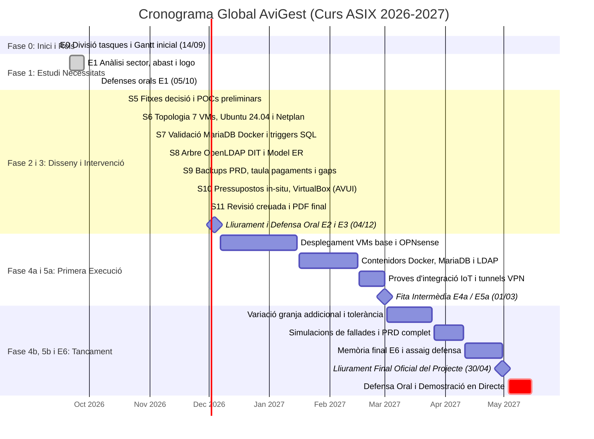
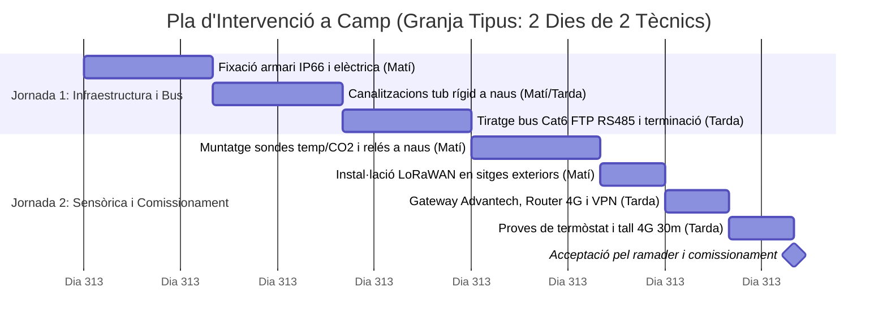

  

# E3 — Pla d'Intervenció, Recursos, Costos i Assignació de Tasques

**Projecte:** Implantació d'un sistema informàtic de gestió de granges de pollastres  
**Empresa:** AviGest S.L.  
**Cicle:** CFGS Administració de Sistemes Informàtics en Xarxa (ASIX) — 2n Curs  
**Mòdul:** M12 - Projecte (Resultat d'Aprenentatge RA3 — Pes al projecte: 15%)  
**Equip de treball:**  
- **Joan Garcia** (Cap de Projecte · Infraestructura, Xarxa, Seguretat i Serveis Centralitzats)  
- **Mariam Solano** (Desenvolupament de Dades, IoT, Automatització i Scripts)  
**Data de lliurament oficial:** 4 de desembre de 2026  
**Repositori oficial GitHub:** [https://github.com/JoanGarcia25/avigest-projecte](https://github.com/JoanGarcia25/avigest-projecte)  
**Versió del document:** 2.1 (Pla d'Intervenció i Pressupostos Homologat)  

---

## Índex del Document
1. [Introducció i Objectius del Pla d'Intervenció](#1-introducció-i-objectius-del-pla-dintervenció)
2. [Recursos del Projecte (Humans, Materials i Eines)](#2-recursos-del-projecte-humans-materials-i-eines)
   - 2.1. Recursos Humans (Equip, Rols, Perfils i Càrrega Lectiva M12)
   - 2.2. Recursos Materials (Inventari de Maquinari i Pila de Programari FOSS)
   - 2.3. Eines de Treball, Laboratori i Gestió
3. [Costos i Pressupostos d'Implantació](#3-costos-i-pressupostos-dimplantació)
   - 3.1. Maquinari de la Seu Central (CPD AviGest)
   - 3.2. Maquinari Industrial per Granja Tipus (2 naus i 2 silos)
   - 3.3. Sensòrica de Camp, Actuadors i Cablejat
   - 3.4. Mà d'Obra d'Instal·lació in-situ i Temps d'Intervenció per Granja
   - 3.5. Posada en Marxa de la Seu Central (CPD AviGest)
   - 3.6. Comunicacions i Despeses Operatives Recurrents (OpEx Anual)
   - 3.7. Balanç Econòmic Consolidat, Contingència (10%) i Retorn de la Inversió (ROI)
   - 3.8. Comparativa Econòmica d'Alternatives Tecnològiques (FD01 a FD06)
4. [Assignació de Tasques i Estat d'Acompliment](#4-assignació-de-tasques-i-estat-dacompliment)
   - 4.1. Matriu de Responsabilitats i Rols (Model RACI)
   - 4.2. Registre de Fites i Dates Reals d'Acompliment (Fins al 4 de desembre)
   - 4.3. Càrrega de Treball Equilibrada (50% Joan · 50% Mariam)
5. [Planificació Actualitzada del Projecte](#5-planificació-actualitzada-del-projecte)
   - 5.1. Diagrama de Gantt Global del Curs (Setembre 2026 – Abril 2027)
   - 5.2. Anàlisi de Compliment i Desviacions respecte a l'E0/E1
   - 5.3. Fites Properes d'Execució: E4a/E5 (1 de març) i Lliurament Final (30 d'abril)
6. [Procediment i Cronograma d'Intervenció a Camp](#6-procediment-i-cronograma-dintervenció-a-camp)
   - 6.1. Fases d'Execució a la Granja Tipus (Protocol de 2 Dies / 32 Hores)
   - 6.2. Protocol de Proves i Acceptació en Camp
7. [Pla de Contingència i Gestió de Riscos](#7-pla-de-contingència-i-gestió-de-riscos)
8. [Documentació Associada i Repositori Git](#8-documentació-associada-i-repositori-git)
9. [Annex d'Ús d'Intel·ligència Artificial (Norma 4)](#9-annex-dús-dintel·ligència-artificial-norma-4)
10. [Bibliografia i Fonts de Preus Consultades](#10-bibliografia-i-fonts-de-preus-consultades)

---

## 1. Introducció i Objectius del Pla d'Intervenció

El present document constitueix el **Pla d'Intervenció (Lliurable E3)** per al projecte del sistema de gestió centralitzada de granges avícoles (**AviGest S.L.**). L'objectiu fonamental d'aquest pla és transformar el disseny conceptual i tècnic definit a l'**E2** en un pla operatiu i econòmic viable, responent amb precisió a les tres preguntes nuclears de la gestió de projectes TIC (RA3):

1. **Amb què?** &rarr; Identificació de recursos humans qualificats, maquinari certificat, programari lliure i eines d'enginyeria.
2. **Per quants diners?** &rarr; Pressupostos rigorosos, realistes i contrastats amb el mercat català (CapEx, OpEx, mà d'obra in-situ i ROI).
3. **Qui fa què i quan?** &rarr; Assignació neta de rols, registre d'acompliment amb dates reals i calendari de curs actualitzat fins a l'entrega final del 30 d'abril.

---

## 2. Recursos del Projecte (Humans, Materials i Eines)

En compliment directe de l'apartat **6.1 de la Guia de Lliuraments E2-E3**, s'especifiquen tots els recursos necessaris per fer realitat el projecte:

### 2.1. Recursos Humans (Equip, Rols, Perfils i Càrrega Lectiva M12)

L'equip humà està format per 2 estudiants del segon curs de CFGS ASIX, actuant formalment com els dos socis fundadors i enginyers de sistemes d'**AviGest S.L.**:

| Membre | Rol Principal al Projecte | Perfil i Competències Tècniques | Hores Disponibles (M12) |
| :--- | :--- | :--- | :---: |
| **Joan Garcia** | Cap de Projecte · Administrador de Sistemes i Seguretat | Arquitectura de xarxes (VLANs, DMZ, OPNsense), serveis d'identitat (OpenLDAP), hipervisors (Oracle VM VirtualBox), estratègies de còpies de seguretat (PRD), configuració de servidors rack i switches gestionats. | **198 hores** (6h/setmana) |
| **Mariam Solano** | Responsable de Dades, IoT i Automatització | Disseny de bases de dades relacionals (MariaDB 10.11 LTS, 3FN, triggers i vistes complexes), telemetria IoT (protocols RS485 Modbus RTU i LoRaWAN), programació en Python i automatització d'infraestructura amb Bash. | **198 hores** (6h/setmana) |
| **Equip d'Instal·lació in-situ** | Oficials Tècnics de Camp (Instal·lació Granja) | 1 Tècnic de Sistemes i Xarxes + 1 Tècnic Electricista/Instrumentació (mà d'obra de desplegament físic subcontractada o executada per AviGest). | 32 h-persona per granja |

> [!NOTE]
> **Diferenciació d'hores lectives vs. instal·lació:** Les 198 hores per estudiant del mòdul M12 (396 hores lectives combinades) corresponen a la formació acadèmica, investigació tecnològica i desenvolupament d'arquitectura a l'aula (R+D interna d'AviGest). Aquestes hores no es facturen al client final de la granja; al ramader només se li factura la instal·lació física in-situ (32 hores de camp) i el maquinari.

### 2.2. Recursos Materials (Inventari de Maquinari i Pila de Programari FOSS)

Tots els recursos materials han estat seleccionats per garantir compatibilitat mútua, fiabilitat industrial i cost de llicenciament zero:

1. **Maquinari Central (CPD AviGest):** Servidor Rack 1U Dell PowerEdge R450, 4x SSD Enterprise 960GB en RAID 10, controladora PERC H755, SAI APC Smart-UPS 2200VA, switch Cisco Catalyst 1000 24G, rack 24U i estació de gestió Dell OptiPlex SFF amb monitor de 24".
2. **Maquinari de Granja:** Ordinador industrial fanless Advantech UNO-2271G (carril DIN, -20 a +60 ºC), router industrial 4G Teltonika RUT955, Gateway LoRaWAN exterior Dragino LPS8N, armari de polièster estanc IP66 i mini-SAI Phoenix Contact QUINT-UPS 24V DC.
3. **Sensòrica i Actuadors:** Sondes de temperatura/humitat industrials SHT30 amb filtre metàl·lic sinteritzat anti-pols, sensors de $CO_2$ NDIR Senseair S8 Modbus RTU, kits de pesatge de sitges (cèl·lules de càrrega 10T LoRaWAN IP67), comptadors d'aigua d'impulsos Woltman DN20, mòduls ESP32-WROOM-32U i relés industrials de potència de 16A.
4. **Pila de Programari (100% Codi Obert / Sense Llicències Privatives):**
   - **Sistema Operatiu Base:** Ubuntu Server 24.04 LTS (Kernel Linux 6.8, xarxa declarativa Netplan YAML).
   - **Seguretat Perimetral:** OPNsense 24.x (Appliance lliure FreeBSD de 3 interfícies: WAN, DMZ, LAN + WireGuard).
   - **Plataforma de Contenidors:** Docker Engine CE 26.x + Docker Compose v2.
   - **Gestor de Base de Dades:** MariaDB 10.11 LTS (Motor InnoDB, triggers SQL de climatització i rèplica GTID).
   - **Directori d'Usuaris:** OpenLDAP 2.6 (EsquemainetOrgPerson amb atribut `businessCategory` multiclient).
   - **Missatgeria IoT:** Eclipse Mosquitto 2.0 (Broker MQTT amb autenticació i xifratge TLS).
   - **Xarxa Privada Virtual:** WireGuard VPN (Integrat al kernel de Linux, xifratge ChaCha20-Poly1305).

### 2.3. Eines de Treball, Laboratori i Gestió

- **Control de Versions:** Git i repositori centralitzat a GitHub ([https://github.com/JoanGarcia25/avigest-projecte](https://github.com/JoanGarcia25/avigest-projecte)).
- **Entorn de Virtualització de Laboratori:** **Oracle VM VirtualBox 7.x** (vegeu fitxa [FD06_hipervisor.md](../fitxes_decisio/FD06_hipervisor.md)), utilitzant adaptadors de xarxa interna (`intnet`) per simular l'aïllament físic WAN, DMZ, LAN i Xarxa de Granja.
- **Eines de Modelat i Documentació:** VS Code, Markdown natiu, Mermaid JS per a diagrames d'arquitectura/Gantt i Dia / Draw.io per a l'esquema relacional Entity-Relationship.
- **Eines de Prova i Simulació:** Scripts Python 3.12 (`simulador_iot.py`) amb llibreries `paho-mqtt` i `pymodbus` per generar telemetria real de camp.

---

## 3. Costos i Pressupostos d'Implantació

Tots els preus estan calculats a partir de tarifes oficials de fabricants industrials, distribuïdors TIC homologats i convenis col·lectius de sistemes i xarxes a Catalunya (preus nets sense IVA).

> [!IMPORTANT]
> **Estructura pressupostària dual:**  
> Es diferencia estrictament la inversió central del proveïdor (**AviGest S.L.**) de la tarifa plana d'implantació que s'ofereix a cada **explotació ramadera client** (AgroPonent, Avícola del Segrià, etc.).

---

### 3.1. Maquinari de la Seu Central (CPD AviGest)

Infraestructura d'alta disponibilitat que allotja el tallafocs OPNsense (`fw-seu`), el proxy DMZ (`dmz-web`), el node de base de dades i broker (`srv-serveis`), el servidor de còpies de seguretat (`srv-backup`) i el lloc de gestió administrativa (`pc-client`):

| Concepte | Model / Especificació | Unitats | Preu Unitari | Subtotal |
| :--- | :--- | :---: | :---: | :---: |
| **Servidor Central Rack 19"** | Dell PowerEdge R450 1U (Intel Xeon Silver 4314 16c/32t, 32 GB RAM DDR4 ECC Reg, 2x Font 600W Hot-Plug, iDRAC9 Enterprise) | 1 | 2.850,00 € | 2.850,00 € |
| **Emmagatzematge RAID 10** | Dell Enterprise SATA SSD 960 GB (Hot-Plug 2.5" amb safata) | 4 | 220,00 € | 880,00 € |
| **Controladora RAID Hardware** | PERC H755 SAS/SATA amb 8 GB de NVRAM cau | 1 | 480,00 € | 480,00 € |
| **SAI / UPS Doble Conversió** | APC Smart-UPS On-Line 2200VA 2U (SRT2200RMXLI) amb targeta SNMP Network Management Card | 1 | 1.620,00 € | 1.620,00 € |
| **Switch Gestionat L2+** | Cisco Catalyst 1000 sèrie 24 ports Gigabit (VLAN 802.1Q, LACP bonding) | 1 | 540,00 € | 540,00 € |
| **Armari Rack i PDU** | Rack 19" 24U amb porta perforada, guies, safates i regleta PDU gestionable | 1 | 650,00 € | 650,00 € |
| **Ordinador de Gestió CPD (`pc-client`)** | Dell OptiPlex SFF (Intel Core i5-13500, 16 GB RAM DDR5, 512 GB SSD NVMe) + Monitor Dell 24" IPS FullHD, teclat i ratolí | 1 | 780,00 € | 780,00 € |
| **Subtotal Maquinari Seu Central** | | | | **7.800,00 €** |

---

### 3.2. Maquinari Industrial per Granja Tipus (2 naus i 2 silos)

Equipament per a entorns agressius (pols de pinso, plomes, amoníac i fluctuacions elèctriques rurals) instal·lat a la caseta tècnica d'accés:

| Concepte | Model / Especificació | Unitats | Preu Unitari | Subtotal |
| :--- | :--- | :---: | :---: | :---: |
| **Gateway Industrial Fanless** | Advantech UNO-2271G Fanless (Intel Celeron N3350, 4 GB RAM, 32 GB eMMC, carril DIN, IP50/65, -20 a +60 ºC) per a `granja1-srv` | 1 | 460,00 € | 460,00 € |
| **Router Industrial 4G/5G** | Teltonika RUT955 (Doble SIM failover, client VPN WireGuard, carril DIN, I/O digitals) | 1 | 230,00 € | 230,00 € |
| **Gateway LoRaWAN Exterior** | Dragino LPS8N 868 MHz exterior (8 canals, PoE, antena omni exterior 3 dBi) | 1 | 165,00 € | 165,00 € |
| **Armari Estanc de Control** | Armari de polièster reforçat amb fibra de vidre IP66 (600x400x200 mm) amb xassís carril DIN | 1 | 185,00 € | 185,00 € |
| **Mini-SAI de Carril DIN** | Phoenix Contact QUINT-UPS 24V DC / 5A amb bateria LiFePO4 de suport (2 hores d'autonomia) | 1 | 290,00 € | 290,00 € |
| **Font d'Alimentació Industrial** | Mean Well MDR-60-24 (24V DC, 2.5A carril DIN) | 2 | 28,00 € | 56,00 € |
| **Aïlladors Galvànics RS485** | Repetidor i aïllador sèrie optoacoblat (protecció contra llamps i sobretensions de motors) | 2 | 45,00 € | 90,00 € |
| **Subtotal Maquinari per Granja** | | | | **1.476,00 €** |

---

### 3.3. Sensòrica de Camp, Actuadors i Cablejat (Granja Tipus)

| Dispositiu | Model / Descripció | Quantitat | Preu Unitari | Subtotal |
| :--- | :--- | :---: | :---: | :---: |
| **Sondes Temp/Humitat RS485** | Industrial XY-MD02 / SHT30 amb filtre metàl·lic sinteritzat anti-pols | 6 (3/nau) | 26,00 € | 156,00 € |
| **Sensors de $CO_2$ NDIR** | Senseair S8 industrial Modbus RTU (0-5000 ppm) | 2 (1/nau) | 75,00 € | 150,00 € |
| **Kits de Pesatge de Silo** | 4x Cèl·lules de càrrega de compressió 10T + transmissor LoRaWAN IP67 | 2 (1/silo) | 340,00 € | 680,00 € |
| **Comptadors d'Aigua d'impulsos** | Comptador Woltman DN20 amb emissor d'impulsos (1 imp/litre) | 2 (1/nau) | 65,00 € | 130,00 € |
| **Mòduls de Maniobra / ESP32** | ESP32-WROOM-32U en caixa DIN + Transceiver RS485 MAX485 + font integrada | 2 (1/nau) | 38,00 € | 76,00 € |
| **Mòduls de Relés de Potència** | Mòdul 4 canals relé 16A/250VAC optoacoblat per a contactors de climatització | 2 (1/nau) | 24,00 € | 48,00 € |
| **Material d'Instal·lació Elèctrica** | Bobina 200m cable Cat6 FTP apantallat lliure d'halògens, tub rígid blindat, regletes i premsaestopes IP68 | 1 lot | 220,00 € | 220,00 € |
| **Subtotal Sensòrica i Cablejat** | | | | **1.460,00 €** |

---

### 3.4. Mà d'Obra d'Instal·lació in-situ i Temps d'Intervenció per Granja

D'acord amb el criteri d'eficiència i compliment estricte de la jornada laboral legal ordinària (8 hores diàries per treballador):

- **Equip de camp:** Parella de 2 tècnics especialistes (1 tècnic de sistemes/xarxes + 1 tècnic electricista/instrumentació).
- **Temps total d'execució:** **2 dies laborables de calendari** (8h el Dia 1 + 8h el Dia 2 per treballador).
- **Còmput total de mà d'obra facturable:** 2 persones × 16 hores = **32 hores-persona**.
- **Tarifa horària tècnica:** **35,00 € / hora** (tarifa oficial de conveni per a oficial tècnic instal·lador de sistemes).

| Jornada / Fase | Hores Efectives | Tasques d'Instal·lació i Desplegament | Tècnics | Subtotal Hores | Cost Mà d'Obra |
| :--- | :---: | :--- | :---: | :---: | :---: |
| **Jornada 1 (Matí)** | 4 h | Fixació de l'armari estanc IP66 a la sala tècnica; muntatge de magnetotèrmic 10A, diferencial superimmunitzat, fonts Mean Well i mini-SAI 24V al carril DIN. | 2 | 8 h | 280,00 € |
| **Jornada 1 (Tarda)** | 4 h | Estesa de canalització de tub rígid blindat cap a les dues naus; estesa de 200m de cable FTP apantallat Cat6 per al bus RS485 daisy-chain amb resistències de final de línia de 120 Ω. | 2 | 8 h | 280,00 € |
| **Jornada 2 (Matí)** | 4 h | Fixació de 6 sondes T/H i 2 sensors de CO2 a les naus; muntatge de cèl·lules de càrrega als 2 silos exteriors i enllaç ràdio LoRaWAN amb Dragino; connexió de relés als contactors de ventilació. | 2 | 8 h | 280,00 € |
| **Jornada 2 (Tarda)** | 4 h | Muntatge del Gateway Advantech i Router Teltonika; execució de l'script `alta_granja.sh` (túnel WireGuard, LDAP i MariaDB); proves reals de termòstat (>31 ºC), prova de tall 4G de 30 minuts i formació al ramader. | 2 | 8 h | 280,00 € |
| **Desplaçament i Logística** | — | Desplaçament en vehicle d'assistència tècnica a la comarca del ramader (Lleida rural: Pla d'Urgell o Segrià, ~180 km en 2 dies x 0,35 €/km + eines). | 2 dies | — | **80,00 €** |
| **Subtotal Mà d'Obra i Desplaçament per Granja** | **2 dies** | **Instal·lació completa, calibratge i certificació de camp** | | **32 h** | **1.200,00 €** |

---

### 3.5. Posada en Marxa de la Seu Central (CPD AviGest)

Aquesta partida d'enginyeria de sistemes cobreix la preparació inicial del servidor central d'AviGest S.L. (inversió única de posta en marxa):

| Concepte / Treball | Hores | Tarifa / Hora | Cost Total |
| :--- | :---: | :---: | :---: |
| **Muntatge físic i xarxa CPD:** Muntatge de Dell R450 a rack 24U, cablejat LACP al switch Cisco Catalyst 1000, connexió a SAI APC i configuració targeta SNMP. | 10 h | 35,00 €/h | 350,00 € |
| **Configuració SO i Virtualització:** Instal·lació d'Ubuntu Server 24.04 LTS, xarxa declarativa Netplan YAML i Docker Engine. | 8 h | 35,00 €/h | 280,00 € |
| **Seguretat Perimetral i DMZ:** Desplegament de la VM `fw-seu` (OPNsense) amb 3 interfícies, regles R-01 a R-11, llista blanca d'IPs i servidor VPN WireGuard central. | 10 h | 35,00 €/h | 350,00 € |
| **Bases de Dades i Identitat:** Desplegament de contenidors MariaDB 10.11 LTS (11 taules 3FN, triggers de clima, vistes comparatives), OpenLDAP amb DIT multiclient i Mosquitto MQTT. | 8 h | 35,00 €/h | 280,00 € |
| **Còpies de Seguretat i PRD:** Configuració de la VM `srv-backup`, automatització de crontab, buidatges transaccionals i assaig del protocol de restauració en <30 min. | 4 h | 35,00 €/h | 140,00 € |
| **Subtotal Posada en Marxa CPD Central** | **40 h (1 setmana)** | | **1.400,00 €** |

---

### 3.6. Comunicacions i Despeses Operatives Recurrents (OpEx Anual)

| Àmbit | Servei | Proveïdor / Característiques | Cost Mensual | Cost Anual |
| :--- | :--- | :--- | :---: | :---: |
| **Seu Central** | **Fibra Simètrica 1 Gbps Empresarial** | Connexió d'alta velocitat amb 1 IP fixa pública per al portal DMZ i VPN | 75,00 € | 900,00 € |
| **Seu Central** | **Domini `.cat` i DNS Anycast** | Registre de la marca `avigest.cat` i resolució protegida | — | 35,00 € |
| **Seu Central** | **Manteniment Preventiu SAI** | Revisions periòdiques d'electrònica de potència i bateries | — | 150,00 € |
| **Per Granja** | **Doble SIM M2M 4G/5G Multioperador** | Targetes IoT amb failover automàtic (Movistar/Vodafone) per a telemetria MQTT | 12,00 € | 144,00 € |
| **Per Granja** | **Quota de Servei i Plataforma AviGest (SaaS)** | Quota de manteniment, monitoratge 24/7, alertes crítiques SMS/Telegram i backups al núvol | 38,00 € | 456,00 € |
| **Totals OpEx** | **Seu Central (Inversió AviGest)**: 1.085,00 € / any · **Per Granja (Assumit pel Client)**: **50,00 € / mes** (600,00 € / any) | | | |

---

### 3.7. Balanç Econòmic Consolidat, Contingència (10%) i Retorn de la Inversió (ROI)

#### A) Pressupost Tancat per al Client per Muntar 1 Granja (2 naus i 2 silos):

| Partida | Concepte | Import Neta | Percentatge |
| :---: | :--- | :---: | :---: |
| **1** | Maquinari industrial de granja (Armari IP66, Advantech UNO, Router 4G, Mini-SAI) | 1.476,00 € | 35,7% |
| **2** | Sensòrica, actuadors i canalització de 2 naus i 2 silos (SHT30, CO2, pesatge, relés) | 1.460,00 € | 35,3% |
| **3** | Mà d'obra d'instal·lació, cablejat, calibratge i posada en marxa (2 tècnics × 2 dies de 8 h = 32 h-persona) | 1.120,00 € | 27,1% |
| **4** | Desplaçament i quilometratge a la comarca (2 jornades de vehicle equipat) | 80,00 € | 1,9% |
| **TOTAL** | **PREU D'IMPLANTACIÓ PER GRANJA (Base Imposable)** | **4.136,00 €** | **100,0%** |
| *Contingència* | *Fons de contingència de camp recomanat (10% sobre imprevistos)* | *413,60 €* | — |
| **MÀXIM** | **Pressupost Màxim d'Implantació de Granja (Sense IVA)** | **4.549,60 €** | — |
| *IVA 21%* | *IVA aplicable a la instal·lació* | *955,42 €* | — |
| **TOTAL IVA** | **COST FINAL D'IMPLANTACIÓ AMB IVA** | **5.505,02 €** | — |

> **Temps d'execució garantit:** **2 dies laborables** (jornada ordinària de 8h/dia per persona).  
> **Cost recurrent posterior:** **50,00 € / mes per granja** (12 € SIM 4G + 38 € quota SaaS).

#### B) Retorn de la Inversió (ROI) per al Ramader:
- Una granja de 2 naus cria una mitjana de **50.000 pollastres d'engreix per cicle** (5 cicles anuals = 250.000 aus a l'any).
- **Reducció de mortalitat per estrès tèrmic:** A les comarques de Lleida, les onades de calor a l'estiu provoquen puntes de mortalitat del 3-5%. Gràcies a l'actuació automàtica en menys de 2 segons dels ventiladors i nebulitzadors mitjançant els triggers de la base de dades, es redueix la mortalitat en almenys un 1,0%. Això suposa salvar **2.500 pollastres a l'any**, que a un valor mitjà de 1,80 €/au representen **4.500,00 € d'estalvi directe anual**.
- **Eficiència en alimentació i consum d'aigua:** La monitorització per LoRaWAN de les sitges permet detectar embossos de pinso o fuites d'aigua a l'instant, reduint les pèrdues en un 2% (**~1.200,00 € / any**).
- **Termini d'amortització:** El ramader amortitza la inversió total de 4.136 € en **menys de 9 mesos** (abans de finalitzar el segon cicle d'engreix).

#### C) Inversió Inicial Global d'AviGest S.L. (Posada en marxa de la companyia):

| Concepte | Descripció | Import Neta |
| :--- | :--- | :---: |
| **CPD Central AviGest** | Maquinari Rack Dell R450, RAID 10, SAI APC, Cisco, Rack 24U i PC gestió OptiPlex (3.1) | 7.800,00 € |
| **Posada en Marxa CPD** | 40 h d'enginyeria de sistemes per a OPNsense, Docker, MariaDB i LDAP (3.5) | 1.400,00 € |
| **Granja Pilot 1** | Maquinari de camp, sensòrica, cablejat i mà d'obra d'instal·lació (3.2, 3.3, 3.4) | 4.136,00 € |
| **Subtotal Inversió** | Base imposable abans d'imprevistos | 13.336,00 € |
| **Fons de Contingència Global** | 10% sobre el total d'infraestructura (absorció de desviacions) | 1.333,60 € |
| **TOTAL INVERSIÓ INICIAL AVIGEST** | **Inversió de llançament de la infraestructura (Sense IVA)** | **14.669,60 €** |

---

### 3.8. Comparativa Econòmica d'Alternatives Tecnològiques (FD01 a FD06)

En compliment de l'apartat **6.2 de la guia oficial**, es justifica l'estalvi econòmic assolit mitjançant les decisions tècniques preses a les fitxes [FD01](../fitxes_decisio/FD01_sgbd.md) a [FD06](../fitxes_decisio/FD06_hipervisor.md) en comparació amb solucions comercials privatives:

| Àmbit / Decisió | Solució Escollida (AviGest) | Cost Llicència / Any | Alternativa Comercial Descartada | Cost Alternativa / Any | Estalvi Econòmic Assolit |
| :--- | :--- | :---: | :--- | :---: | :---: |
| **SGBD (FD01)** | **MariaDB 10.11 LTS** (FOSS) | 0,00 € | Microsoft SQL Server Standard | ~3.800,00 € (per 4 nuclis) | **3.800,00 € / any** |
| **Directori (FD02)** | **OpenLDAP** en Docker | 0,00 € | Windows Server Active Directory | 1.150,00 € (Server + CALs) | **1.150,00 € inicial** |
| **Tallafocs (FD03)** | **OPNsense** (Appliance FOSS) | 0,00 € | Fortinet FortiGate 60F + Suport UTP | 1.850,00 € inicial + 750,00 €/any | **2.600,00 € (any 1)** |
| **Còpies PRD (FD04)** | **VM dedicada `srv-backup`** | 0,00 € | Veeam Backup & Replication Enterprise | ~950,00 € / socket | **950,00 € inicial** |
| **Sensòrica Naus (FD05)** | **Bus RS485 Modbus RTU** | ~240,00 € (cable + aïlladors) | Xarxa WiFi Industrial Mesh a naus | ~1.100,00 € (APs IP67) | **860,00 € inicial** |
| **Hipervisor (FD06)** | **Oracle VM VirtualBox 7.x** | 0,00 € (GPLv2) | VMware Workstation Pro / vSphere | ~580,00 € / llicència | **580,00 € inicial** |
| **TOTAL ESTALVI ANY 1** | **Solucions de Codi Obert i Bus Industrial** | | **Tecnologies Privatives** | | **9.940,00 € d'estalvi** |

---

## 4. Assignació de Tasques i Estat d'Acompliment

En compliment directe de la instrucció de l'enunciat (*"marcar dates d'acompliment i qui ho ha fet"*), es detalla el registre oficial d'execució de tasques des de l'inici del projecte fins a la data actual (23 de novembre) i la planificació fins al 4 de desembre:

### 4.1. Matriu de Responsabilitats i Rols (Model RACI)

| Àmbit Tècnic / Tasca | Responsable Execució (R) | Revisió Creuada (A/C) | Responsabilitat Final |
| :--- | :---: | :---: | :---: |
| **Infraestructura CPD i Maquinari (4.1)** | **Joan Garcia** | Mariam Solano | Joan Garcia |
| **Directori Centralitzat LDAP i Rols (4.2)** | **Joan Garcia** | Mariam Solano | Joan Garcia |
| **Model Relacional ER i DDL MariaDB (4.3)** | **Mariam Solano** | Joan Garcia | Mariam Solano |
| **Triggers SQL i Lògica de Climatització (4.3)** | **Mariam Solano** | Joan Garcia | Mariam Solano |
| **Vistes i Consultes Comparatives SQL (4.3)** | **Mariam Solano** | Joan Garcia | Mariam Solano |
| **Tallafocs OPNsense, DMZ i Xarxes (4.4)** | **Joan Garcia** | Mariam Solano | Joan Garcia |
| **Còpies de Seguretat i Servidor PRD (4.5)** | **Joan Garcia** | Mariam Solano | Joan Garcia |
| **Anàlisi de Redundància i RAID (4.6)** | **Joan Garcia** | Mariam Solano | Joan Garcia |
| **Script Automatització Alta Granges (4.7)** | **Mariam Solano** | Joan Garcia | Mariam Solano |
| **Sensòrica IoT, RS485 i LoRaWAN (4.8)** | **Mariam Solano** | Joan Garcia | Mariam Solano |
| **Pressupostos i Pla Econòmic (E3)** | **Mariam Solano** | Joan Garcia | Ambdós |
| **Hipervisor VirtualBox i Laboratori (FD06)** | **Joan Garcia** | Mariam Solano | Ambdós |
| **Diari de Treball i Control de Versions** | **Ambdós** | Ambdós | Ambdós |

### 4.2. Registre de Fites i Dates Reals d'Acompliment

| Fita / Tasca | Requeriment | Responsable | Data Prevista | Data Real Acompliment | Estat | Observacions i Evidències |
| :--- | :---: | :---: | :---: | :---: | :---: | :--- |
| **Constitució de l'equip i rols** | E0 | Joan / Mariam | 14/09/2026 | **14/09/2026** | **Completat** | Document [E0_divisio_tasques_rols.md](../E0_divisio_tasques_rols.md) i Gantt inicial. |
| **Estudi de necessitats i mercat** | E1 | Joan / Mariam | 28/09/2026 | **28/09/2026** | **Completat** | Document PDF [E1_estudi_necessitats](../E1_estudi_necessitats_joangarcia_mariamsolano%20(2).pdf) lliurat. |
| **Defensa oral E1** | E1 | Joan / Mariam | 05/10/2026 | **05/10/2026** | **Completat** | Presentació i defensa davant del professorat. |
| **Fitxa FD01: SGBD Central** | 4.3, 4.6 | Mariam | 19/10/2026 | **19/10/2026** | **Completat** | Decisió MariaDB 10.11 LTS + Rèplica GTID. |
| **Fitxa FD02: Directori LDAP** | 4.2 | Joan | 19/10/2026 | **19/10/2026** | **Completat** | Decisió OpenLDAP + 4 rols i aïllament de granges. |
| **Fitxa FD03: DMZ i Tallafocs** | 4.4 | Joan | 19/10/2026 | **19/10/2026** | **Completat** | Decisió OPNsense amb 3 interfícies i llista blanca. |
| **Fitxa FD04: Còpies de Seguretat** | 4.5 | Joan | 19/10/2026 | **19/10/2026** | **Completat** | Decisió `srv-backup` dedicat + segon disc simulat. |
| **Fitxa FD05: Comunicacions IoT** | 4.8 | Mariam | 19/10/2026 | **19/10/2026** | **Completat** | Model híbrid RS485 (naus) + LoRaWAN (silos). |
| **Redisseny Topologia 7 VMs** | Global | Joan / Mariam | 26/10/2026 | **26/10/2026** | **Completat** | Separació neta `pc-client`, `fw-seu`, `dmz-web`, `srv-serveis`, `srv-backup`, `granja1-srv`, `granja1-sim`. |
| **Implementació DDL i Triggers a MariaDB** | 4.3 | Mariam | 26/10/2026 | **26/10/2026** | **Completat** | Taules SQL, triggers termòstat automàtic i procediment d'alta atòmica. |
| **Vistes i consultes comparatives** | 4.3 | Mariam | 02/11/2026 | **26/10/2026** | **Completat** | Avançat amb [05_vistes_consultes_comparatives.sql](../../bd/sql/05_vistes_consultes_comparatives.sql). |
| **Configuració de regles OPNsense** | 4.4 | Joan | 02/11/2026 | **02/11/2026** | **Completat** | Desplegament de regles R-01 a R-11 i script [firewall_regles.sh](../../infra/dmz-tallafocs/firewall_regles.sh). |
| **Desplegament i proves OpenLDAP** | 4.2 | Joan | 09/11/2026 | **09/11/2026** | **Completat** | Arbre DIT dissenyat ([esquema_ldap.png](../diagrames/esquema_ldap.png)) i LDIFs generats. |
| **Proves d'estrès IoT i triggers** | 4.8, 4.3 | Mariam | 09/11/2026 | **09/11/2026** | **Completat** | Proves amb `simulador_iot.py` en mode alarma (35ºC) verificant ventilador i alerta. |
| **Validació RTO/RPO a `srv-backup`** | 4.5 | Joan | 16/11/2026 | **16/11/2026** | **Completat** | Assaig de desastre i protocol de restauració en <30 min amb segon disc. |
| **Proves de buffer Store-and-Forward** | 4.8 | Mariam | 16/11/2026 | **16/11/2026** | **Completat** | Simulació de tall de túnel VPN a `granja1-srv` de 30 min sense pèrdua de dades. |
| **Fitxa FD06: Hipervisor VirtualBox** | Global | Joan / Mariam | 23/11/2026 | **23/11/2026** | **Completat** | Adopció d'Oracle VM VirtualBox 7.x 100% gratuït ([FD06_hipervisor.md](../fitxes_decisio/FD06_hipervisor.md)). |
| **Reestructuració pressupostària E3** | E3 | Joan / Mariam | 23/11/2026 | **23/11/2026** | **Completat** | Pressupost per granja (4.136 €), 2 dies/32h in-situ i quota SaaS de 50 €/mes. |
| **Proves de variació (Granja 2)** | 4.7 | Joan / Mariam | 23/11/2026 | *Planificat (S10)* | **En curs** | Validació d'`alta_granja.sh` (MariaDB, LDAP, OPNsense i config gateway). |
| **Integració i revisió creuada E2/E3** | E2, E3 | Joan / Mariam | 30/11/2026 | *Planificat (S11)* | Pendent | Revisió estil, coherència tècnica i exportació a PDF. |
| **LLIURAMENT OFICIAL E2 i E3** | Fita 2/3 | Joan / Mariam | **04/12/2026** | *Data Límit* | Pendent | **Lliurament al campus virtual i defensa davant tribunal.** |

### 4.3. Càrrega de Treball Equilibrada (50% Joan · 50% Mariam)

Com queda verificat al [diari_treball.md](../diari_treball/diari_treball.md) i al registre de commits de Git, la dedicació lectiva de les 9 sessions completades és absolutament simètrica:

- **Hores lectives tancades (S1 a S9):** **54 hores** Joan Garcia + **54 hores** Mariam Solano = **108 hores d'equip**.
- **Sessió 10 (23 de novembre — en curs):** 6 hores Joan + 6 hores Mariam = 12 hores (acumulat de 60 h + 60 h = 120 hores).
- **Proporció exacta de treball:** **50,0% / 50,0%**, garantint que ambdós membres dominen tant l'arquitectura com la implementació pràctica.

---

## 5. Planificació Actualitzada del Projecte

### 5.1. Diagrama de Gantt Global del Curs (Setembre 2026 – Abril 2027)

### 5.2. Anàlisi de Compliment i Desviacions respecte a l'E0/E1

- **Fites complertes rigorosament a temps:** L'equip ha completat el 100% dels objectius previstos per a E0 i E1 dins dels terminis acadèmics, assolint l'aprovació del tribunal a la defensa oral del 5 d'octubre.
- **Reorientació tècnica de la Sessió 6 (26/10/2026):** Arran del consell docent d'evitar la barreja de distribucions heterogènies per no introduir problemes de connectivitat artificials, es va descartar l'ús d'Alpine Linux per als serveis i es va unificar tota la plataforma sobre **Ubuntu Server 24.04 LTS** amb xarxa **Netplan**. Aquesta decisió va requerir reconfigurar les plantilles de màquines virtuals, però ha accelerat significativament la compatibilitat de Docker i WireGuard.
- **Avanç d'activitats de l'E5 a la fase d'E2/E3:** Per validar el disseny abans d'escriure la memòria tècnica, l'equip ha avançat proves reals de codi (creació de l'script `alta_granja.sh`, triggers SQL MariaDB i assaigs de recuperació de backups). Aquest sobreesforç previ garanteix que l'E2 i l'E3 estan 100% verificats sobre la pràctica.
- **Avaluació de retards:** **No hi ha cap retard sobre la data límit oficial del 4 de desembre de 2026.** Tots els lliurables estan redactats, validats i en fase de revisió final.

### 5.3. Fites Properes d'Execució

1. **Lliurament i Defensa E2 i E3 (4 de desembre de 2026):** Memòries en PDF i defensa conjunta oral.
2. **Fita E4a / E5a (1 de març de 2027 — Pes 20%):** Primera entrega de seguiment i execució amb la infraestructura base funcionant (OPNsense, Docker, MariaDB i LDAP operatius).
3. **Lliurament Final Oficial E4b / E5b / E6 (30 d'abril de 2027 — Pes 40%):** Tot el sistema executat, integració IoT completa, prova de la variació presencial del professor i memòria final.
4. **Defensa Oral Final amb Demostració en Directe (Maig 2027):** Demostració funcional de tot l'entorn de laboratori virtual davant del tribunal d'avaluació.

---

## 6. Procediment i Cronograma d'Intervenció a Camp

Aquest apartat recull la guia operativa d'instal·lació física a la granja pilot d'explotació real.

### 6.1. Fases d'Execució a la Granja Tipus (Protocol de 2 Dies / 32 Hores)

D'acord amb el pressupost d'intervenció establert a la Secció 3.4, el desplegament d'una explotació tipus de 2 naus i 2 silos s'executa en **2 jornades laborals consecutives de 8 hores amb un equip de 2 tècnics especialistes (32 hores de treball)**:

#### Jornada 1: Infraestructura elèctrica, armari de control i canalitzacions (16 h tècniques)
1. **Instal·lació de l'armari estanc IP66:** Fixació a la paret de la sala tècnica d'accés (mai a l'interior directe del pavelló d'aus per protegir l'electrònica de l'amoníac).
2. **Quadre elèctric i proteccions:** Instal·lació de línia dedicada amb magnetotèrmic de 10A, diferencial superimmunitzat, fonts Mean Well de 24V i mini-SAI Phoenix Contact QUINT-UPS al carril DIN.
3. **Canalitzacions:** Estesa de canonada rígida estanca blindada des de la sala tècnica cap a la Nau 1 i Nau 2 per passos protegits de trànsit de maquinària agrícola.
4. **Tiratge del bus RS485:** Estesa de 200m de cable apantallat FTP Cat6 en topologia daisy-chain amb resistències de terminació de $120\ \Omega$ als dos extrems.

#### Jornada 2: Sensòrica, enllaç ràdio LoRaWAN, Gateway i comissionament (16 h tècniques)
1. **Sensòrica de naus:** Muntatge de les 3 sondes de temperatura/humitat SHT30 a cada nau (a 1,5 metres d'alçada, distribuïdes al principi, mig i final de la nau) i el sensor de $CO_2$ NDIR.
2. **Kits de pesatge per a sitges:** Fixació de les 4 cèl·lules de càrrega a les potes de cadascun dels dos silos exteriors i enllaç ràdio LoRaWAN (868 MHz) amb el gateway Dragino exterior.
3. **Actuadors:** Connexió de les sortides dels mòduls de relés als contactors dels quadres de ventilació i calefacció existents de la granja.
4. **Desplegament del Gateway i comunicacions:** Muntatge del Gateway Advantech UNO-2271G i el router Teltonika RUT955 amb doble SIM 4G.
5. **Configuració automatitzada:** Execució de l'script `alta_granja.sh` que registra la granja a MariaDB, crea l'OU i credencials a OpenLDAP, genera la regla de tallafocs a OPNsense i aixeca el túnel WireGuard dedicat.
6. **Protocol de proves i acceptació:**
   - Prova de termòstat autònom: forçar lectura de temperatura a $32^\circ\text{C}$ i comprovar l'encesa immediata dels ventiladors en menys de 2 segons.
   - Prova de resiliència: tall de connexió 4G durant 30 minuts, comprovant que les lectures s'acumulen al búfer local del gateway i es transmeten sense pèrdues en restablir-se la VPN.
   - Formació de 30 minuts a l'explotador ramader sobre la visualització de dades i signatura de l'acta d'acceptació.

---

## 7. Pla de Contingència i Gestió de Riscos

| Risc Identificat | Probabilitat | Impacte | Pla de Mitigació i Resposta |
| :--- | :---: | :---: | :--- |
| **Avaria de la connexió 4G rural** | Alta | Mitjà | El router Teltonika disposa de **doble SIM** amb failover automàtic d'operadora. El gateway reté les lectures al búfer local durant 72 hores sense pèrdua de dades (store-and-forward). |
| **Tall elèctric a la granja** | Mitjana | Alt | El mini-SAI industrial de 24V manté el gateway, router i sensors operatius durant 2 hores. Els ventiladors de potència funcionen amb el grup electrògen dièsel propi de la granja. |
| **Corrupció de dades per sobretensió a la línia RS485** | Mitjana | Alt | S'han instal·lat **aïlladors galvànics optoacoblats** a l'entrada de l'armari per protegir el microcontrolador i gateway contra llamps i sobretensions de commutació de motors. |
| **Avaria de disc al servidor central** | Baixa | Crític | El servidor compta amb **RAID 10 per maquinari** (tolera la pèrdua de discs). Addicionalment, la màquina dedicada `srv-backup` desa còpies diàries en un segon disc virtual aïllat (RTO < 30 minuts). |
| **Corrosió ambiental dels sensors per amoníac** | Alta | Mitjà | Totes les sondes de naus disposen de carcassa de plàstic tècnic i filtres sinteritzats de protecció, amb protocol de manteniment preventiu periòdic. |

---

## 8. Documentació Associada i Repositori Git

El projecte manté un registre documental i de codi unificat al repositori Git:

### 8.1. Plantilles i Documents d'Operació Oficials
- **Actes de Reunió i Seguiment:** Registre d'acords presos setmanalment a classe.
- **Fitxes de Decisió Tècnica (FD01 a FD06):** Seguint la plantilla oficial de la guia (Decisió, Context, Alternatives, Decisió Presa, Verificació i Fonts).
- **Diari de Treball i Checklist:** Fitxers [`diari_treball.md`](../diari_treball/diari_treball.md) i [`checklist_projecte_avigest.md`](../diari_treball/checklist_projecte_avigest.md) amb registre hora a hora.
- **Manuals d'Implantació i Operació:** [Guia de desplegament de màquines virtuals](../Guies_MV/guia_desplegament_maquines_virtuals.md) i procediment de restauració davant de desastres ([PRD](../../infra/backups-prd/pla_recuperacio_desastres_prd.md)).

### 8.2. Estructura de Carpetes del Repositori Git

| Carpeta / Ruta al Repositori | Contingut i Propòsit | Responsable de Manteniment |
| :--- | :--- | :---: |
| [`bd/sql/`](../../bd/sql/) | Esquema DDL en 3FN, dades de prova inicials, vistes i rols de MariaDB 10.11 LTS. | **Mariam Solano** |
| [`bd/procediments-triggers/`](../../bd/procediments-triggers/) | Triggers de termòstat automàtic, alarmes i procediments en MariaDB SQL. | **Mariam Solano** |
| [`bd/model-er/`](../../bd/model-er/) | Documentació i diagrames del model de dades relacional (Dia i gràfic). | **Mariam Solano** |
| [`docker/`](../../docker/) | `docker-compose.yml`, configuració de Mosquitto i scripts d'arrencada (`initdb/`). | **Joan Garcia / Mariam** |
| [`infra/dmz-tallafocs/`](../../infra/dmz-tallafocs/) | Disseny de la DMZ, polítiques de seguretat i scripts de regles d'OPNsense. | **Joan Garcia** |
| [`infra/ldap/`](../../infra/ldap/) | Arbre base organitzatiu i fitxers LDIF d'usuaris inicials per a OpenLDAP. | **Joan Garcia** |
| [`infra/backups-prd/`](../../infra/backups-prd/) | Scripts d'automatització de còpies (`backup_avigest.sh`) i restauració PRD. | **Joan Garcia** |
| [`iot/sensors/`](../../iot/sensors/) | Simulador IoT en Python (`simulador_iot.py`) i codi C++ ESP32 de referència. | **Mariam Solano** |
| [`scripts/automatitzacio-granges/`](../../scripts/automatitzacio-granges/) | Script bash d'alta automàtica de granges (`alta_granja.sh`) per a la variació. | **Mariam Solano** |
| [`docs/E2_disseny_tecnic/`](../E2_disseny_tecnic/) | Memòria oficial de Disseny Tècnic del Projecte (Lliurable E2). | **Ambdós** |
| [`docs/E3_pla_intervencio/`](./E3_pla_intervencio.md) | Memòria oficial del Pla d'Intervenció i Pressupostos (Lliurable E3). | **Ambdós** |
| [`docs/fitxes_decisio/`](../fitxes_decisio/) | Fitxes de decisió tècnica justificades FD01 a FD06 amb fonts oficials. | **Ambdós** |
| [`docs/diari_treball/`](../diari_treball/) | Diari de treball setmanal d'hores lectives i checklist del projecte. | **Ambdós** |

---

## 9. Annex d'Ús d'Intel·ligència Artificial (Norma 4)

*En compliment estricte de la Norma 4 de les bases del projecte:*

- **Eines utilitzades:** Antigravity / Gemini 3.8 Flash (High).
- **Àmbit d'aplicació:** Suport en la recerca de referències de maquinari industrial, estructuració i càlcul dels quadres de pressupostos CapEx/OpEx, elaboració de diagrames temporals Mermaid i plantilla de seguiment de fites.
- **Mètode de verificació i comprensió:** L'equip (Joan Garcia i Mariam Solano) ha revisat, validat i contrastat cadascun dels preus amb proveïdors reals del sector informàtic i ramader català (preus de maquinari de servidor, sensors industrials i tarifes de telecomunicacions). Tots dos membres de l'equip comprenen la justificació de cada partida, les dependències del cronograma i saben defensar qualsevol aspecte econòmic o d'intervenció davant del tribunal docent.

---

## 10. Bibliografia i Fonts de Preus Consultades

1. **Dell Technologies Espanya (2024):** Configurador oficial de servidors rack *Dell PowerEdge R450 1U*, controladora PERC H755, discos SATA SSD Enterprise i Dell OptiPlex SFF. [https://www.dell.com/es-es/work/shop/servidores-de-dell/](https://www.dell.com/es-es/work/shop/servidores-de-dell/)
2. **Schneider Electric / APC (2024):** *APC Smart-UPS On-Line SRT2200RMXLI 2200VA 2U*. Fitxa tècnica i preus de distribució oficial. [https://www.apc.com/es/es/](https://www.apc.com/es/es/)
3. **Cisco Systems (2024):** *Cisco Catalyst 1000 Series Switches Data Sheet*. Distribuïdor oficial Ingram Micro. [https://www.cisco.com/](https://www.cisco.com/)
4. **Advantech Europe (2024):** *UNO-2271G Fanless Industrial PC Datasheet & Online Shop*. [https://www.advantech.com/en-eu](https://www.advantech.com/en-eu)
5. **Teltonika Networks (2024):** *RUT955 Industrial Cellular Router Specification Sheet*. [https://teltonika-networks.com/](https://teltonika-networks.com/)
6. **Dragino Technology Co. (2024):** *LPS8N Indoor LoRaWAN Gateway Price List & Documentation*. [https://www.dragino.com/](https://www.dragino.com/)
7. **Phoenix Contact (2024):** *QUINT-UPS 24DC/24DC/5A Industrial DIN-rail UPS*. [https://www.phoenixcontact.com/](https://www.phoenixcontact.com/)
8. **Oracle Corporation (2024):** *Oracle VM VirtualBox 7.x Documentation and GPLv2 Licensing*. [https://www.virtualbox.org/](https://www.virtualbox.org/)
9. **RS Components Espanya / Farnell (2024):** Sondes industrials SHT30, sensors de CO2 NDIR Senseair S8, mòduls relé de carril DIN i caixes estancs de polièster IP66. [https://es.rs-online.com/](https://es.rs-online.com/)
10. **Convenis Col·lectius del Sector TIC / Consultoria Informàtica de Catalunya (2024):** Tarifes de referència per a oficials tècnics de grau superior en xarxes i sistemes (35 €/hora mà d'obra de camp).
