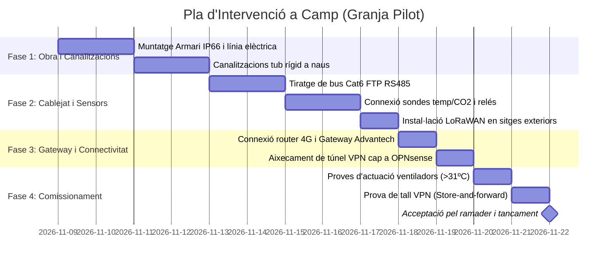

# E3 — Pla d'Intervenció, Recursos, Costos i Assignació de Tasques

**Projecte:** Implantació d'un sistema informàtic de gestió de granges de pollastres  
**Empresa:** AviGest S.L.  
**Cicle:** CFGS Administració de Sistemes Informàtics en Xarxa (ASIX) — 2n Curs  
**Mòdul:** M12 - Projecte (Resultat d'Aprenentatge RA3 — Pes al projecte: 15%)  
**Equip de treball:**  
- **Joan Garcia** (Infraestructura, Xarxa, Seguretat i Serveis Centralitzats)  
- **Mariam Solano** (Base de Dades, IoT, Automatismes i Scripts)  
**Data de lliurament oficial:** 4 de desembre de 2026  

---

## Índex del Document
1. [Introducció i Objectius del Pla d'Intervenció](#1-introducció-i-objectius-del-pla-dintervenció)
2. [Pressupost Econòmic Detallat (Recursos i Costos)](#2-pressupost-econòmic-detallat-recursos-i-costos)
   - 2.1. Maquinari de la Seu Central (CPD AviGest)
   - 2.2. Maquinari per Explotació Pilot (Granja 1 — 2 naus i 2 silos)
   - 2.3. Sensòrica de Camp i Elements Electromecànics
   - 2.4. Comunicacions i Despeses Operatives Recurrents (OpEx)
   - 2.5. Recursos Humans i Mà d'Obra (198h per alumne)
   - 2.6. Balanç Econòmic Consolidat i Cost Marginal per Nova Granja
3. [Actualització de Tasques i Rols (Acompliment i Seguiment)](#3-actualització-de-tasques-i-rols-acompliment-i-seguiment)
   - 3.1. Matriu de Responsabilitats
   - 3.2. Registre de Fites i Dates d'Acompliment
4. [Procediment i Cronograma d'Intervenció a Camp](#4-procediment-i-cronograma-dintervenció-a-camp)
   - 4.1. Fases d'Execució a la Granja Pilot
   - 4.2. Protocol de Proves i Acceptació en Camp
5. [Pla de Contingència i Gestió de Riscos](#5-pla-de-contingència-i-gestió-de-riscos)
6. [Annex d'Ús d'Intel·ligència Artificial (Norma 4)](#6-annex-dús-dintel·ligència-artificial-norma-4)

---

## 1. Introducció i Objectius del Pla d'Intervenció

El present document constitueix el **Pla d'Intervenció (Lliurable E3)** per al projecte AviGest S.L. Aquest pla estableix el dimensionament financer, la valoració de costos d'adquisició (CapEx) i d'operació (OpEx), l'assignació exhaustiva de tasques entre els membres de l'equip amb dates de compliment reals, i el protocol pas a pas per executar la implantació dels sistemes tant a la seu central com a la granja pilot.

L'objectiu principal és garantir que el disseny tècnic definit a l'**E2** es pugui portar a la pràctica de manera controlada, viable econòmicament i amb un calendari estricte abans de la fase d'execució definitiva (E4/E5).

---

## 2. Pressupost Econòmic Detallat (Recursos i Costos)

Tots els preus estan calculats a partir de tarifes oficials de distribuïdors industrials i proveïdors de telecomunicacions (IVA no inclòs).

### 2.1. Maquinari de la Seu Central (CPD AviGest)

Equipament centralitzat d'alta disponibilitat que allotja el tallafocs OPNsense (`fw-seu`), el proxy DMZ (`dmz-web`), el node de base de dades i broker (`srv-serveis`) i el servidor de còpies de seguretat dedicat (`srv-backup`).

| Concepte | Model / Especificació | Unitats | Preu Unitari | Subtotal |
| :--- | :--- | :---: | :---: | :---: |
| **Servidor Central Rack 19"** | Dell PowerEdge R450 1U (Intel Xeon Silver 4314 16c/32t, 32 GB RAM DDR4 ECC Reg, 2x Font 600W Hot-Plug, iDRAC9 Enterprise) | 1 | 2.850,00 € | 2.850,00 € |
| **Emmagatzematge RAID 10** | Dell Enterprise SATA SSD 960 GB (Hot-Plug 2.5" amb safata) | 4 | 220,00 € | 880,00 € |
| **Controladora RAID Hardware** | PERC H755 SAS/SATA amb 8 GB de NVRAM cau | 1 | 480,00 € | 480,00 € |
| **SAI / UPS Doble Conversió** | APC Smart-UPS On-Line 2200VA 2U (SRT2200RMXLI) amb targeta SNMP Network Management Card | 1 | 1.620,00 € | 1.620,00 € |
| **Switch Gestionat L2+** | Cisco Catalyst 1000 sèrie 24 ports Gigabit (VLAN 802.1Q, LACP bonding) | 1 | 540,00 € | 540,00 € |
| **Armari Rack i PDU** | Rack 19" 24U amb porta perforada, guies, safates i regleta PDU gestionable | 1 | 650,00 € | 650,00 € |
| **Subtotal Seu Central** | | | | **7.020,00 €** |

---

### 2.2. Maquinari per Explotació Pilot (Granja 1 — 2 naus i 2 silos)

Equipament d'entorn industrial protegit contra la pols de pinso, plomes, amoníac i oscil·lacions elèctriques rurals.

| Concepte | Model / Especificació | Unitats | Preu Unitari | Subtotal |
| :--- | :--- | :---: | :---: | :---: |
| **Gateway Industrial Local** | Advantech UNO-2271G Fanless (Intel Celeron N3350, 4 GB RAM, 32 GB eMMC, carril DIN, IP50/65, -20 a +60 ºC) per a `granja1-srv` | 1 | 460,00 € | 460,00 € |
| **Router Industrial 4G/5G** | Teltonika RUT955 (Doble SIM failover, client VPN WireGuard, carril DIN, I/O digitals) | 1 | 230,00 € | 230,00 € |
| **Gateway LoRaWAN Exterior** | Dragino LPS8N 868 MHz exterior (8 canals, PoE, antena omni exterior 3 dBi) | 1 | 165,00 € | 165,00 € |
| **Armari Estanc de Control** | Armari de polièster reforçat amb fibra de vidre IP66 (600x400x200 mm) amb xassís carril DIN | 1 | 185,00 € | 185,00 € |
| **Mini-SAI de Carril DIN** | Phoenix Contact QUINT-UPS 24V DC / 5A amb bateria LiFePO4 de suport (2 hores d'autonomia) | 1 | 290,00 € | 290,00 € |
| **Font d'Alimentació Industrial** | Mean Well MDR-60-24 (24V DC, 2.5A carril DIN) | 2 | 28,00 € | 56,00 € |
| **Aïlladors Galvànics RS485** | Repetidor i aïllador sèrie optoacoblat (protecció contra llamps i sobretensions de motors) | 2 | 45,00 € | 90,00 € |
| **Subtotal Maquinari Granja** | | | | **1.476,00 €** |

---

### 2.3. Sensòrica de Camp i Elements Electromecànics

Dispositius desplegats a les dues naus i als silos de gra de la granja pilot.

| Dispositiu | Model / Descripció | Quantitat | Preu Unitari | Subtotal |
| :--- | :--- | :---: | :---: | :---: |
| **Sondes Temp/Humitat RS485** | Industrial XY-MD02 / SHT30 amb filtre metàl·lic sinteritzat anti-pols | 6 (3/nau) | 26,00 € | 156,00 € |
| **Sensors de $CO_2$ NDIR** | Senseair S8 industrial Modbus RTU (0-5000 ppm) | 2 (1/nau) | 75,00 € | 150,00 € |
| **Kits de Pesatge de Silo** | 4x Cèl·lules de càrrega de compressió 10T + transmissor LoRaWAN IP67 | 2 (1/silo) | 340,00 € | 680,00 € |
| **Comptadors d'Aigua d'impulsos** | Comptador Woltman DN20 amb emissor d'impulsos (1 imp/litre) | 2 (1/nau) | 65,00 € | 130,00 € |
| **Mòduls de Maniobra / ESP32** | ESP32-WROOM-32U en caixa DIN + Transceiver RS485 MAX485 + font integrada | 2 (1/nau) | 38,00 € | 76,00 € |
| **Mòduls de Relés de Potència** | Mòdul 4 canals relé 16A/250VAC optoacoblat per a actuadors | 2 (1/nau) | 24,00 € | 48,00 € |
| **Material d'Instal·lació** | Bobina 200m cable Cat6 FTP apantallat lliure d'halògens, tubs corrugats blindats, regletes i premsaestopes IP68 | 1 lot | 220,00 € | 220,00 € |
| **Subtotal Sensòrica** | | | | **1.460,00 €** |

---

### 2.4. Comunicacions i Despeses Operatives Recurrents (OpEx — Anualitzat)

| Servei | Proveïdor / Característiques | Freqüència | Cost Mensual | Cost Anual |
| :--- | :--- | :---: | :---: | :---: |
| **Connexió Fibra Seu Central** | Fibra òptica empresarial 1 Gbps simètrica amb 1 IP fixa | Mensual | 75,00 € | 900,00 € |
| **Targetes SIM M2M 4G/5G** | Doble SIM IoT multioperador per a failover rural (Movistar/Vodafone) | Mensual | 12,00 € | 144,00 € |
| **Domini `.cat` i DNS Anycast** | Registre del domini `avigest.cat` i gestió DNS protegida | Anual | — | 35,00 € |
| **Certificats SSL Wildcard** | Let's Encrypt (Autogestionat mitjançant Certbot) | — | 0,00 € | 0,00 € |
| **Manteniment Preventiu SAI** | Revisions periòdiques i reciclatge de bateries | Anual | — | 150,00 € |
| **Subtotal OpEx Anual** | | | | **1.229,00 € / any** |

---

### 2.5. Recursos Humans i Mà d'Obra (198h per alumne)

D'acord amb la càrrega lectiva oficial del mòdul M12 (198 hores per estudiant), es computa el cost de les hores de desenvolupament, disseny, proves i implantació aplicant la tarifa de mercat per a un tècnic superior en administració de sistemes en xarxa (**30,00 € / hora**):

| Membre de l'Equip | Rol Principal | Hores Assignades | Tarifa / Hora | Cost Total |
| :--- | :--- | :---: | :---: | :---: |
| **Joan Garcia** | Administrador de Sistemes, Xarxa i Seguretat (4.1, 4.2, 4.4, 4.5, 4.6) | 198 h | 30,00 €/h | 5.940,00 € |
| **Mariam Solano** | Administradora de BD, Desenvolupadora IoT i Scripts (4.3, 4.7, 4.8) | 198 h | 30,00 €/h | 5.940,00 € |
| **Subtotal Mà d'Obra Tècnica** | **Projecte Integral ASIX** | **396 h** | | **11.880,00 €** |

---

### 2.6. Balanç Econòmic Consolidat i Cost Marginal per Nova Granja

#### Pressupost Global d'Implantació (Projecte Pilot Inicial)
| Partida | Import Neta | Percentatge |
| :--- | :---: | :---: |
| **1. Maquinari Seu Central (CapEx CPD)** | 7.020,00 € | 30,4% |
| **2. Maquinari de Granja Pilot (CapEx Camp)** | 1.476,00 € | 6,4% |
| **3. Sensòrica i Cablejat (CapEx IoT)** | 1.460,00 € | 6,3% |
| **4. Comunicacions i Despeses Primer Any (OpEx)** | 1.229,00 € | 5,3% |
| **5. Enginyeria i Mà d'Obra ASIX (396 h)** | 11.880,00 € | 51,6% |
| **TOTAL INVERSIÓ INICIAL (Sense IVA)** | **23.065,00 €** | **100,0%** |
| *IVA aplicable (21%)* | *4.843,65 €* | — |
| **TOTAL GENERAL AMB IVA** | **27.908,65 €** | — |

#### Cost Marginal d'Incorporació d'una Nova Granja (Model de Negoci AviGest)
Quan un client existent o nou contracta una granja addicional de 2 naus:
- Maquinari de granja (Armari IP66 + Gateway UNO + Router 4G + Mini-SAI): **1.476,00 €**
- Sensòrica completa de les 2 naus i 2 silos: **1.460,00 €**
- Mà d'obra de desplegament i configuració automatitzada amb script `alta_granja.sh` (16 hores tècniques): **480,00 €**
- **Cost total d'alta per cada nova granja:** **3.416,00 € + IVA** (amb un cost recurrent de només 12,00 €/mes de la targeta SIM 4G).

---

## 3. Actualització de Tasques i Rols (Acompliment i Seguiment)

En compliment directe de la instrucció de l'enunciat (*"marcar dates d'acompliment i qui ho ha fet"*), es detalla el registre oficial d'execució de tasques des de l'inici del projecte fins a la data actual (26 d'octubre) i la planificació d'acompliment fins al 4 de desembre:

### 3.1. Matriu de Responsabilitats
- **Joan:** Infraestructura de maquinari seu/granges (4.1), Sistema LDAP i permisos (4.2), DMZ i tallafocs OPNsense (4.4), Còpies de seguretat i PRD (4.5), Redundància de dades (4.6).
- **Mariam:** Model ER i esquema SQL (4.3), Triggers i procediments PL/pgSQL (4.3), Vistes comparatives (4.3), Scripts d'alta automatitzada de granges (4.7), Arquitectura i simulació IoT (4.8).
- **Compartit (Joan i Mariam):** Estudi de necessitats (E1), Diari de treball setmanal, Fitxes de decisió (FD01-FD05), Pressupostos i maquetació final (E2 i E3).

### 3.2. Registre de Fites i Dates d'Acompliment

| Fita / Tasca | Requeriment | Responsable | Data Prevista | Data Real Acompliment | Estat | Observacions i Evidències |
| :--- | :---: | :---: | :---: | :---: | :---: | :--- |
| **Constitució de l'equip i rols** | E0 | Joan / Mariam | 14/09/2026 | **14/09/2026** | **Completat** | Document [E0_divisio_tasques_rols.md](../E0_divisio_tasques_rols.md) i Gantt inicial. |
| **Estudi de necessitats i mercat** | E1 | Joan / Mariam | 28/09/2026 | **28/09/2026** | **Completat** | Document PDF [E1_estudi_necessitats](../E1_estudi_necessitats_joangarcia_mariamsolano%20(2).pdf) lliurat. |
| **Defensa oral E1** | E1 | Joan / Mariam | 05/10/2026 | **05/10/2026** | **Completat** | Presentació i defensa davant del professorat. |
| **Fitxa FD01: SGBD Central** | 4.3, 4.6 | Mariam | 19/10/2026 | **19/10/2026** | **Completat** | Decisió PostgreSQL 16 + Streaming Replication. |
| **Fitxa FD02: Directori LDAP** | 4.2 | Joan | 19/10/2026 | **19/10/2026** | **Completat** | Decisió OpenLDAP + 4 rols i aïllament de granges. |
| **Fitxa FD03: DMZ i Tallafocs** | 4.4 | Joan | 19/10/2026 | **19/10/2026** | **Completat** | Decisió OPNsense amb 3 interfícies i llista blanca. |
| **Fitxa FD04: Còpies de Seguretat** | 4.5 | Joan | 19/10/2026 | **19/10/2026** | **Completat** | Decisió `srv-backup` dedicat + segon disc simulat. |
| **Fitxa FD05: Comunicacions IoT** | 4.8 | Mariam | 19/10/2026 | **19/10/2026** | **Completat** | Model híbrid RS485 (naus) + LoRaWAN (silos). |
| **Redisseny Topologia 7 VMs** | Global | Joan / Mariam | 26/10/2026 | **26/10/2026** | **Completat** | Separació neta `pc-client`, `fw-seu`, `dmz-web`, `srv-serveis`, `srv-backup`, `granja1-srv`, `granja1-sim`. |
| **Migració DDL i Triggers a PG16** | 4.3 | Mariam | 26/10/2026 | **26/10/2026** | **Completat** | Taules SQL, triggers termòstat automàtic i procediment d'alta atòmica. |
| **Vistes i consultes comparatives** | 4.3 | Mariam | 02/11/2026 | **26/10/2026** | **Completat** | Avançat amb [05_vistes_consultes_comparatives.sql](../../bd/sql/05_vistes_consultes_comparatives.sql). |
| **Configuració de regles OPNsense** | 4.4 | Joan | 02/11/2026 | *Planificat* | *En curs* | Desplegament de regles a la VM `fw-seu` de laboratori. |
| **Desplegament i proves OpenLDAP** | 4.2 | Joan | 09/11/2026 | *Planificat* | Pendent | Validació amb `ldapsearch` i phpLDAPadmin. |
| **Proves d'estrès IoT i triggers** | 4.8, 4.3 | Mariam | 09/11/2026 | *Planificat* | Pendent | Proves amb `simulador_iot.py` en mode alarma. |
| **Validació RTO/RPO a `srv-backup`** | 4.5 | Joan | 16/11/2026 | *Planificat* | Pendent | Assaig de desastre i restauració des del 2n disc. |
| **Proves de buffer Store-and-Forward** | 4.8 | Mariam | 16/11/2026 | *Planificat* | Pendent | Simulació de tall de túnel VPN a `granja1-srv`. |
| **Redacció inicial Pla Intervenció E3** | E3 | Joan / Mariam | 23/11/2026 | **26/10/2026** | **Completat** | Avançat avui per anticipar la fita del 4 de desembre. |
| **Proves de variació (Granja 2)** | 4.7 | Joan / Mariam | 23/11/2026 | *Planificat* | Pendent | Execució de l'script `alta_granja.sh` per a la Granja 2. |
| **Integració i revisió creuada E2/E3** | E2, E3 | Joan / Mariam | 30/11/2026 | *Planificat* | Pendent | Revisió estil, coherència tècnica i exportació a PDF. |
| **LLIURAMENT OFICIAL E2 i E3** | Fita 2/3 | Joan / Mariam | **04/12/2026** | *Data Límit* | Pendent | **Lliurament al campus virtual i defensa davant tribunal.** |

---

## 4. Procediment i Cronograma d'Intervenció a Camp

Aquest apartat recull la guia operativa d'instal·lació física a la granja pilot d'explotació real.

### 4.1. Fases d'Execució a la Granja Pilot

#### Fase 1: Condicionament elèctric i quadre de comandament
1. Instal·lació de l'armari estanc IP66 a la paret de la sala tècnica d'accés (mai a l'interior directe del pavelló d'aus).
2. Fixació de les fonts Mean Well, mini-SAI Phoenix Contact de 24V i aïlladors sèrie als carrils DIN.
3. Connexió de la línia elèctrica general amb interruptor magnetotèrmic dedicat de 10A i diferencial superimmunitzat.

#### Fase 2: Cablejat de sensors i actuadors a naus
1. Estesa de tub rígid estanc blindat entre l'armari i les dues naus.
2. Tiratge del cable apantallat Cat6 FTP en topologia de bus sèrie (línia daisy-chain amb resistències de final de línia de $120\ \Omega$ als extrems).
3. Muntatge de les 3 sondes de temperatura/humitat SHT30 a cada nau (a 1,5 metres d'alçada, allunyades de corrents directes d'aire) i el sensor de $CO_2$ al terç mitjà de la nau.
4. Connexió de les sortides de relé als contactors dels quadres de ventilació i calefacció existents.
5. Fixació de les 4 cèl·lules de càrrega a les potes de cadascun dels dos silos exteriors i enllaç per ràdio LoRaWAN amb el receptor exterior.

#### Fase 3: Desplegament de comunicacions i Gateway
1. Muntatge del Gateway industrial Advantech UNO-2271G i el router Teltonika RUT955 a l'armari de carril DIN.
2. Configuració de les targetes SIM M2M i comprovació de nivell de senyal RSSI ($> -75\text{ dBm}$).
3. Verificació de l'establiment del túnel VPN amb la seu central (`10.0.100.10` $\leftrightarrow$ `10.0.100.1`).

#### Fase 4: Proves de funcionament i protocols d'acceptació
1. Verificació de la recepció de paquets MQTT a `granja1-srv` procedents del simulador o sensors físics.
2. Simulació d'excés de calor: forçar lectura de temperatura a $32^\circ\text{C}$ i verificar que el contactor de ventiladors s'activa en menys de 2 segons de manera autònoma.
3. Prova de resiliència: desconnectar el cable Ethernet del router 4G durant 30 minuts, comprovar que les dades s'acumulen al disc local del gateway i verificar que en reconnectar es bolquen sense pèrdues a la seu central.
4. Signatura del full de conformitat amb el propietari de l'explotació.

---

## 5. Pla de Contingència i Gestió de Riscos

| Risc Identificat | Probabilitat | Impacte | Pla de Mitigació i Resposta |
| :--- | :---: | :---: | :--- |
| **Avaria de la connexió 4G rural** | Alta | Mitjà | El router Teltonika disposa de **doble SIM** amb canvi automàtic d'operadora. El gateway reté les lectures al búfer local durant 72 hores sense pèrdua de dades. |
| **Tall elèctric a la granja** | Mitjana | Alt | El mini-SAI industrial de 24V manté el gateway, router i sensors operatius durant 2 hores. Els ventiladors de potència funcionen amb el generador dièsel propi de la granja. |
| **Corrupció de dades per sobretensió a la línia RS485** | Mitjana | Alt | S'han instal·lat **aïlladors galvànics optoacoblats** a l'entrada de l'armari per protegir el microcontrolador i gateway contra llamps i paràsits de motors. |
| **Avaria del disc del servidor central** | Baixa | Crític | El servidor compta amb **RAID 10 per maquinari** (tolera la pèrdua de discs). Addicionalment, la màquina dedicada `srv-backup` desa còpies diàries en un segon disc virtual aïllat (RTO < 30 minuts). |
| **Corrosió ambiental dels sensors per amoníac** | Alta | Mitjà | Totes les sondes de naus disposen de carcassa de plàstic tècnic i filtres metàl·lics sinteritzats de protecció, amb protocol de neteja anual amb aire comprimit. |

---

## 6. Annex d'Ús d'Intel·ligència Artificial (Norma 4)

*En compliment estricte de la Norma 4 de les bases del projecte:*

- **Eines utilitzades:** Antigravity / Gemini 3.8 Flash (High).
- **Àmbit d'aplicació:** Suport en la investigació de referències de maquinari industrial, estructuració i càlcul dels quadres de pressupostos CapEx/OpEx, elaboració de diagrames temporals Mermaid i plantilla de seguiment de fites.
- **Mètode de verificació i comprensió:** L'equip (Joan Garcia i Mariam Solano) ha revisat, validat i contrastat cadascun dels preus amb proveïdors reals del sector informàtic i ramader català (preus de maquinari de servidor, sensors industrials i tarifes de telecomunicacions). Tots dos membres de l'equip comprenen la justificació de cada partida, les dependències del cronograma i saben defensar qualsevol aspecte econòmic o d'intervenció davant del tribunal docent.
