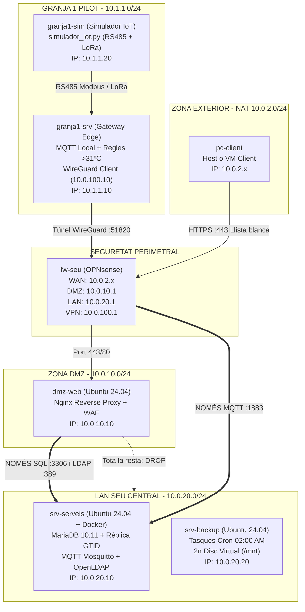

# 🖥️ Arquitectura, Justificació i Distribució de Màquines Virtuals — AviGest S.L.

**Document:** `docs/Guies_MV/distribucio_serveis_per_vm.md`  
**Cicle Formatiu:** CFGS Administració de Sistemes Informàtics en Xarxa (ASIX) — Mòdul M12 (Projecte)  
**Equip:** Joan Garcia (Xarxa, Seguretat i Infraestructura) i Mariam Solano (Base de Dades, IoT i Automatització)  
**Data:** Novembre de 2026  

---

## 1. Quantes Màquines Virtuals s'utilitzen al Projecte?

Per al desplegament del laboratori virtual d'AviGest es requereixen exactament **6 màquines virtuals a l'hipervisor** (VirtualBox o VMware) més **1 màquina client** (que pot ser el propi sistema amfitrió físic o una 7a màquina virtual dedicada):

| # | Nom de la Màquina | Rol Arquitectònic | Sistema Operatiu | Adreces IP Assignades |
| :-: | :--- | :--- | :--- | :--- |
| **1** | **`fw-seu`** | Tallafocs perimetral 3 potes + Servidor VPN WireGuard | **OPNsense 24.x** (FreeBSD Appliance) | **WAN:** `10.0.2.x` (DHCP NAT) **DMZ:** `10.0.10.1` **LAN:** `10.0.20.1` **VPN:** `10.0.100.1` |
| **2** | **`dmz-web`** | Proxy Invers Nginx, WAF i terminació SSL/TLS | **Ubuntu Server 24.04 LTS** | **DMZ:** `10.0.10.10` (GW: `10.0.10.1`) |
| **3** | **`srv-serveis`** | Nucli de serveis centrals (MariaDB, MQTT, LDAP) | **Ubuntu Server 24.04 LTS** + Docker | **LAN:** `10.0.20.10` (GW: `10.0.20.1`) |
| **4** | **`srv-backup`** | Servidor dedicat de còpies de seguretat (PRD) | **Ubuntu Server 24.04 LTS** + 2n disc | **LAN:** `10.0.20.20` (GW: `10.0.20.1`) |
| **5** | **`granja1-srv`** | Gateway industrial de camp (Edge Computing) | **Ubuntu Server 24.04 LTS** | **LAN Granja:** `10.1.1.10` **VPN:** `10.0.100.10` |
| **6** | **`granja1-sim`** | Simulador de sensors ambientals i sitges | **Ubuntu Server 24.04 LTS** | **LAN Granja:** `10.1.1.20` (GW: `10.1.1.10`) |
| **7** | **`pc-client`** | Client extern contractant (Navegador i proves) | Host físic / VM Ubuntu Desktop | **WAN:** `10.0.2.x` (DHCP NAT) |

> [!NOTE]
> **Variació Presencial (Granja 2 — Requeriment 4.7):** Durant la defensa davant del professor es clonen ràpidament `granja1-srv` com a `granja2-srv` (`10.1.2.10`) i `granja1-sim` com a `granja2-sim` (`10.1.2.20`) per demostrar la creació desatesa en menys de 10 segons amb `alta_granja.sh`.

---

## 2. Per què s'utilitzen aquestes Màquines Virtuals? (Justificació Tècnica)

En administració de sistemes professionals i en el currículum d'ASIX, **no és acceptable instal·lar-ho tot en una o dues màquines virtuals**. La separació en 6 servidors s'argumenta estrictament pels següents principis de seguretat i xarxa:

### 2.1. Principi de Segregació de Xarxes i Zones de Seguretat (DMZ vs LAN)
* **Separació `fw-seu` vs Servidors:** Un tallafocs perimetral mai ha de compartir màquina amb serveis d'aplicació ni bases de dades. Si cau el servei web, el tallafocs ha de continuar filtrant i protegint la xarxa.
* **Separació `dmz-web` vs `srv-serveis`:** Els servidors web amb accés públic han d'estar físicament o virtualment aïllats a la DMZ. Si un atacant troba una vulnerabilitat a Nginx, queda confinat a la DMZ (`10.0.10.0/24`) i el tallafocs li bloqueja l'accés directe a la base de dades i a LDAP (`Default DROP`).

### 2.2. Principi de Continuïtat de Negoci i Còpies de Seguretat (Model 3-2-1)
* **Separació `srv-serveis` vs `srv-backup`:** Si les còpies de seguretat s'executessin al mateix servidor `srv-serveis`, un atac de ransomware, una fallada de disc dur o un error humà destruiria la base de dades de producció i les còpies simultàniament (*Single Point of Failure*). `srv-backup` és una màquina independent amb un segon disc virtual separat muntat a `/mnt/disc-extern-backup/`.

### 2.3. Modelatge d'Entorn de Camp Rural (Edge Computing vs Central)
* **Separació `granja1-srv` vs Central:** La granja avícola es troba físicament a desenes de quilòmetres (ex: Bellpuig) i es comunica per una connexió 4G rural amb túnel WireGuard VPN. El gateway de granja necessita autonomia local: si cau la fibra de la seu o Internet, la ventilació de suport a la vida (> 31 ºC) s'ha d'activar en menys de 2 segons en local.
* **Separació `granja1-sim`:** En un entorn de laboratori acadèmic, no disposem de centenars d'aus reals ni d'un galliner físic. La màquina `granja1-sim` actua com a substitut dels microcontroladors ESP32 generant trames reals per bus sèrie RS485 Modbus i ràdio LoRaWAN.

---

## 3. Fitxa Detallada de Cada Màquina Virtual: Què hi va exactament?

---

### VM 1: `fw-seu` (Appliance de Seguretat Dedicat)
* **Funció:** Tallafocs perimetral de 3 potes, passarel·la d'enrutament, NAT i servidor VPN WireGuard.
* **Sistema Operatiu:** OPNsense 24.x (FreeBSD Appliance amd64).
* **Recursos Virtuals:** 2 vCPU | 2 GB RAM | 20 GB Disc.
* **Adaptadors de xarxa:**
  1. Adaptador 1: Xarxa NAT (`internet-lab`) $\rightarrow$ WAN (`10.0.2.x`, DHCP).
  2. Adaptador 2: Xarxa Interna (`dmz`) $\rightarrow$ DMZ (`10.0.10.1/24`).
  3. Adaptador 3: Xarxa Interna (`lan-seu`) $\rightarrow$ LAN (`10.0.20.1/24`).
* **Quins serveis i configuracions hi van:**
  - Taula d'adreces amb llista blanca de clients contractats autoritzats a entrar des de la WAN.
  - Regles de filtre estricte (*Default DROP* a totes les interfícies).
  - Regla DMZ $\rightarrow$ LAN: només autoritza trànsit cap a `10.0.20.10:3306` (MariaDB) i `10.0.20.10:389/636` (LDAP). Tota la resta es descarta.
  - Servidor WireGuard VPN (`10.0.100.1/24`, port UDP 51820): autenticació de claus asimètriques amb les granges rurals.
  - Regla VPN $\rightarrow$ LAN: només autoritza trànsit cap a `10.0.20.10:1883` (Broker MQTT central). La granja té vetat l'accés a la BD o a LDAP.
* **Fitxers del repositori associats:** [`infra/dmz-tallafocs/firewall_regles.sh`](file:///c:/avigest-projecte/infra/dmz-tallafocs/firewall_regles.sh) i [`infra/dmz-tallafocs/disseny_dmz_seguretat.md`](file:///c:/avigest-projecte/infra/dmz-tallafocs/disseny_dmz_seguretat.md).

---

### VM 2: `dmz-web` (Servidor Web Frontal i Proxy Invers)
* **Funció:** Punt d'accés segur per als usuaris finals i clients de la plataforma.
* **Sistema Operatiu:** Ubuntu Server 24.04 LTS (derivat de la plantilla `ubuntu-base`).
* **Recursos Virtuals:** 1 vCPU | 1 GB RAM | 10 GB Disc.
* **Adaptadors de xarxa:**
  1. Adaptador 1: Xarxa Interna (`dmz`) $\rightarrow$ IP estàtica `10.0.10.10/24` (GW: `10.0.10.1`, DNS: `1.1.1.1`).
* **Quins serveis i configuracions hi van:**
  - **Nginx:** configurat com a proxy invers amb terminació TLS/SSL (HTTPS 443).
  - **Capçaleres de seguretat WAF:** mitigació d'atacs comuns (X-Frame-Options, X-Content-Type-Options, CSP, rate-limiting de peticions).
  - **Accés protegit:** Redirecciona les peticions autoritzades cap al servei phpLDAPadmin intern (`http://10.0.20.10:8081`).
* **Fitxers del repositori associats:** Configuracions Nginx a `infra/dmz-tallafocs/`.

---

### VM 3: `srv-serveis` (Nucli de Serveis i Dades de la Seu)
* **Funció:** Servidor central de bases de dades, directori d'usuaris, broker de missatgeria IoT i serveis d'ingesta.
* **Sistema Operatiu:** Ubuntu Server 24.04 LTS amb Docker Engine i Docker Compose.
* **Recursos Virtuals:** 2 vCPU | 4 GB RAM | 40 GB Disc.
* **Adaptadors de xarxa:**
  1. Adaptador 1: Xarxa Interna (`lan-seu`) $\rightarrow$ IP estàtica `10.0.20.10/24` (GW: `10.0.20.1`).
* **Quins serveis i processos hi van (Orquestrats via Docker Compose):**
  1. **`avigest_mariadb` (MariaDB 10.11 LTS - Port 3306):**
     - Base de dades relacional mestra `avigest_db`.
     - Esquema 3FN de 11 taules (`01_esquema.sql`).
     - Triggers d'automatització ambiental i auditoria (`02_triggers_procedures.sql`).
     - Procediments d'alta atòmica (`sp_alta_granja_completa`) i resolució (`sp_resoldre_alarma`).
     - Vistes multitenant segures amb context de sessió (`v_tenant_*`).
  2. **`avigest_mariadb_replica` (MariaDB 10.11 - Port 3307):**
     - Rèplica de continuïtat GTID en mode només lectura (*Hot Standby*).
  3. **`avigest_mosquitto` (Eclipse Mosquitto - Port 1883):**
     - Broker MQTT central de la seu que rep les publicacions de telemetria de les granges rurals pel túnel VPN.
  4. **`avigest_mqtt_ingest` (Python PyMySQL - Ingestor continu):**
     - Servei dimoni que subscriu `avigest/+/telemetria/#` i executa els `INSERT` a `lectures_sensors` amb el rol de mínim privilegi `avigest_iot`.
  5. **`avigest_openldap` (OpenLDAP 2.6 - Ports 389 i 636):**
     - Directori d'identitats centralitzat sota `dc=avigest,dc=cat`.
     - 4 rols de seguretat `posixGroup` i branques multitenant per client.
  6. **`avigest_phpldapadmin` (phpLDAPadmin - Port 8081 en local):**
     - Administració web del directori accessible únicament a través del proxy invers de la DMZ.
* **Fitxers del repositori associats:** [`docker/docker-compose.yml`](file:///c:/avigest-projecte/docker/docker-compose.yml), [`bd/sql/`](file:///c:/avigest-projecte/bd/sql/), [`docker/initdb/`](file:///c:/avigest-projecte/docker/initdb/), [`iot/ingestio/`](file:///c:/avigest-projecte/iot/ingestio/) i [`infra/ldap/ldif/`](file:///c:/avigest-projecte/infra/ldap/ldif/).

---

### VM 4: `srv-backup` (Servidor Dedicat de Còpies de Seguretat i PRD)
* **Funció:** Servidor independent de recuperació davant desastres (PRD), aïllat de fallades de producció.
* **Sistema Operatiu:** Ubuntu Server 24.04 LTS (plantilla `ubuntu-base`).
* **Recursos Virtuals:** 1 vCPU | 1 GB RAM | 10 GB Disc SO + **20 GB 2n Disc Virtual Separat** (`/dev/sdb` muntat a `/mnt/disc-extern-backup/`).
* **Adaptadors de xarxa:**
  1. Adaptador 1: Xarxa Interna (`lan-seu`) $\rightarrow$ IP estàtica `10.0.20.20/24` (GW: `10.0.20.1`).
* **Quins serveis i configuracions hi van:**
  - **Dimoni `cron`:** programat cada nit a les 02:00 AM (`crontab.txt`).
  - **Script de còpies [`backup_avigest.sh`](file:///c:/avigest-projecte/infra/backups-prd/backup_avigest.sh):**
    1. Executa un buidatge transaccional complet de MariaDB (`mariadb-dump` amb `--single-transaction --routines --triggers`) connectant-se remotament a `srv-serveis:3306`.
    2. Extreu l'arbre LDAP complet amb `slapcat` / `ldapsearch`.
    3. Empaqueta i comprimeix en arxiu `.tar.gz`.
    4. Genera la suma de verificació criptogràfica SHA-256 per garantir que la còpia no ha estat manipulada ni corrompuda.
    5. Emmagatzema el paquet al segon disc virtual separat muntat a `/mnt/disc-extern-backup/` (simulant la còpia externa fora de la màquina principal).
    6. Aplica una política de rotació de retenció automàtica de 30 dies.
  - **Script de recuperació [`restaurar_avigest.sh`](file:///c:/avigest-projecte/infra/backups-prd/restaurar_avigest.sh):**
    - Permet restaurar íntegrament la base de dades i els usuaris en menys de 30 minuts davant d'un desastre total (compliment de RTO < 30 min i RPO < 24 h).
* **Fitxers del repositori associats:** [`infra/backups-prd/`](file:///c:/avigest-projecte/infra/backups-prd/).

---

### VM 5: `granja1-srv` (Gateway Industrial Edge de Camp)
* **Funció:** Passarel·la de comunicacions de camp, enllaç VPN segur i control ambiental autònom per sobretemperatura.
* **Sistema Operatiu:** Ubuntu Server 24.04 LTS (simula un PC industrial de camp com ara un Advantech UNO o una Raspberry Pi industrial amb mòdem 4G).
* **Recursos Virtuals:** 1 vCPU | 1 GB RAM | 10 GB Disc.
* **Adaptadors de xarxa:**
  1. Adaptador 1: Xarxa Interna (`lan-granja1`) $\rightarrow$ IP `10.1.1.10/24`.
  2. Adaptador 2: Xarxa NAT (`internet-lab`) $\rightarrow$ Simula la connexió 4G rural cap a Internet.
  3. Interfície Virtual `wg0`: WireGuard VPN Client $\rightarrow$ IP `10.0.100.10/24` (túnel xifrat cap a `fw-seu`).
* **Quins serveis i configuracions hi van:**
  - **Broker MQTT local:** rep les lectures dels sensors de la granja (naus i sitges).
  - **Lògica de decisió autònoma d'emergència (Edge Computing):**
    - Si la temperatura supera els **31 ºC**, commuta immediatament el relé del ventilador a **ON** en local en menys de 2 segons.
    - **Principi de seguretat animal:** Aquesta decisió s'executa a la mateixa granja, funcionant fins i tot si la connexió d'Internet o la VPN estan caigudes.
  - **Búfer de retenció *Store-and-Forward*:**
    - Emmagatzema les dades de telemetria en memòria local si hi ha un tall de xarxa rural (fins a 72 hores de capacitat).
    - Quan la VPN es restableix, envia automàticament totes les dades pendents a la seu central sense cap pèrdua de dades.
* **Fitxers del repositori associats:** Scripts locals de granja i configuració WireGuard.

---

### VM 6: `granja1-sim` (Simulador de Sensòrica i Silos)
* **Funció:** Emulació de microcontroladors de camp ESP32, sondes ambientals i cèl·lules de pesatge de sitges.
* **Sistema Operatiu:** Ubuntu Server 24.04 LTS (plantilla `ubuntu-base`).
* **Recursos Virtuals:** 1 vCPU | 1 GB RAM | 10 GB Disc.
* **Adaptadors de xarxa:**
  1. Adaptador 1: Xarxa Interna (`lan-granja1`) $\rightarrow$ IP estàtica `10.1.1.20/24` (GW: `10.1.1.10`).
* **Quins serveis i processos hi van:**
  - **Simulador IoT en Python:** [`iot/sensors/simulador_iot.py`](file:///c:/avigest-projecte/iot/sensors/simulador_iot.py).
  - **Simulació del bus industrial RS485 Modbus RTU:**
    - Generació de dades de temperatura i humitat (sondes SHT30) cada 30 segons.
    - Generació de concentració de CO2 (sensor Senseair S8) cada 60 segons.
  - **Simulació de la xarxa de ràdio LoRaWAN 868 MHz:**
    - Generació de dades de pesatge de sitges de pinso cada 15 minuts (emulant el gateway Dragino LPS8N).
  - **Modes de prova:**
    - Mode normal (valors regulars de funcionament).
    - Mode alarma / estrès tèrmic (genera 34 ºC per comprovar com reacciona el tallafocs, el gateway i els triggers de MariaDB).
* **Fitxers del repositori associats:** [`iot/sensors/simulador_iot.py`](file:///c:/avigest-projecte/iot/sensors/simulador_iot.py) i [`iot/sensors/codi_esp32_referencia.ino`](file:///c:/avigest-projecte/iot/sensors/codi_esp32_referencia.ino).

---

### VM 7 (o Host Físic): `pc-client`
* **Funció:** Estació de treball de l'empresa ramadera client o auditor tècnic connectat des d'Internet.
* **Sistema Operatiu:** Host físic (el teu propi PC Windows/Linux) o una màquina virtual Ubuntu Desktop.
* **Xarxa:** Xarxa NAT (`internet-lab` / `10.0.2.x`).
* **Què hi va:**
  - Navegador web per comprovar la connectivitat HTTPS cap a la DMZ (`https://10.0.10.10`).
  - Proves de llista blanca (comprovació que només les IPs autoritzades poden accedir al servei).
  - Comprovació amb `curl` o `nc` que la xarxa corporativa LAN (`10.0.20.0/24`) és invisible des de l'exterior.

---

## 4. Balanç Total de Recursos de Laboratori (RAM i CPU)

Per comprovar que el conjunt de les màquines virtuals cap perfectament en un ordinador físic típic d'estudiant (amb 16 GB de RAM):

| Màquina Virtual | vCPU | RAM Assignada | RAM Real Consumida (sense entorn gràfic) | Espai en Disc |
| :--- | :---: | :---: | :---: | :---: |
| **`fw-seu`** (OPNsense) | 2 | 2.048 MB (2 GB) | ~450 MB | 20 GB |
| **`dmz-web`** (Ubuntu) | 1 | 1.024 MB (1 GB) | ~220 MB | 10 GB |
| **`srv-serveis`** (Ubuntu + Docker) | 2 | 4.096 MB (4 GB) | ~1.400 MB | 40 GB |
| **`srv-backup`** (Ubuntu + 2n disc) | 1 | 1.024 MB (1 GB) | ~200 MB | 10 GB + 20 GB |
| **`granja1-srv`** (Ubuntu Edge) | 1 | 1.024 MB (1 GB) | ~210 MB | 10 GB |
| **`granja1-sim`** (Ubuntu Sim) | 1 | 1.024 MB (1 GB) | ~200 MB | 10 GB |
| **TOTAL (6 MVs)** | **8 vCPU** | **10.240 MB (~10 GB)** | **~2.700 MB (< 3 GB reals)** | **120 GB dinàmics** |

> [!TIP]
> Com que totes les màquines Ubuntu són **Ubuntu Server minimized sense escriptori gràfic**, el consum de memòria RAM real és d'aproximadament **3 GB entre totes les màquines enceses simultàniament**. Un ordinador amfitrió amb 16 GB de RAM pot executar les 6 màquines virtuals amb total fluïdesa.

---

## 5. Resum per a la Defensa davant del Professorat

Quan el professor pregunti: *"Per què heu muntat 6 màquines virtuals en lloc de posar-ho tot en una?"*

La resposta argumentada és:
1. **Seguretat Perimetral i DMZ:** El tallafocs (`fw-seu`) i el proxy públic (`dmz-web`) estan aïllats per evitar que un atac extern arribi directament a les dades corporatives de la LAN.
2. **Alta Disponibilitat i Resiliència 3-2-1:** El servidor de còpies (`srv-backup`) és independent de `srv-serveis` per evitar punts únics de fallada.
3. **Model de Camp Real (Edge Computing):** La granja (`granja1-srv`) ha de poder sobreviure i climatitzar els animals autònomament sense dependre de la connexió amb la seu central.
4. **Variació Presencial Ràpida (4.7):** L'script `alta_granja.sh` permet clonar la granja 1 com a granja 2 en pocs segons per demostrar l'escalabilitat del disseny.

