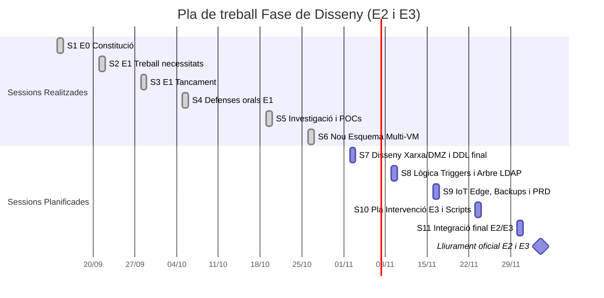

# Diari de Treball — AviGest S.L.

**Projecte:** Implantació d'un sistema informàtic de gestió de granges de pollastres  
**Cicle:** CFGS Administració de Sistemes Informàtics en Xarxa (ASIX) — 2n Curs  
**Mòdul:** M12 - Projecte (Bloc lectiu de 6 hores setmanals els dilluns)  
**Equip de treball:**  
- **Joan Garcia** (Infraestructura, Xarxa, Seguretat i Serveis Centralitzats)  
- **Mariam Solano** (Base de Dades, Automatismes, IoT i Scripts)  
**Tutor del Projecte:** Professorat de l'Institut Mollerussa  
**Inici del Projecte:** 14 de setembre de 2026  
**Lliurament Fita E2/E3:** 4 de desembre de 2026  
**Darrera actualització:** Dilluns, 26 d'octubre de 2026  

---

## Metodologia i Context Acadèmic

> [!NOTE]
> El mòdul M12 es desenvolupa exclusivament els **dilluns en sessions de 6 hores lectives** a l'aula/laboratori.
> 
> La planificació oficial de l'enunciat estableix:
> - **Fase 1 (Setembre):** Constitució de l'equip (E0) i Estudi de Necessitats (E1). Tancada i defensada a principis d'octubre.
> - **Fase 2 (Octubre – 4 de Desembre):** Fase de **DISSENY TÈCNIC (E2)** i **Pla d'Intervenció (E3)**. En aquest període no s'espera la implementació final en producció, sinó la recerca d'alternatives, redacció de fitxes de decisió, proves de concepte preliminars (POC), modelatge conceptual/lògic i acords d'arquitectura.

---

## Registre de Sessions Realitzades

### Sessió 1: Dilluns, 14 de setembre de 2026 (6 hores)
**Fita:** Constitució de l'equip i definició de rols (Lliurable E0)

- **Objectiu:** Formalitzar l'equip de treball, definir el cas de negoci d'AviGest S.L. i establir la divisió de tasques de l'enunciat.
- **Treball realitzat:**
  - **Joan:** Recerca prèvia sobre els requeriments d'infraestructura (maquinari de servidor, necessitat de directori centralitzat i seguretat perimetral).
  - **Mariam:** Recerca sobre la normativa de benestar animal en avicultura d'engreix (temperatures recomanades, ventilació, humitat i CO2).
  - **Treball conjunt:** Definició dels àmbits de responsabilitat (Joan: Infraestructura, Xarxa i Seguretat; Mariam: BD, IoT i Automatització). Redacció i tancament del document [E0_divisio_tasques_rols.md](../E0_divisio_tasques_rols.md).
- **Dedicació:** Joan: 6 h | Mariam: 6 h (Total: 12 h)

---

### Sessió 2: Dilluns, 21 de setembre de 2026 (6 hores)
**Fita:** Elaboració de l'Estudi de Necessitats (Lliurable E1)

- **Objectiu:** Analitzar el sector avícola a les comarques de Lleida (Pla d'Urgell, Urgell, Segrià) i definir les mancances dels sistemes actuals.
- **Treball realitzat:**
  - **Joan:** Anàlisi de la connectivitat a entorns rurals i aïllats (problemes de línies ADSL antigues, cobertura 4G/5G) i estudi de solucions comercials de climatització ramadera.
  - **Mariam:** Anàlisi de necessitats del client: model de negoci basat en integradores avícoles que requereixen centralitzar múltiples granges mantenint un aïllament estricte (*multitenant*).
  - **Treball conjunt:** Redacció de l'abast del projecte, elaboració de la matriu DAFO i disseny del logotip d'AviGest S.L.
- **Dedicació:** Joan: 6 h | Mariam: 6 h (Total: 12 h)

---

### Sessió 3: Dilluns, 28 de setembre de 2026 (6 hores)
**Fita:** Tancament de l'E1 i preparació de la defensa oral

- **Objectiu:** Enllestir el document d'Estudi de Necessitats, crear l'estructura del repositori col·laboratiu i preparar les 2 diapositives de la presentació.
- **Treball realitzat:**
  - **Joan:** Inicialització de l'estructura de carpetes del repositori a Git, definició de branques de treball i configuració de fitxers `.gitignore`.
  - **Mariam:** Concreció dels paràmetres ambientals a monitoritzar (temperatura, humitat, CO2 i nivell de sitja) i revisió de l'apartat de viabilitat.
  - **Treball conjunt:** Revisió final i maquetació del document [E1_estudi_necessitats_joangarcia_mariamsolano.pdf](../E1_estudi_necessitats_joangarcia_mariamsolano%20(2).pdf) i elaboració de les 2 diapositives resum (*què hem comparat / què farem*).
- **Dedicació:** Joan: 6 h | Mariam: 6 h (Total: 12 h)

---

### Sessió 4: Dilluns, 5 d'octubre de 2026 (6 hores de classe)
**Fita:** Jornada de defenses orals de l'Estudi de Necessitats (Lliurable E1)

- **Objectiu:** Exposició oral formal del projecte davant del professorat/tribunal.
- **Desglossament exacte del temps de la sessió:**
  - **1 h 30 min (Preparació i assaig):** Ajust de les 2 diapositives resum, assaig del discurs i coordinació del torn de paraula entre en Joan i la Mariam just abans de presentar.
  - **10 minuts (Defensa oral):** Exposició davant del tribunal explicant la idea d'AviGest S.L., la comparativa de mercat i el model multiclient, seguit del torn de preguntes del professor.
  - **Resta de la sessió:** Assistència a l'aula com a oients a les exposicions de la resta de grups del curs durant el bloc de classe. No es va fer cap altra tasca tècnica d'E2.
- **Dedicació:** 1 h 40 min de treball directe per a la defensa d'AviGest (dins de la jornada lectiva de 6h a l'aula).

---

### Dilluns, 12 d'octubre de 2026 — FESTIU
> [!IMPORTANT]
> **Festa Nacional (El Pilar) — No hi va haver classe lectiva presencial (0 hores).**

---

### Sessió 5: Dilluns, 19 d'octubre de 2026 (6 hores)
**Fita:** Investigació de solucions, primeres proves de concepte (POC) i acords de disseny

- **Objectiu:** Aprofundir en les fitxes de decisió, fer proves tècniques preliminars de laboratori i consensuar el model conceptual de dades i usuaris.
- **Treball realitzat durant les 6 hores:**
  - **Joan (3h):**
    - Redacció de l'esborrany de la fitxa [FD02_ldap.md](../fitxes_decisio/FD02_ldap.md): comparació d'OpenLDAP vs Samba 4 (consum de RAM, facilitat d'automatització amb LDIF i compliment dels 4 rols d'usuaris requerits).
    - Investigació sobre la segmentació perimetral: esquema de DMZ per aïllar la base de dades d'Internet ([FD03_tallafocs_dmz.md](../fitxes_decisio/FD03_tallafocs_dmz.md)).
    - Estudi de maquinari de servidor central per a entorns virtualitzats (necessitat de discs RAID i doble font d'alimentació).
  - **Mariam (3h):**
    - Redacció de l'esborrany de la fitxa [FD01_sgbd.md](../fitxes_decisio/FD01_sgbd.md): comparació inicial de SGBD.
    - Proves de concepte SQL en local: definició conceptual de les primeres entitats (clients, granges, naus, sensors i actuadors).
    - Investigació sobre protocols de comunicació de camp: avantatges de cablejar RS485 a l'interior de les naus vs LoRaWAN per a sitges exteriors ([FD05_iot_comunicacions.md](../fitxes_decisio/FD05_iot_comunicacions.md)).
  - **Treball conjunt (3h):**
    - Debat i acord clau sobre l'**aïllament multiclient**: hem acordat fer servir l'atribut LDAP `businessCategory: CLIENT_<ID>` vinculat directament amb la clau forana `id_client` a la base de dades.
    - Definició de l'estructura del document [E2_document_disseny_tecnic.md](../E2_disseny_tecnic/E2_document_disseny_tecnic.md).
    - Redacció i posada al dia d'aquest [diari_treball.md](diari_treball.md).
- **Dedicació:** Joan: 6 h | Mariam: 6 h (Total: 12 h)

---

### Sessió 6: Dilluns, 26 d'octubre de 2026 (6 hores — AVUI)
**Fita:** Redisseny complet i consens de la topologia de Màquines Virtuals (Punt i a part)

- **Objectiu:** Reestructurar l'entorn de màquines virtuals per reflectir una infraestructura industrial realista, professional i 100% defensable davant del tribunal, consolidant les 7 VMs especialitzades i el flux de dades de sensors de punta a punta.
- **Treball realitzat durant les 6 hores:**
  - **Treball conjunt (Consens de l'esquema de VMs):**
    - S'ha acordat fer un punt i a part respecte a l'esquema inicial i desplegar la infraestructura dividida en:
      * `pc-client`: Client extern / navegador de prova via Internet (NAT).
      * `fw-seu`: Tallafocs perimetral OPNsense de 3 interfícies físiques (WAN, DMZ `10.0.10.0/24`, LAN `10.0.20.0/24`) i servidor VPN (`10.0.100.0/24`).
      * `dmz-web`: DMZ (`10.0.10.10`) amb proxy invers Nginx, WAF i relay SMTP, accessible només per llista blanca d'IPs.
      * `srv-serveis`: LAN (`10.0.20.10`) amb PostgreSQL 16 + Rèplica, Broker MQTT Mosquitto i OpenLDAP.
      * `srv-backup`: LAN (`10.0.20.20`) VM dedicada amb cron nocturn i segon disc virtual simulat.
      * `granja1-srv`: Camp (`10.1.1.10` / VPN `10.0.100.10`) amb MQTT local, regles locals de ventiladors (>31ºC), búfer store-and-forward i client VPN.
      * `granja1-sim`: Camp (`10.1.1.20`) simulador d'ESP32 per RS485 Modbus i silos per LoRaWAN ChirpStack.
  - **Joan:**
    - Disseny i documentació de les regles de tallafocs OPNsense a [disseny_dmz_seguretat.md](../../infra/dmz-tallafocs/disseny_dmz_seguretat.md) i [firewall_regles.sh](../../infra/dmz-tallafocs/firewall_regles.sh), amb aïllament estricte DMZ -> LAN (només TCP 5432 i 389 permesos) i pas de VPN a Broker MQTT.
    - Configuració del servidor dedicat `srv-backup` i del pla de recuperació PRD amb el segon disc virtual simulat ([pla_recuperacio_desastres_prd.md](../../infra/backups-prd/pla_recuperacio_desastres_prd.md)).
  - **Mariam:**
    - Migració completa de la base de dades a **PostgreSQL 16**: conversió de taules DDL, triggers de termòstat automàtic en PL/pgSQL i procediments d'alta atòmica de granges.
    - Actualització de [FD01_sgbd.md](../fitxes_decisio/FD01_sgbd.md) documentant formalment la limitació de la rèplica de BD en contenidor dins de `srv-serveis` i la seva mitigació mitjançant `srv-backup`.
    - Adaptació de l'script d'automatització [alta_granja.sh](../../scripts/automatitzacio-granges/alta_granja.sh) per a la variació de la Granja 2 (`10.1.2.0/24`).
- **Dedicació:** Joan: 6 h | Mariam: 6 h (Total: 12 h)

---

## Taula Resum d'Hores Lectives Dedicades

| Sessió | Data | Fase / Fita | Hores Joan | Hores Mariam | Total Sessió |
| :---: | :---: | :--- | :--- :---: | :---: | :---: |
| **S1** | Dilluns 14/09/2026 | Constitució equip i rols (E0) | 6 h | 6 h | **12 h** |
| **S2** | Dilluns 21/09/2026 | Estudi de necessitats i mercat (E1) | 6 h | 6 h | **12 h** |
| **S3** | Dilluns 28/09/2026 | Tancament E1 i preparació diapositives | 6 h | 6 h | **12 h** |
| **S4** | Dilluns 05/10/2026 | Defenses orals E1 (1h 30m prep + 10m defensa + torns companys) | 6 h | 6 h | **12 h** |
| — | Dilluns 12/10/2026 | *FESTIU (Festa Nacional — Sense classe)* | 0 h | 0 h | **0 h** |
| **S5** | Dilluns 19/10/2026 | Investigació, proves de concepte i acords E2 | 6 h | 6 h | **12 h** |
| **S6** | Dilluns 26/10/2026 | Consens nou esquema multi-VM, PostgreSQL 16 i OPNsense | 6 h | 6 h | **12 h** |
| **TOTAL** | *(Fins al 26/10)* | **6 dilluns lectius x 6 hores** | **36 h** | **36 h** | **72 h** |

---

## Planificació de Properes Sessions (Camí cap al 4 de Desembre)

D'acord amb el ritme lectiu de 6 hores setmanals, el pla de treball per a les properes sessions de dilluns fins a la data límit oficial de lliurament (4 de desembre) és el següent:

### Detall de les properes sessions lectives:

1. **Sessió 7 (Dilluns, 2 de novembre):**
   - **Joan:** Implementació de la configuració d'interfícies i regles a l'entorn virtual d'OPNsense (`fw-seu`) i proves d'aïllament DMZ.
   - **Mariam:** Validació de la ingesta de dades a PostgreSQL 16 a través del broker MQTT central.

2. **Sessió 8 (Dilluns, 9 de novembre):**
   - **Joan:** Desplegament de l'arbre LDAP a `srv-serveis` i validació d'autenticació per a usuaris de granja i de seu central.
   - **Mariam:** Proves d'estrès dels triggers PL/pgSQL davant d'incidències tèrmiques amb el simulador IoT.

3. **Sessió 9 (Dilluns, 16 de novembre):**
   - **Joan:** Proves de còpia i restauració amb `srv-backup` i validació del segon disc simulat (RTO < 30 min).
   - **Mariam:** Prova de buffer Store-and-Forward a `granja1-srv` davant de desconnexió intencionada del túnel VPN.

4. **Sessió 10 (Dilluns, 23 de novembre):**
   - **Treball conjunt:** Elaboració del document **E3 (Pla d'Intervenció i Pressupostos)**: dimensionament econòmic de maquinari i hores de treball.
   - Assaig de l'script d'alta ràpida de la Granja 2 (`alta_granja.sh`).

5. **Sessió 11 (Dilluns, 30 de novembre):**
   - **Treball conjunt:** Maquetació i revisió creuada final d'E2 i E3 per al lliurament definitiu.

6. **Divendres, 4 de desembre de 2026:**
   - **Lliurament oficial dels documents E2 (Disseny Tècnic) i E3 (Pla d'Intervenció).**
