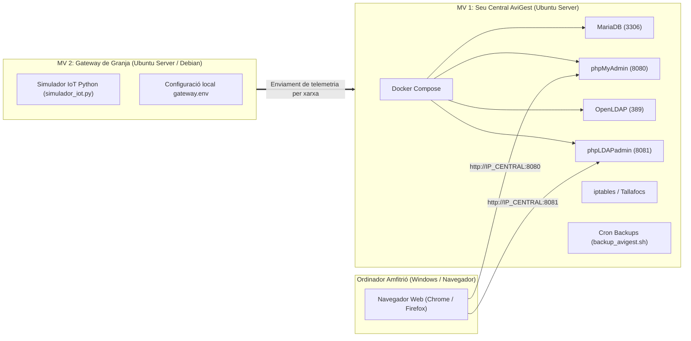

# Guia de Desplegament Pas a Pas en Màquines Virtuals — AviGest S.L.

**Projecte:** Implantació d'un sistema informàtic de gestió de granges de pollastres  
**Destinada a:** Joan i Mariam (Execució del laboratori i preparació de la defensa)  
**Entorn recomanat:** VMware Workstation o VirtualBox (Linux Ubuntu Server 24.04 LTS o Debian 12)  

---

## 1. Escenari del Laboratori de Màquines Virtuals

Per reproduir l'entorn complet d'AviGest tal com s'avaluarà, farem servir **2 Màquines Virtuals (MVs)** connectades a la mateixa xarxa virtual de VMware:



### Configuració de Xarxa a VMware / VirtualBox
* **Mode de targeta de xarxa:** Totes dues MVs en mode **NAT** o **Xarxa Només Amfitrió (Host-Only)** perquè es puguin comunicar entre elles i amb el teu ordinador Windows.
* **Assignació d'IPs d'exemple:**
  - **MV 1 (Central):** `192.168.100.10` (o la IP que li doni el DHCP de VMware, comprova-la amb `ip a`).
  - **MV 2 (Granja):** `192.168.100.20`

---

## 2. Pas a Pas a la MV 1: Seu Central d'AviGest

Aquesta màquina és el cor del projecte (Base de dades, usuaris LDAP, tallafocs i backups).

### Pas 1: Copiar el projecte a la màquina
Pots clonar el teu repositori de Git o copiar la carpeta `avigest-projecte` directament a `/opt/`:
```bash
sudo cp -r /ruta/on/hagis/copiat/avigest-projecte /opt/
cd /opt/avigest-projecte
```

### Pas 2: Instal·lar Docker i Docker Compose (si no ho està)
Si la teva màquina virtual Ubuntu no té Docker instal·lat, només has d'executar aquesta comanda oficial que ho fa tot automàtic:
```bash
curl -fsSL https://get.docker.com | sudo sh
sudo usermod -aG docker $USER
newgrp docker
```

### Pas 3: Arrencar tots els serveis de la Central
Entra a la carpeta `docker/` i aixeca els contenidors:
```bash
cd /opt/avigest-projecte/docker
docker compose up -d
```
*Què passarà automàticament?*
- S'arrencaran MariaDB, phpMyAdmin, OpenLDAP i phpLDAPadmin.
- MariaDB carregarà automàticament en iniciar-se els 3 fitxers de `docker/initdb/`:
  1. `01_esquema.sql` (les 9 taules relacionades).
  2. `02_triggers_procedures.sql` (els triggers de ventiladors i procediments).
  3. `03_dades_prova.sql` (clients, granges, lots de pollastres i lectures).
- OpenLDAP carregarà l'arbre d'usuaris des de `infra/ldap/ldif/`.

### Pas 4: Verificar que tot funciona a la MV 1
Executa:
```bash
docker compose ps
```
Hauries de veure els 4 contenidors amb estat `Up`:
- `avigest_mariadb`
- `avigest_phpmyadmin`
- `avigest_openldap`
- `avigest_phpldapadmin`

### Pas 5: Comprovar l'accés des del teu navegador Windows
Obre el navegador del teu ordinador i entra a:
1. **phpMyAdmin:** `http://<IP_DE_LA_MV1>:8080`
   - Usuari: `avigest_app`
   - Contrasenya: `avigest_secret_2026`
   - *(Comprova que a l'esquerra veus la base de dades `avigest_db` amb totes les taules i les dades!)*
2. **phpLDAPadmin:** `http://<IP_DE_LA_MV1>:8081`
   - Clica a "login" (a l'esquerra).
   - Login DN: `cn=admin,dc=avigest,dc=cat`
   - Contrasenya: `admin_ldap_pass_2026`
   - *(Veuràs l'arbre desplegable amb els grups Admins, Clients i els usuaris que hem creat).*

### Pas 6: Configurar les còpies de seguretat automàtiques (Requeriment 4.5)
Dona permisos d'execució als scripts de còpies:
```bash
chmod +x /opt/avigest-projecte/infra/backups-prd/*.sh
sudo mkdir -p /var/backups/avigest
```
Instal·la el crontab automàtic:
```bash
sudo crontab /opt/avigest-projecte/infra/backups-prd/crontab.txt
```
Prova de fer una còpia manual ara mateix per verificar que funciona:
```bash
sudo /opt/avigest-projecte/infra/backups-prd/backup_avigest.sh
```
*(Veuràs com genera el fitxer `.tar.gz` i el fitxer `.sha256` a `/var/backups/avigest/`)*.

---

## 3. Pas a Pas a la MV 2: Gateway de Granja (IoT)

Aquesta màquina representa l'equip industrial que està físicament a la granja recollint dades dels sensors ESP32.

### Pas 1: Requisits mínims
A la MV 2 només necessites Python 3 (que ja ve instal·lat per defecte a qualsevol Ubuntu/Debian):
```bash
python3 --version
```

### Pas 2: Copiar els fitxers d'IoT
Copia la carpeta `iot/` i `scripts/` a la MV 2:
```bash
cd /opt/avigest-projecte/iot/sensors
```

### Pas 3: Executar el Simulador de Sensors
Pots executar el simulador en qualsevol dels seus modes:

1. **Mode Normal (Telemetria contínua):**
   ```bash
   python3 simulador_iot.py --mode normal
   ```
   *Veuràs lectures de temperatura (23-25ºC), humitat i nivell de silos cada pocs segons.*

2. **Mode Alarma (La prova que demostraràs al professor!):**
   ```bash
   python3 simulador_iot.py --mode alarma
   ```
   *Què passarà?*
   - Injectarà una temperatura de **34.8 ºC** (superant el límit de 31 ºC de la Nau 1 de Bellpuig).
   - Injectarà un nivell de silo de **980 kg** (per sota del mínim de reserva de 1500 kg).
   - El trigger de MariaDB actuarà automàticament: posarà el ventilador de la nau a `ON`, ho registrarà a `registre_actuacions` i generarà la incidència a `alarmes_incidencies`.

---

## 4. Com Defensar el Projecte davant del Professor (Guió de 10)

Quan el professor et demani la demostració en directe, segueix aquest ordre exacte:

### Demostració 1: El nucli de Dades i l'Estructura Multitenant (2 minuts)
1. Mostra **phpMyAdmin** (`http://IP:8080`):
   - Ensenya la taula `granges` i com el Client 1 (AgroPonent) té 2 granges (Bellpuig i Mollerussa) i el Client 2 en té 1 (Alcarràs).
   - Ensenya la taula `sensors` amb la diferenciació clara de tecnologies: **RS485** per als de dins de la nau i **LoRaWAN** per al silo exterior.
2. Mostra **phpLDAPadmin** (`http://IP:8081`):
   - Ensenya l'arbre d'usuaris i la separació per unitats organitzatives.
   - Mostra l'usuari `gestor_bellpuig` i destaca que té l'atribut `departmentNumber: GRANJA_1` per garantir que **mai pugui veure dades d'una altra granja** (Aïllament R3).

### Demostració 2: El Funcionament dels Triggers IoT en Directe (3 minuts)
1. Mostra a phpMyAdmin la taula `actuadors` (veuràs que el ventilador de la Nau 1 està a `OFF`).
2. Executa des de la terminal de la MV 2 (o de la MV 1):
   ```bash
   python3 iot/sensors/simulador_iot.py --mode alarma
   ```
3. Refresca la taula `actuadors` a phpMyAdmin:
   - **Màgia:** El ventilador ara està a **`ON`**.
   - Ensenya la taula `registre_actuacions`: s'ha apuntat l'hora exacta, l'acció `ACTIVAR` i el motiu ("Temperatura crítica: 34.8 ºC supera límit 31.0 ºC").
   - Ensenya la taula `alarmes_incidencies`: s'ha generat l'alarma crítica per avisar el granger.

### Demostració 3: Còpia de Seguretat i Prova de Restauració (2 minuts)
1. Executa la comanda de backup:
   ```bash
   sudo /opt/avigest-projecte/infra/backups-prd/backup_avigest.sh
   ```
2. Mostra com s'ha generat el paquet comprimit a `/var/backups/avigest/`.
3. Explica que amb `./restaurar_avigest.sh <fitxer>` el sistema es recupera al 100% en menys de 3 minuts (RTO).

### Demostració 4: La prova presencial del professor (Crear una nova granja)
El professor us demanarà: *"Molt bé, ara doneu-me d'alta una granja nova per a un client"*.
En comptes de fer-ho a mà durant mitja hora, executes el vostre script davant dels seus ulls:
```bash
cd /opt/avigest-projecte/scripts/automatitzacio-granges
chmod +x alta_granja.sh
./alta_granja.sh -c 1 -n "Granja Nova Urgell" -e "ES259990005" -a "Camí Reial s/n" -p "Anglesola" -s 2 -u "gestor_anglesola"
```
En **2 segons**:
- S'haurà creat la granja a MariaDB amb les seves 2 naus i tots els sensors i actuadors.
- S'haurà creat el compte d'usuari a OpenLDAP amb els seus permisos.
- S'hauran creat les carpetes locals de dades.
- Ensenyes el resultat a phpMyAdmin i phpLDAPadmin per deixar el professor bocabadat.
