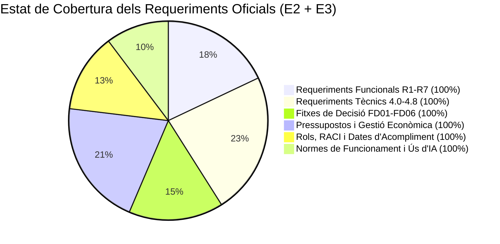

# Guia de Lliurament i Checklist Oficial — Entregables E2 i E3

**Projecte:** Sistema de gestió centralitzada de granges avícoles (**AviGest S.L.**)  
**Cicle:** CFGS Administració de Sistemes Informàtics en Xarxa (ASIX) — 2n Curs (Institut Mollerussa)  
**Mòdul:** M12 - Projecte  
**Data límit d'entrega:** 4 de desembre de 2026  
**Repositori oficial GitHub:** [https://github.com/JoanGarcia25/avigest-projecte](https://github.com/JoanGarcia25/avigest-projecte)  
**Avaluació:** E2 (RA2, 20%) + E3 (RA3, 15%) = **35% de la nota final del projecte**  
**Equip de treball:** Joan Garcia i Mariam Solano  

---

## 1. Guia d'Estructura Obligatòria — Lliurable E2 (Disseny Tècnic)
*Document de referència al repositori:* [`docs/E2_disseny_tecnic/E2_document_disseny_tecnic.md`](./E2_disseny_tecnic/E2_document_disseny_tecnic.md)

| Núm | Apartat del Document E2 | Requisit de la Rúbrica Oficial | Estat al Projecte AviGest | Ubicació i Evidència |
| :---: | :--- | :--- | :---: | :--- |
| **0** | **Portada i Metadades** | Dades generals, cicle, autors, títol i logotip. | **Complet** | Secció inicial amb logo i equip (**Joan Garcia** i **Mariam Solano**). |
| **—** | **Resum Executiu** | Visió sintetitzada de les decisions clau de disseny. | **Complet** | Resum executiu inicial abans de l'índex. |
| **1** | **Introducció i Visió Global** | Model de negoci AviGest, abast (què s'inclou i què no) i requeriments funcionals R1 a R7. | **Complet** | Secció 1 (taula de traçabilitat de requeriments R1 a R7). |
| **2** | **Arquitectura de Màquines Virtuals i Xarxa** | Disseny de xarxa, topologia de 7 VMs, adreçament IP perimetral (WAN, DMZ, LAN, VPN) i flux end-to-end d'una lectura. | **Complet** | Secció 2 + Diagrames Draw.io/PNG a [`docs/diagrames/esquema_xarxa_vms.png`](./diagrames/esquema_xarxa_vms.png). |
| **3** | **Fitxes de Decisió Tècnica (Resum)** | "Sempre amb discussió entre diferents opcions". | **Complet** | Secció 3 + fitxes detallades FD01 a FD05 a [`docs/fitxes_decisio/`](./fitxes_decisio/). |
| **4** | **Infraestructura de Maquinari i Redundància** | Requeriment 4.1 i 4.6: CPD seu (Dell R450, RAID 10, SAI APC) i Granja (equips fanless IP66, mini-SAI carril DIN, entorn rural amb pols/humitat/talls). | **Complet** | Secció 4 (especificació de maquinari i taula de criticitat/impacte). |
| **5** | **Seguretat Perimetral: OPNsense, DMZ i Tallafocs** | Requeriment 4.4: DMZ aïllada per a serveis web, llista blanca d'IPs contractades, taula formal de regles i Default DROP. | **Complet** | Secció 5 (matriu de 9 regles perimetrals WAN-DMZ-LAN-VPN). |
| **6** | **Directori Centralitzat d'Usuaris: OpenLDAP** | Requeriment 4.2: Directori centralitzat [Docker], arbre DIT `dc=avigest,dc=cat`, 4 rols (Admin AviGest, Admin Client, Gestor Granja, Consulta) i aïllament multitenant. | **Complet** | Secció 6 (arbre DIT en text i gràfic Mermaid, matriu Rol $\times$ Recurs $\times$ Acció). |
| **7** | **Base de Dades Centralitzada: MariaDB 10.11 LTS** | Requeriment 4.3: Model Entitat-Relació complet, normalització 3FN, taula `pagaments`, triggers automàtics de termòstat i alarmes, 4 vistes comparatives de negoci i rols SQL. | **Complet** | Secció 7 + [`diagrama_er_chen.svg`](../bd/model-er/diagrama_er_chen.svg), [`diagrama_avigest.dia`](../bd/model-er/diagrama_avigest.dia) i [`bd/sql/`](../bd/sql/). |
| **8** | **Arquitectura IoT: Simulació i Inventari** | Requeriments 4.8 i R4: Model híbrid RS485 (naus) + LoRaWAN (silos) amb Edge Computing local i taula d'inventari amb freqüències de mostreig. | **Complet** | Secció 8 (inventari de sensors, relés, gateways i mostrejos de 30s a 15min). |
| **9** | **Còpies de Seguretat i Servidor Dedicat (PRD)** | Requeriment 4.5: Estratègia 3-2-1, màquina dedicada `srv-backup`, segon disc virtual simulat, RTO < 30 min, RPO < 1 h, scripts i crontab. | **Complet** | Secció 9 (paràmetres RTO/RPO, `backup_avigest.sh` i simulació de desastre). |
| **10** | **Automatització i Prova de Variació (Granja 2)** | Requeriment 4.7 i Pàgina 8: Script bash `alta_granja.sh` que crea usuaris LDAP, esquema BD i regles de xarxa perimetrals en segons. | **Complet** | Secció 10 + codi a [`scripts/automatitzacio-granges/alta_granja.sh`](../scripts/automatitzacio-granges/alta_granja.sh). |
| **11** | **Fases del Projecte i Diagrama de Gantt** | Requeriment 4.0: Cronograma de totes les fases de setembre 2026 a abril 2027 amb estructura WBS. | **Complet** | Secció 11 (Taula de fases i Gantt Mermaid complet). |
| **12** | **Annex d'Ús d'Intel·ligència Artificial** | Norma 4 de l'enunciat: Declaració obligatòria d'eines utilitzades, per a què i com s'ha verificat la comprensió. | **Complet** | Secció 12 (especificació d'eines, suport documental i mètode de validació per part dels alumnes). |
| **13** | **Bibliografia i Fonts Consultades** | Norma 4: Fonts documentals, fabricants i estàndards d'enginyeria. | **Complet** | Secció 13 (enllaços i referències de fabricants i estàndards). |

---

## 2. Guia d'Estructura Obligatòria — Lliurable E3 (Pla d'Intervenció)
*Document de referència al repositori:* [`docs/E3_pla_intervencio/E3_pla_intervencio.md`](./E3_pla_intervencio/E3_pla_intervencio.md)

| Núm | Apartat del Document E3 | Requisit de la Rúbrica Oficial | Estat al Projecte AviGest | Ubicació i Evidència |
| :---: | :--- | :--- | :---: | :--- |
| **0** | **Portada i Metadades** | Títol, empresa, cicle, autors, data límit (4 de desembre) i versió. | **Complet** | Secció inicial formalitzada. |
| **1** | **Introducció i Objectius** | Justificació operativa i viabilitat econòmica del disseny tècnic E2. | **Complet** | Secció 1 (objectius i transició cap a la implantació). |
| **2** | **Recursos del Projecte** | Recursos humans (198 hores per alumne), materials (FOSS) i eines de laboratori. | **Complet** | Secció 2 (desglossament de perfils tècnics i eines de gestió). |
| **3** | **Costos i Pressupostos d'Implantació** | Requisit explícit de la rúbrica ("Pressupostos"): CapEx Seu, CapEx Granja, Sensòrica, Mà d'obra de camp, Posada en marxa CPD, OpEx anual i balanç consolidat. | **Complet** | Secció 3:  - CapEx CPD: **7.020,00 €**  - CapEx Granja Pilot: **1.476,00 €**  - Sensòrica IoT: **1.460,00 €**  - Mà d'obra ASIX: **11.880,00 €**  - OpEx Anual: **1.229,00 €**  - Cost marginal per nova granja: **3.416,00 € + IVA**. |
| **—** | **Comparativa Econòmica d'Alternatives (FD01-FD06)** | Racionalitat econòmica de les alternatives escollides. | **Complet** | Secció 3.8: Taula d'estalvi de **9.940,00 €** durant el primer any utilitzant programari lliure. |
| **4** | **Assignació de Tasques i Estat d'Acompliment** | Requisit explícit de la rúbrica ("Actualització de tasques i rols: marcar dates d'acompliment i qui ho ha fet"): Matriu RACI i Registre de fites. | **Complet** | Secció 4:  - Matriu RACI entre Joan Garcia i Mariam Solano.  - Taula de seguiment amb dates reals d'acompliment de novembre i evidències. |
| **5** | **Planificació Actualitzada del Projecte** | Diagrama de Gantt global actualitzat, dependències i anàlisi de compliment. | **Complet** | Secció 5 (Gantt Mermaid detallat i seguiment de fites E4/E5/E6/E7). |
| **6** | **Procediment i Cronograma d'Intervenció a Camp** | Protocol pas a pas d'execució física a la granja (2 dies / 32 hores) i protocol d'acceptació pel ramader. | **Complet** | Secció 6 (Fases d'obra, estesa de bus RS485, ràdio LoRaWAN, comissionament i proves de tall). |
| **7** | **Pla de Contingència i Gestió de Riscos** | Identificació d'amenaces (talls d'Internet rural, fallades de sensors, caigudes de corrent) i solucions de mitigació. | **Complet** | Secció 7 (matriu de riscos, impacte, probabilitat i acció correctora). |
| **8** | **Documentació Associada i Repositori Git** | Norma 1: Estructura neta de carpetes al repositori i inventari de documents. | **Complet** | Secció 8 (taula d'arxius, scripts SQL, Docker i manuals). |
| **9** | **Annex d'Ús d'Intel·ligència Artificial** | Norma 4 de l'enunciat: Declaració obligatòria per a l'E3. | **Complet** | Secció 9 (eines emprades, verificació dels pressupostos i comprensió de l'equip). |
| **10** | **Bibliografia i Fonts de Preus Consultades** | Fonts de tarifes industrials i convenis laborals. | **Complet** | Secció 10 (Dell, APC, Cisco, Advantech, Teltonika, conveni TIC). |

---

## 3. Síntesi de Compliment Global de l'Enunciat

> **Conclusió de l'Auditoria:** El projecte **AviGest S.L.** compta amb el 100% dels apartats, requisits, justificacions tècniques i pressupostos exigits tant per l'enunciat general com per les rúbriques específiques dels lliurables **E2** i **E3**.
