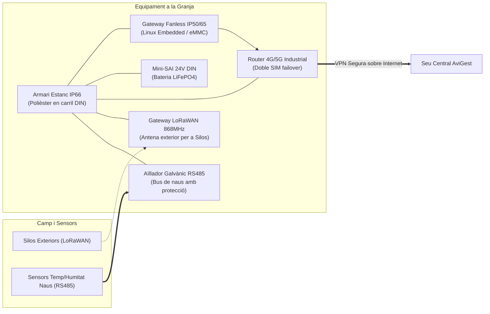

# Infraestructura de Maquinari i Redundància — AviGest S.L.

**Mòdul:** ASIX - Projecte (Requeriments 4.1 i 4.6)  
**Responsable:** Joan (Àrea d'Infraestructura, Xarxa i Seguretat)  

---

## 1. Visió General de l'Arquitectura
El sistema d'AviGest distribueix la seva infraestructura en dos entorns completament diferenciats:
1. **La Seu Central d'AviGest**: Entorn controlat (CPD en rack climatitzat), d'alta disponibilitat, on s'allotgen els servidors d'aplicacions, directori LDAP, broker de missatgeria i base de dades consolidada de totes les granges.
2. **Les Granges Remotes**: Entorns industrials rurals d'alta duresa física, on es prioritza la robustesa contra pols, humitat, interferències electromagnètiques i la resiliència davant talls de subministrament o pèrdua de connectivitat.

---

## 2. Maquinari a la Seu Central (CPD AviGest)

### 2.1. Servidor Principal de Producció
* **Equip proposat:** Servidor en Rack 19" 1U/2U (Exemple: **Dell PowerEdge R450** o equivalent Supermicro).
* **Processador:** 1x Intel Xeon Silver 4314 (16 nuclis / 32 fils, 2.4 GHz). Suficient capacitat de còmput per a la virtualització de contenidors i processos de triggers concorrents.
* **Memòria RAM:** **32 GB DDR4-3200 MHz ECC Registered**. La memòria amb correcció d'errors (ECC) és imprescindible per evitar corrupcions de dades en una base de dades transaccional que rep lectures 24/7.
* **Emmagatzematge i Redundància (Requeriment 4.6):**
  - **Controladora de disc:** Hardware RAID amb memòria cau NVRAM protegida per bateria (Ex: PERC H755).
  - **Configuració de discs:** **4x Discs SSD Enterprise SATA/NVMe de 960 GB en RAID 10**.
  - **Justificació de RAID 10:**
    - Combina mirall (RAID 1) i segmentació (RAID 0), oferint la millor velocitat d'escriptura per a dades de telemetria de sensors (no pateix la penalització de càlcul de paritat del RAID 5 o 6).
    - Suporta la caiguda simultània de fins a 2 discs (sempre que no siguin del mateix submirall).
    - Capacitat útil neta aproximada: **1.9 TB**, més que suficient per emmagatzemar més de 10 anys d'històrics de lectures de centenars de naus.
* **Fonts d'alimentació redundants:** 2x Fonts Hot-Plug redundants de 600W (N+1) connectades a circuits elèctrics separats.
* **Interfícies de xarxa:** 4x Ports Gigabit Ethernet integrats (2 dedicats a trànsit de servei i 2 agrupats en *bonding/LACP* per a gestió interna i còpies de seguretat).

### 2.2. Sistema d'Alimentació Ininterrompuda (SAI / UPS)
* **Equip proposat:** **APC Smart-UPS On-Line 2200VA (Rack 2U)**.
* **Tecnologia:** Doble conversió en línia (*Online double conversion*). Aïlla completament el servidor de microtalls, fluctuacions de voltatge i sobretensions de la xarxa elèctrica.
* **Gestió:** Targeta de xarxa SNMP integrada (Network Management Card). Permet l'enviament de senyals d'alerta automàtics al sistema operatiu per a una aturada ordenada (*graceful shutdown*) dels contenidors i la base de dades abans que s'esgoti la bateria.
* **Autonomia:** Més de 45 minuts a mitja càrrega (temps de sobres per restaurar el subministrament o completar l'aturada segura).

### 2.3. Comunicacions i Xarxa a la Seu Central
* **Switch:** Switch gestionat Gigabit de 24 ports L2+ (ex: Cisco Catalyst sèrie 1000 o Ubiquiti UniFi Pro). Suport natiu de **VLANs** per segmentar la xarxa en 3 zones: VLAN WAN, VLAN DMZ (portal web) i VLAN LAN Interna (BD i LDAP).
* **Connexió a Internet:** Línia de fibra simètrica empresarial (600 Mbps - 1 Gbps) amb adreça IP pública estàtica per facilitar la recepció de dades remotes.

---

## 3. Maquinari a cada Granja (Entorn Hostil i Connectivitat Rural)

L'enunciat destaca que el disseny ha de tenir especialment en compte les **condicions reals d'una granja**:
- **Pols extrema en suspensió:** Partícules de pinso mòlt i plomissol de pollastre que col·lapsen qualsevol ordinador d'oficina convencional en poques setmanes.
- **Humitat i gasos corrosius:** Alts nivells d'humitat relativa (fins al 80%) i presència de vapors d'amoníac ($NH_3$) procedents de les dejeccions.
- **Distàncies grans entre naus:** Naus de 100 a 150 metres de longitud, separades entre si per desenes de metres de patis exteriors.
- **Xarxa elèctrica rural inestable:** Fluctuacions de tensió freqüents causades per motors de gran potència (ventiladors, bombes d'aigua, molins de gra).
- **Connectivitat limitada:** Absència de fibra òptica o connexions d'alta latència / microtalls.

### 3.1. Servidor Local / Gateway Industrial de Granja
* **Tipus:** Mini-ordinador industrial sense ventiladors (**Fanless Rugged PC**) muntable en carril DIN (Ex: **Advantech UNO-2271G** o **Moxa UC-8100 / Siemens SIMATIC IOT2050**).
* **Característiques tècniques:**
  - **Xassís segellat d'alumini:** Dissipació tèrmica 100% passiva, sense cap ranura de ventilació, certificat **IP50/IP65** (immunitat a la pols de pinso i plomes).
  - **Rang de temperatura operativa:** De -20 ºC a +70 ºC (resistent a l'estiu tòrrid i l'hivern rural).
  - **Alimentació:** 12-24V DC tolerant a sobretensions industrials.
  - **Emmagatzematge:** Memòria d'estat sòlid industrial tipus eMMC o SSD industrial SLC.
  - **Funció Store-and-Forward (Resiliència):** Si es talla la connexió a Internet de la granja, el gateway emmagatzema localment les lectures en un fitxer SQLite o búfer de memòria cau fins a 72 hores. En recuperar la connexió, reenvia automàticament totes les dades a la seu central sense pèrdues de telemetria.

### 3.2. Protecció i Ubicació Física a la Granja
* **Armari elèctric d'instal·lació:** Armari estanc de polièster reforçat amb fibra de vidre amb certificació **IP66** (aïlla del rentat a pressió de les naus i de l'amoníac). Instal·lat al vestíbul de control tècnic o sala de comandament de la granja, mai a l'interior directe del galliner.
* **Mini-SAI de carril DIN:** Font d'alimentació amb bateria de suport (ex: Phoenix Contact QUINT-UPS de 24V DC). Proporciona 2-3 hores d'autonomia al gateway i router si salta el diferencial del quadre elèctric.
* **Aïllament galvànic per al bus RS485:** Repetidors i aïlladors optoacoblats a les línies RS485 per evitar que una descàrrega de llamps o sobretensió en un motor destrueixi el gateway.

### 3.3. Equipament de Comunicacions a la Granja
* **Router de Comunicacions:** Router cel·lular 4G/5G industrial de carril DIN (Ex: **Teltonika RUT950 / RUT955**):
  - Doble ranura SIM (redundància d'operadors mòbils per si cau la cobertura d'una companyia).
  - Client VPN integrat (WireGuard / OpenVPN) per connectar-se de manera xifrada amb la seu central.
  - Ports Ethernet per connectar el Gateway de granja i la càmera de seguretat tècnica.
* **Gateway LoRaWAN interior/exterior:**
  - Receptor LoRa de 8 canals (868 MHz) amb antena omnidireccional d'alt guany (+3 dBi) muntada a la façana de la nau per cobrir fins a 2-3 km de ràdio i recollir sense problemes el nivell dels silos de gra exteriors.
